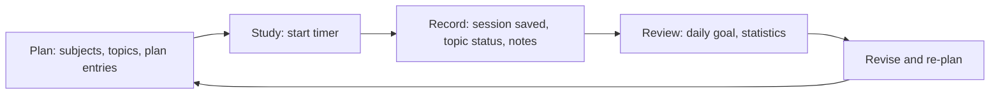

# User Journeys

> Status: Proposal. Journeys describe expected behavior, not UI design.

## Core loop

## 1. First-time onboarding
- **Steps:** sign up (email+password or Google) → pick primary goal (exam prep / coursework / self-learning) → create first subject → set daily goal (default 120 min) → confirm timezone → start first session (guided).
- **Touchpoints:** landing, signup, onboarding wizard, timer screen.
- **Pain points:** long setup before value; unclear what to enter as goal; timezone mistakes.
- **Success criterion:** first saved session within 24h of signup; wizard completable in < 3 min; every step skippable except account.

## 2. Creating subjects and topics
- **Steps:** add subject (name, color) → add topics (flat list; optional weight) → reorder/edit → archive (soft-delete) a subject.
- **Touchpoints:** subjects page, quick-add.
- **Pain points:** tedious entry for big syllabi; deep hierarchies overwhelm.
- **Success criterion:** ≥ 1 subject and ≥ 3 topics created in the first session of use; bulk paste of topic list supported (proposed).

## 3. Creating study plans
- **Steps:** choose subject/topic → choose date, start time, duration → save plan entry → see overlap warning if conflicting → confirm or change.
- **Touchpoints:** planner list/calendar (MVP: list + read-only calendar; Phase 2: drag-and-drop).
- **Pain points:** over-planning; conflicts with exams; editing past entries.
- **Success criterion:** plan entry created in ≤ 4 interactions; planned time visible beside actual time.

## 4. Starting and completing study sessions
- **Steps:** pick subject (optionally topic / plan entry) → choose Pomodoro or Stopwatch → start → pause/resume → stop or let focus interval end → session saved → optional quick note.
- **Abandoned sessions:** if no heartbeat for > 30 min the session closes at the last heartbeat (BR-006); user sees it flagged and may edit.
- **Touchpoints:** timer screen, browser tab title, notification on interval end.
- **Pain points:** timer drift in background tabs; forgetting to stop; two devices running timers.
- **Success criterion:** saved duration within ±2 s of wall-clock; no lost session on tab close/refresh.

## 5. Recording study progress
- **Steps:** after session, mark topic status (Not started / In progress / Done) → add note (markdown) to topic or subject → tick related to-dos.
- **Pain points:** friction after a session; notes becoming a second product.
- **Success criterion:** ≥ 30% of sessions end with a topic status or note update.

## 6. Reviewing statistics
- **Steps:** open dashboard → today's progress vs goal → daily/weekly/monthly totals by subject → calendar heatmap → planned vs actual comparison.
- **Pain points:** misleading charts with sparse data; timezone/day-boundary confusion.
- **Success criterion:** user can answer "how long did I study each subject this month?" in ≤ 2 clicks.

## 7. Preparing for an exam
- **Steps:** create exam (subject, date) → link/select topics as checklist → see countdown → plan sessions backward from the date → tick topics as completed → view readiness (completed topics ÷ total, weighted) → after exam, archive.
- **Pain points:** inaccurate readiness giving false confidence; exam date changes.
- **Success criterion:** every active exam shows days remaining and readiness; user can state which topics remain.
