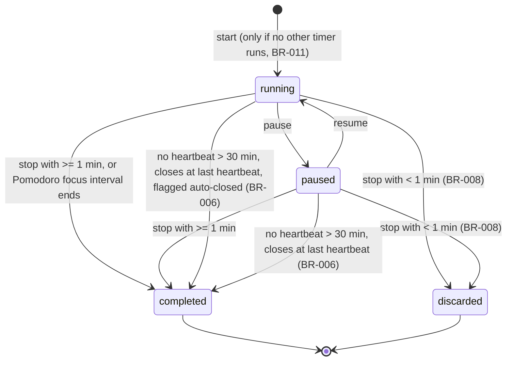

# Lumora Product Requirements Document (PRD)

> Status: Proposal, pending approval. Source of truth: Phase 1 docs.

## 1. Purpose and status

This PRD turns the approved Phase 1 discovery documents into testable product requirements for Lumora, a web application where learners plan study time, study with a timer, record sessions and compare actual effort with the plan.

- Sources of truth: `docs/01-product-discovery/*`, `docs/PROJECT-BRIEF.md`, `docs/FEATURE-PRIORITIZATION.md`. Business rules BR-001..BR-032 and decisions (a)-(h) are used as written. No Phase 1 file was changed.
- Scope of this phase: requirements only. No architecture, database, API design or UI design.
- Numeric values not fixed by Phase 1 are proposals and are listed in section 10 where a decision is needed.
- Everything here is a proposal until the user approves it. System design (SDD) must not start before approval.

## 2. Product goals

| ID | Goal | Measured by |
|---|---|---|
| PG-1 | Per-subject study time is visible to the learner | User answers "how long did I study each subject this month?" in <= 2 clicks (USER-JOURNEYS journey 6) |
| PG-2 | Planned and actual study time are compared side by side | Plan adherence tracked (PRODUCT-VISION) |
| PG-3 | Daily consistency is supported through goals and feedback | Daily goal met rate >= 40%; sessions/week/active user >= 4 |
| PG-4 | Preparation is driven by exams: date, topics, countdown, readiness | Every active exam shows days remaining and its topic checklist |
| PG-5 | Low-friction activation and retention | D7 retention >= 25%; activation >= 50% (PRODUCT-VISION) |
| PG-6 | Trust and data ownership | Export and account deletion available; no cross-user data exposure |

## 3. User needs

| ID | Need | Segments (TARGET-USERS) |
|---|---|---|
| UN-1 | Know how long I studied per subject | all |
| UN-2 | A daily target and my progress against it | all |
| UN-3 | A distraction-free, accurate timer | all |
| UN-4 | Topic-level progress and notes | university, exam candidates, self-directed |
| UN-5 | Exam countdown and topic checklist | high-school, university, exam candidates |
| UN-6 | Consistency and habit feedback | self-directed, high-school |
| UN-7 | Accountability with peers (Phase 3) | high-school, university |
| UN-8 | Plan study time | all |
| UN-9 | Manage study-related tasks | all |
| UN-10 | Revise and recall material (Phase 2) | exam candidates, university |
| UN-11 | Own and move my data | all |
| UN-12 | Fast onboarding | all |

## 4. Scope by release

Lists are copied from `docs/01-product-discovery/PRODUCT-SCOPE.md`; additions made by this PRD are marked **(added)**.

### MVP
- Authentication (email+password, Google) and profile (timezone, settings)
- Subjects and topics (soft-delete)
- Study Hours Tracking by Subject (timer sessions + flagged manual entries)
- Pomodoro Timer and Stopwatch
- Daily Study Goals
- To-Do List and Priority Management
- Study Activity Calendar (read-only heatmap + planned sessions list; plan entries created by form)
- Daily and Monthly Statistics (incl. planned vs actual)
- Basic notes per subject/topic (markdown)
- Basic Exam Management (exam date, countdown, topic checklist)
- Data export, onboarding, responsive web, dark mode
- Internal API serving the web client (not public)
- **(added)** Dashboard composed only of MVP data (inconsistency I-1)
- **(added)** Study planning by form, listed under the calendar and plan umbrella (inconsistency I-7)

### Out of scope (not planned)
- Native mobile apps
- Video/course hosting, content marketplace
- Payments, subscriptions
- Real-time chat
- LMS instructor features (classes, grading, assignments)
- Offline-first sync
- Languages other than English

### MVP boundaries
- Single user per account; no social or sharing.
- Responsive web only (desktop + mobile browsers).
- No drag-and-drop planning; no gamification; no AI; no public API; no ambient audio.
- Free product; no billing code.

### Future expansion
| Phase | Items |
|---|---|
| 2 | Drag-and-Drop Study Calendar, revision tools (flashcards/spaced repetition), Habit Streak then XP, Focus Timer ambient audio, exam readiness score, reminders, PWA |
| 3 | AI-Generated Study Schedule, Study Groups and Leaderboards, public REST API |
| Later | Integrations: Google Calendar, Notion, Anki import; additional languages |

**Mapping notes (added).** Reminders are a Phase 2 item (FR-150..154, inconsistency I-6). PWA is listed by Phase 1 for Phase 2 but has no requirement here because Phase 1 defines no behavior for it; it is left for a later decision. Phase 2 and 3 features are specified for forward planning with priority Could Have and Won't Have respectively (inconsistency I-5).

## 5. Feature specifications

Features follow the order of the project brief. FR bodies, acceptance criteria and error handling are in FUNCTIONAL-REQUIREMENTS.md; edge cases in EDGE-CASES.md. "Actor" means the role from USER-ROLES-AND-PERMISSIONS.md.

### 5.1 Dashboard
- **Phase/priority:** MVP, Should Have (derived feature, I-1).
- **Purpose:** one landing view of today: progress, running timer, upcoming plan, to-dos, recent effort.
- **Actors:** Registered User.
- **Data concepts:** daily goal, sessions of today, running timer, plan entries, to-dos, seven-day totals per subject.
- **Main flow:** user signs in -> dashboard shows progress against goal, timer card, next 3 planned entries, due and overdue to-dos, last 7 days by subject.
- **States:** none of its own; shows timer state from 5.7.
- **Rules:** BR-013, BR-014, BR-015, BR-031.
- **FRs:** FR-020..024. **Edge cases:** EC-001, EC-004, EC-006.

### 5.2 Subjects and topics
- **Phase/priority:** MVP, Must Have.
- **Purpose:** the backbone every other feature attaches to.
- **Actors:** Registered User.
- **Data concepts:** subject (name, color, order, archived flag); topic (name, weight 1-5 default 1, order, status Not started/In progress/Done, archived flag).
- **Main flow:** add subject -> add topics one by one or by pasting a list (one per line) -> reorder and edit -> archive when no longer needed -> restore from the archived list.
- **States:** active <-> archived (soft-delete).
- **Rules:** BR-029.
- **FRs:** FR-010..019. **Edge cases:** EC-007, EC-008, EC-020.

### 5.3 Study planning
- **Phase/priority:** MVP, Should Have (I-7).
- **Purpose:** put time blocks on days and compare them with what was actually studied.
- **Actors:** Registered User.
- **Data concepts:** plan entry (subject, optional topic, date, start time, duration 5-480 min, missed flag).
- **Main flow:** choose subject/topic, date, start time and duration -> save -> confirm if it overlaps -> later see planned versus actual.
- **States:** upcoming -> past; past with no linked session may become missed. Past entries are read-only except marking missed.
- **Rules:** BR-001..BR-005, BR-025, BR-026, BR-028.
- **FRs:** FR-030..038. **Edge cases:** EC-003, EC-013, EC-020, EC-022.

### 5.4 Study sessions and hours tracking
- **Phase/priority:** MVP, Must Have.
- **Purpose:** the core record of how long the learner studied.
- **Actors:** Registered User.
- **Data concepts:** session (subject, optional topic, optional plan entry, start, end, source timer or manual, state, auto-closed flag, frozen timezone and local date, client request key).
- **Main flow:** timer sessions are saved when stopped; manual entries are typed in and flagged; sessions can be edited or deleted; sessions under 1 min are discarded; idle sessions auto-close.
- **States:** see the diagram in 5.7.
- **Rules:** BR-003, BR-006, BR-008, BR-010, BR-012, BR-014, BR-016.
- **FRs:** FR-040..049. **Edge cases:** EC-001, EC-006, EC-009, EC-010, EC-011, EC-012, EC-021, EC-028.

### 5.5 Calendar
- **Phase/priority:** MVP read-only, Should Have (FR-060..062); drag-and-drop Phase 2, Could Have (FR-065..069).
- **Purpose:** show when the user studied and what is planned.
- **Actors:** Registered User.
- **Data concepts:** per-day study minutes in four buckets (0; 1-59; 60-119; >= 120 minutes), planned entries.
- **Main flow:** open month -> see heatmap with the numeric minutes -> open a day -> see sessions and planned entries. Phase 2: create, move and resize entries on a 15-minute grid, with a keyboard alternative.
- **States:** none.
- **Rules:** BR-014, BR-016, BR-026, BR-027, BR-028, BR-030.
- **FRs:** FR-060..062, FR-065..069. **Edge cases:** EC-003, EC-006, EC-009.

### 5.6 Daily goals
- **Phase/priority:** MVP, Must Have (per-subject goal Should Have).
- **Purpose:** daily target and progress feedback.
- **Actors:** Registered User.
- **Data concepts:** daily target (default 120 min, range 5-1440), optional per-subject targets, target history by effective date.
- **Main flow:** set target -> studying advances progress -> goal-met state appears when progress >= target.
- **States:** not met -> met (per day).
- **Rules:** BR-013, BR-014, BR-015.
- **FRs:** FR-070..074. **Edge cases:** EC-004, EC-005, EC-006, EC-023.

### 5.7 Timer
- **Phase/priority:** MVP, Must Have.
- **Purpose:** produce accurate session records with little effort.
- **Actors:** Registered User.
- **Data concepts:** timer mode (Pomodoro, stopwatch), settings (focus 1-120 min default 25, break 1-60 default 5, long break 1-60 default 15, cycles before long break 2-8 default 4), running state, heartbeat.
- **Main flow:** choose subject (optionally topic/plan entry) -> choose mode -> start -> pause/resume -> stop or let the focus interval end -> session saved.
- **States and transitions:** the session and timer share the states of BR-006.
- **Rules:** BR-006..BR-009, BR-011, BR-012.
- **FRs:** FR-050..059. **Edge cases:** EC-001, EC-002, EC-010, EC-012, EC-020, EC-024, EC-028.

A Pomodoro stopped at >= 5 min of focus counts as a completed pomodoro; 1 to under 5 min is saved as time only (BR-007; interpretation I-2). Break time is not study time (BR-009).

### 5.8 Statistics
- **Phase/priority:** MVP, Must Have.
- **Purpose:** feedback and insight on effort.
- **Actors:** Registered User.
- **Data concepts:** totals per day, week (Monday start, proposed), month and subject; goal-hit rate; planned versus actual with signed variance (BR-004).
- **Main flow:** open statistics -> choose range up to 24 months -> read totals by subject and the planned-versus-actual view; fewer than 3 days of data shows an empty state.
- **States:** none.
- **Rules:** BR-001, BR-002, BR-004, BR-010, BR-014, BR-029, BR-030.
- **FRs:** FR-080..089. **Edge cases:** EC-006, EC-007, EC-011.

### 5.9 Notes and revision
- **Phase/priority:** notes MVP, Should Have (FR-100..104); flashcards and spaced repetition Phase 2, Could Have (FR-107..112).
- **Purpose:** keep material and support recall.
- **Actors:** Registered User.
- **Data concepts:** note (markdown body, owner subject or topic, version); flashcard (front, back, rating history, next review date); daily review limit default 50.
- **Main flow:** write a note, autosave, sanitized preview. Phase 2: create cards, review the daily queue, rate Again/Hard/Good/Easy.
- **States:** note saved/unsaved/conflicted; card new -> learning -> review.
- **Rules:** BR-029, BR-030.
- **FRs:** FR-100..104, FR-107..112. **Edge cases:** EC-006, EC-007, EC-020, EC-021.

### 5.10 AI-generated study schedule
- **Phase/priority:** Phase 3, Won't Have this release.
- **Purpose:** draft a plan from exams, topics and past pace.
- **Actors:** Registered User.
- **Data concepts:** generation request (exams, topics, available weekly hours, 4 weeks of history), proposed entries (preview only), consent record, daily usage count (max 5).
- **Main flow:** consent -> request -> preview with warnings and removed-entry count -> accept or discard. Nothing is saved before accept.
- **States:** requested -> previewed -> accepted or discarded; or failed.
- **Rules:** BR-025, BR-026.
- **FRs:** FR-190..198. **Edge cases:** EC-015, EC-016.

### 5.11 Ambient audio
- **Phase/priority:** Phase 2, Could Have.
- **Purpose:** support concentration during sessions.
- **Actors:** Registered User.
- **Data concepts:** built-in loops (rain, white noise, cafe), volume 0-100, last choice.
- **Main flow:** choose loop -> audio plays only while a session runs -> mutes on pause.
- **States:** off, playing, muted.
- **Rules:** none.
- **FRs:** FR-180..184. **Edge cases:** EC-024.

### 5.12 XP and streaks
- **Phase/priority:** Phase 2, Could Have; streak first, then XP.
- **Purpose:** consistency and motivation tied to recorded effort.
- **Actors:** Registered User.
- **Data concepts:** streak (current, longest, freeze), XP ledger entries (user, source event, rule, amount), level thresholds (level n needs 100*n*(n+1)/2 cumulative XP: 100, 300, 600, 1000, ...; proposal U-2).
- **Main flow:** meet the daily goal -> streak grows; study -> XP is awarded up to 600/day.
- **States:** streak active -> reset or frozen day.
- **Rules:** BR-017..BR-022 (BR-020 is decision (b), see I-4).
- **FRs:** FR-160..164, FR-170..177. **Edge cases:** EC-004, EC-006, EC-017.

### 5.13 Exam preparation
- **Phase/priority:** MVP basic, Should Have (FR-120..125); readiness Phase 2, Could Have (FR-126..128).
- **Purpose:** turn an exam date into a topic checklist, countdown and coverage signal.
- **Actors:** Registered User.
- **Data concepts:** exam (subject, title, date, topic checklist, archived flag); readiness = sum of weights of completed topics divided by sum of weights of all topics (BR-024), labelled topic coverage.
- **Main flow:** create exam -> pick topics -> see days remaining -> tick topics -> after the date the exam is archived.
- **States:** active -> archived.
- **Rules:** BR-023, BR-024, BR-025.
- **FRs:** FR-120..128. **Edge cases:** EC-006, EC-008, EC-013, EC-014.

### 5.14 Study groups and leaderboards
- **Phase/priority:** Phase 3, Won't Have this release.
- **Purpose:** accountability with peers.
- **Actors:** Registered User, Group Member, Group Administrator.
- **Data concepts:** group (name, members, administrators, maximum 20 members), invite, per-user sharing setting, weekly leaderboard by focused minutes.
- **Main flow:** create group -> invite -> join -> view leaderboard of shared totals -> leave or be removed.
- **States:** member joined -> left or removed; group active -> dissolved.
- **Rules:** BR-010.
- **FRs:** FR-200..212. **Edge cases:** EC-018, EC-019, EC-025.

### 5.15 REST API
- **Phase/priority:** public API Phase 3, Won't Have this release. The internal API serving the web client exists from the MVP, is not public, and is covered by NFR-060 only (I-8).
- **Purpose:** third-party integrations.
- **Actors:** Registered User, acting through an API client credential.
- **Data concepts:** API key (name, scopes read/write per resource, created, revoked), rate limit 60 requests/min/key, version `/v1`, error format with code, message and details.
- **Main flow:** create key (shown once) -> call resources within scopes -> revoke.
- **States:** key active -> revoked.
- **Rules:** none.
- **FRs:** FR-220..226. **Edge cases:** EC-026.

### 5.16 Task management
- **Phase/priority:** MVP, Must Have (Phase 1 feature 14, To-Do List; I-1).
- **Purpose:** capture tasks tied to subjects. To-dos are tasks; plan entries are time blocks.
- **Actors:** Registered User.
- **Data concepts:** to-do (title <= 200 chars, optional subject/topic, due date, priority High/Medium/Low, done flag).
- **Main flow:** add to-do -> filter -> sort by priority then due date -> tick done.
- **States:** open <-> done.
- **Rules:** BR-031 (and BR-017 for Phase 2 XP).
- **FRs:** FR-090..096. **Edge cases:** EC-020.

## 6. Roles summary

Four product roles: Guest, Registered User (MVP), Group Member and Group Administrator (Phase 3). There is no in-app system administrator. API clients act as one Registered User within key scopes. Cross-user access returns not-found. Full detail: [USER-ROLES-AND-PERMISSIONS.md](USER-ROLES-AND-PERMISSIONS.md).

## 7. Non-functional requirements summary

Eleven categories with IDs NFR-001..NFR-104: performance, security, privacy, accessibility, reliability, maintainability, scalability, browser compatibility, responsive design, data integrity, backup and recovery. Highlights (all proposed): LCP <= 2.5 s, API p95 <= 300 ms read / <= 500 ms write, timer accuracy +/- 2 s, WCAG 2.2 AA, availability 99.5%, RPO 24 h, RTO 8 h. Full detail: [NON-FUNCTIONAL-REQUIREMENTS.md](NON-FUNCTIONAL-REQUIREMENTS.md).

## 8. Success metrics

Copied from `docs/01-product-discovery/PRODUCT-VISION.md` (proposed targets, to be validated):

| Metric | Definition | Initial target |
|---|---|---|
| D7 retention | % of new signups with ≥1 session on days 7–13 after signup | ≥ 25% |
| Sessions / week / active user | Mean saved sessions per user active that week | ≥ 4 |
| Daily goal met rate | % of active-user days where progress ≥ target | ≥ 40% |
| Activation | % of signups completing first session within 24h | ≥ 50% |
| Plan adherence | actual ÷ planned minutes for users who plan | tracked, no target in MVP |

## 9. Phase 1 inconsistencies and proposed resolutions

Phase 1 files are not edited. Each item needs approval (U-1).

| ID | Inconsistency | Proposed resolution | Status |
|---|---|---|---|
| I-1 | Dashboard and Task management appear in the Phase 2 brief but not as Phase 1 features. Task management is Phase 1 feature 14 (To-Do); Dashboard is new. | Treat Task management as feature 14. Add Dashboard as Should Have, MVP, composed only of MVP data (FR-020..024). | Proposed, needs approval |
| I-2 | BR-007 is ambiguous for a Pomodoro stopped before 5 min. | Stopped at >= 5 min of focus: completed pomodoro. 1 to under 5 min: saved as time only, not a completed pomodoro. Under 1 min: discarded (FR-045, FR-058, EC-012). | Proposed, needs approval |
| I-3 | Phase 1 assumption 7 (users 16+) conflicts with the TARGET-USERS segment "High-school students", who are often under 16. | Keep the 16+ rule for the MVP. Limit the high-school segment to users 16+ until legal review (NFR-035). | Proposed, needs approval |
| I-4 | BR-020 labels the streak choice "D2", while the approval list used (a)-(h). | Refer to it as decision (b). | Proposed, needs approval |
| I-5 | The Phase 2 brief asks for group roles, AI, audio, XP and API specifications, but Phase 1 scoped them to Phase 2/3 and a single-user MVP. | Specify them with a Phase tag; priority Won't Have for Phase 3, Could Have for Phase 2. | Proposed, needs approval |
| I-6 | Phase 1 lists Reminders for Phase 2 but no business rule covers them. | FR-150..154 introduce defaults, including a 10-minute lead time. | Proposed, needs approval |
| I-7 | PRODUCT-SCOPE says plan entries are created by form in the MVP, but FEATURE-ANALYSIS has no standalone Study planning feature. | FR-030..038 are Should Have, MVP, under the calendar and plan umbrella. | Proposed, needs approval |
| I-8 | Phase 1 says the internal API exists from the MVP, yet no requirement existed. | Add NFR-060. | Proposed, needs approval |

## 10. Unresolved decisions

Each default is already used in the documents. Changing a decision changes only the rows named.

| ID | Decision needed | Recommended default | Affects |
|---|---|---|---|
| U-1 | Approve resolutions I-1..I-8 | Approve as written in section 9 | See section 9 |
| U-2 | Level threshold formula | Level n needs 100*n*(n+1)/2 cumulative XP: 100, 300, 600, 1000, ... | FR-175 |
| U-3 | Daily review limit and group size cap | Review limit 50 per day; group size max 20 | FR-111, FR-208 |
| U-4 | AI generations per day and consent wording for sending data to the provider (legal review) | 5 per user per day; wording to be set by legal review | FR-192, FR-196, NFR-036 |
| U-5 | Availability, RPO, RTO | 99.5%, 24 h, 8 h | NFR-050, NFR-101, NFR-102 |
| U-6 | Minimum age policy | 16+ | NFR-035, FR-001 |
| U-7 | Manual entry that overlaps a recorded session | Reject with a message naming the conflicting session | EC-011, FR-042, FR-043 |
| U-8 | Notes conflict-resolution UX | Show both versions; keep mine, keep theirs or copy both | EC-020, FR-103 |
| U-9 | Public API rate limit | 60 requests per minute per key | FR-222, EC-026 |

## 11. Document map

| Document | Purpose |
|---|---|
| [PRD.md](PRD.md) | This document |
| [FUNCTIONAL-REQUIREMENTS.md](FUNCTIONAL-REQUIREMENTS.md) | FR-001..FR-226 with acceptance criteria |
| [NON-FUNCTIONAL-REQUIREMENTS.md](NON-FUNCTIONAL-REQUIREMENTS.md) | NFR-001..NFR-104 |
| [USER-ROLES-AND-PERMISSIONS.md](USER-ROLES-AND-PERMISSIONS.md) | Roles, matrix, denial behavior |
| [ACCEPTANCE-CRITERIA.md](ACCEPTANCE-CRITERIA.md) | AC index, NFR acceptance, end-to-end scenarios, MVP definition of done |
| [EDGE-CASES.md](EDGE-CASES.md) | EC-001..EC-028 |
| [REQUIREMENT-TRACEABILITY.md](REQUIREMENT-TRACEABILITY.md) | Goal, need, requirement, criterion and planned test mapping |
