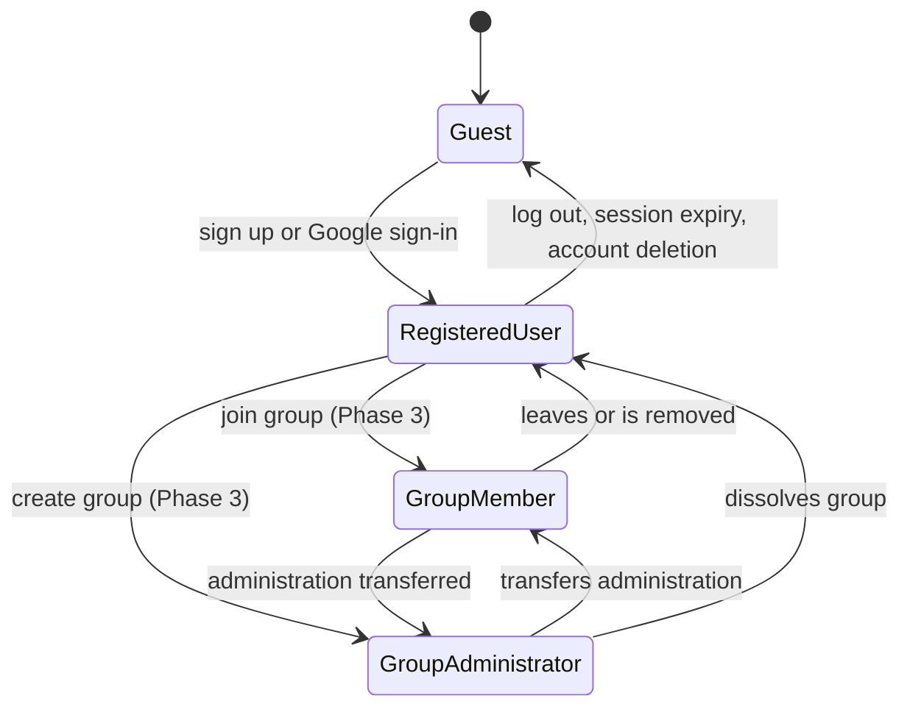

# Lumora User Roles and Permissions

> Status: Proposal, pending approval. Source of truth: Phase 1 docs.

## 1. Roles

| Role | Phase | Description |
|---|---|---|
| Guest | MVP | Unauthenticated visitor. Can reach the landing page, sign-up, login (including Google sign-in) and password reset only. |
| Registered User | MVP | Authenticated person who owns exactly one account and all data in it. This is the only role with study functionality in the MVP. |
| Group Member | 3 | A Registered User who has joined a study group. Holds this role per group, in addition to Registered User. |
| Group Administrator | 3 | A Group Member who administers one group. The creator is the first administrator. A group always has at least one administrator. |

**Decision R-1: no System Administrator role.** There is no in-app admin console in any phase covered by this PRD. Operational access to production data happens outside the product and is governed by NFR-016 (object-level authorization), NFR-020 (authentication audit log, 90-day retention) and NFR-030 (data minimization).

**Decision R-2: API client is not a role.** An API client (Phase 3) is a delegated credential that acts as exactly one Registered User and is limited to the scopes of its key (FR-220, FR-221). It never has more rights than its owner.

## 2. Ownership rules

1. A Registered User may create, read, update and delete only their own subjects, topics, sessions, plan entries, to-dos, notes, flashcards, exams, goals and settings.
2. Archived (soft-deleted) subjects and topics remain owned by the same user and are restorable by that user only (BR-029, FR-014).
3. Group Member (Phase 3): may view the group name, the member list and leaderboard entries, and only the fields each member has opted to share (FR-206, NFR-037).
4. Group Administrator (Phase 3): may invite and remove members, rename the group, delete the group and transfer administration (FR-201, FR-204, FR-205, FR-210, FR-212). May **not** see members' subjects, topics, notes, to-dos, plan entries or individual session details.
5. Manual sessions never appear on a leaderboard (BR-010, FR-207).

## 3. Permission matrix

Cell values: **Allow** (full access under the ownership rule above), **Own only** (access to own records only), **Deny**, **N/A (phase)** (function does not exist in that phase).

| Resource / action | Guest | Registered User | Group Member | Group Administrator |
|---|---|---|---|---|
| Landing page, sign-up, login, password reset (FR-001..005) | Allow | N/A (already signed in) | N/A | N/A |
| Own profile, timezone, sign-ins, account deletion (FR-006..009) | Deny | Own only | Own only | Own only |
| Subjects and topics: create, edit, archive, restore (FR-010..019) | Deny | Own only | Own only | Own only |
| Dashboard (FR-020..024) | Deny | Own only | Own only | Own only |
| Plan entries: create, edit, delete, mark missed (FR-030..038) | Deny | Own only | Own only | Own only |
| Sessions: record, manual entry, edit, delete (FR-040..049) | Deny | Own only | Own only | Own only |
| Timer and ambient audio (FR-050..059, FR-180..184) | Deny | Own only | Own only | Own only |
| Calendar view (FR-060..062) and drag-and-drop planning (FR-065..069) | Deny | Own only (drag-and-drop N/A before Phase 2) | Own only | Own only |
| Daily goals (FR-070..074) | Deny | Own only | Own only | Own only |
| Statistics (FR-080..089) | Deny | Own only | Own only | Own only |
| To-dos (FR-090..096) | Deny | Own only | Own only | Own only |
| Notes and flashcards (FR-100..112) | Deny | Own only (flashcards N/A before Phase 2) | Own only | Own only |
| Exams and readiness (FR-120..128) | Deny | Own only (readiness N/A before Phase 2) | Own only | Own only |
| Data export (FR-130..132) | Deny | Own only | Own only | Own only |
| Onboarding and appearance (FR-134..139) | Deny | Own only | Own only | Own only |
| Reminders (FR-150..154) | Deny | Own only (N/A before Phase 2) | Own only | Own only |
| Streaks and XP (FR-160..177) | Deny | Own only (N/A before Phase 2) | Own only | Own only |
| AI schedule generation (FR-190..198) | Deny | Own only (N/A before Phase 3) | Own only | Own only |
| Create a group (FR-200) | Deny | Allow (N/A before Phase 3) | Allow | Allow |
| Join a group (FR-202) | Deny | Allow with a valid invite (N/A before Phase 3) | Allow | Allow |
| Leave a group (FR-203) | Deny | N/A (not a member) | Allow | Allow, except the last administrator must transfer or dissolve (EC-018) |
| View group name, member list, shared leaderboard fields (FR-207, FR-211) | Deny | Deny | Allow, shared fields only | Allow, shared fields only |
| Set own sharing preference (FR-206) | Deny | N/A | Own only | Own only |
| Report a member (FR-209) | Deny | Deny | Allow | Allow |
| Invite members (FR-201) | Deny | Deny | Deny | Allow |
| Remove a member (FR-204) | Deny | Deny | Deny | Allow |
| Rename or dissolve group; transfer administration (FR-205, FR-210, FR-212) | Deny | Deny | Deny | Allow |
| View members' subjects, notes, session details | Deny | Deny | Deny | Deny |
| API keys: create, scope, revoke (FR-220, FR-221, FR-226) | Deny | Own only (N/A before Phase 3) | Own only | Own only |
| API calls with a key (FR-222..225) | Deny | Within key scopes and owner's data only | Same | Same |

## 4. Role transitions

- Joining a group does not change the user's rights over their own data.
- Leaving or removal is immediate and reverts the user to Registered User for that group (EC-018). Own data is unaffected.
- The last administrator cannot leave without transferring administration or dissolving the group (EC-018). If an administrator's account is deleted, the oldest member is promoted automatically (EC-018, EC-019).

## 5. Denial behavior

| Situation | Behavior |
|---|---|
| Unauthenticated request for a protected page | Redirect to login, preserving the target page; after successful login the user lands on the target (FR-002). |
| Unauthenticated request for protected data | Rejected as unauthenticated; no data returned. |
| Request for another user's record (any resource) | Respond as **not found**, never as forbidden, so that the existence of the record is not revealed (NFR-016). |
| Group Member or Administrator requests a field another member did not share | The field is absent; no hint that it exists (NFR-037). |
| Locked account | Sign-in refused with a message that states the lock and its remaining time (NFR-012). |
| API key lacks the scope | Rejected with the standard error format (FR-225); request logged (NFR-063). |
