# Lumora Application Flows

> Status: Proposal, pending approval. Source of truth: Phase 2 PRD and Phase 1 docs.

Thirteen flows show how requests cross the layers defined in [SYSTEM-ARCHITECTURE.md](SYSTEM-ARCHITECTURE.md) section 5: adapter, application service, domain, repository, database. Module names follow [MODULE-BOUNDARIES.md](MODULE-BOUNDARIES.md). Numbers come from the PRD; failure paths cite edge cases. Error codes are named in [ERROR-HANDLING.md](ERROR-HANDLING.md). Every flow runs with a request ID and, for state-changing requests, CSRF protection and an authenticated identity unless stated otherwise (NFR-014, NFR-063).

## 1. User registration and login

**Trigger**: A guest submits the sign-up form, the login form, or chooses Google sign-in.

**Actors**: Guest; Authentication; User profile; email provider; Google.

**Steps**
1. Adapter validates input with the shared schema: email format, password of at least 10 characters, age confirmation ticked, IANA timezone pre-filled from the browser (FR-001, NFR-011, NFR-035).
2. Authentication checks that the email is unused, hashes the password with a salted adaptive hash and creates the account (NFR-011).
3. User profile creates the profile with timezone and defaults; the user is signed in and routed to onboarding (flow 2).
4. Login: Authentication checks lockout state first; a locked account is refused with the remaining time (NFR-012). Otherwise credentials are verified. Success resets the failure counter and issues a revocable session (NFR-013).
5. Google: OAuth code exchange; first-time Google users go through the same age confirmation and timezone step before an account becomes usable (FR-003, NFR-035).
6. Every sign-in, failed sign-in, lockout, reset, revoke and deletion writes an audit event, retained 90 days (NFR-020).
7. A protected page requested by a guest redirects to login and returns to the target after success (FR-002).

**State transitions**: Guest -> Registered User (sign-up or Google); Registered User -> Guest (logout, expiry, deletion) as in USER-ROLES-AND-PERMISSIONS.md section 4. Account: active <-> locked (15 min after 5 consecutive failures).

**Validations**: password length at least 10; age confirmation; unique email; session inactivity expiry 30 days (NFR-013).

**Failure paths**: Wrong credentials give a generic message that does not reveal whether the email exists; fifth consecutive failure locks the account for 15 min (NFR-012). Google denial or error returns to login with a message. Duplicate email on sign-up returns a generic conflict message. Password reset email failure is queued for retry and the user sees the same neutral confirmation (FR-005).

**Requirement links**: FR-001..005, FR-008, NFR-010..013, NFR-020, NFR-035, U-6.

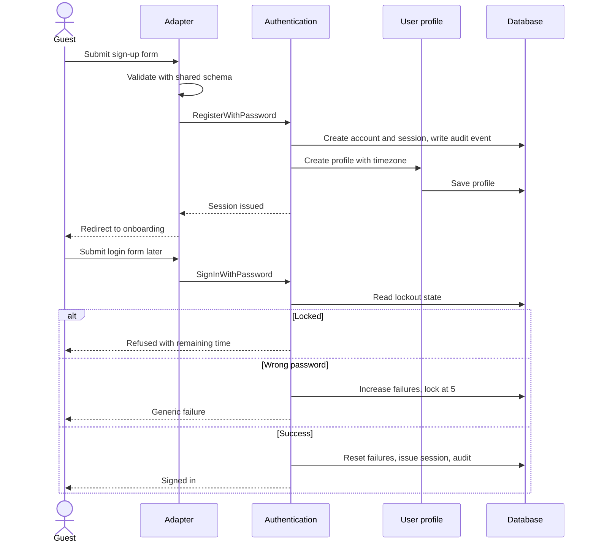

## 2. First-time onboarding

**Trigger**: First sign-in after registration.

**Actors**: Registered User; User profile; Subjects; Goals; Timer.

**Steps**
1. Wizard step 1 asks for a primary goal: exam preparation, coursework or self-learning. It only tailors suggestions (FR-137).
2. Step 2 creates the first subject through the Subjects use case (FR-010).
3. Step 3 confirms the daily goal (default 120 min) and the timezone through Goals and User profile (FR-070, FR-006).
4. Step 4 starts a guided first session: the user picks the subject and starts the timer with hints (FR-136, flow 6).
5. Each step is skippable (FR-135). User profile records progress; the adapter orchestrates the calls. Progress is saved after every step, so a refresh resumes where the user left off.

**State transitions**: onboarding not started -> in progress -> completed or skipped.

**Validations**: Subject and goal rules as in flows 3 and 7. A session under 1 min is discarded as usual (FR-136, BR-008).

**Failure paths**: If a step's request fails the wizard shows a retry and does not lose entered values (NFR-054). Closing the browser mid-wizard resumes on next sign-in. The target path of AC-E2E-01 is signing up, finishing onboarding and saving a first session in 3 min.

**Requirement links**: FR-134..137, FR-006, FR-010, FR-070, AC-E2E-01.

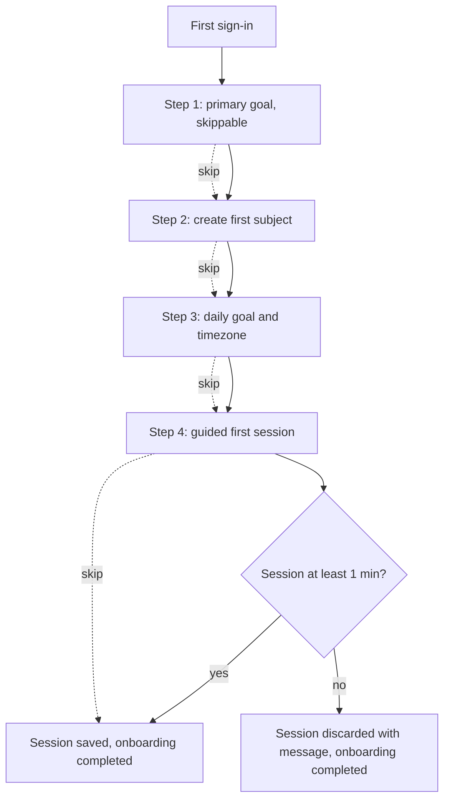

## 3. Subject creation

**Trigger**: The user adds a subject, optionally followed by topics.

**Actors**: Registered User; Subjects; Topics.

**Steps**
1. Adapter validates name, color and order input (FR-010).
2. Subjects use case creates the subject for the owning user and returns it with its version.
3. The user adds topics one by one (weight 1-5, default 1) or pastes a list with one topic per line, which Topics parses into many topics in one transaction (FR-015, FR-017).
4. Editing a subject or topic sends the expected version; a stale version is rejected (FR-011, FR-016, NFR-094).
5. Archiving a subject first asks the registered archive guards whether it may be archived; the Timer guard refuses while a session runs on that subject (EC-007, FR-013). On success the subject is soft-deleted and hidden from pickers, while statistics continue to include it labelled "<name> (archived)". Restore returns it (FR-014).
6. Archiving a topic fires TopicArchived; Exams removes it from readiness denominators (EC-008, FR-018).

**State transitions**: subject active <-> archived; topic status Not started -> In progress -> Done (FR-019); topic active <-> archived.

**Validations**: Ranges from the configuration module; ownership on every operation (NFR-016).

**Failure paths**: Stale version returns the changed-elsewhere conflict with the current record (EC-020). Archive blocked by running session returns a conflict with an explanatory message (EC-007). Bulk paste with a partial failure rolls back the whole paste.

**Requirement links**: FR-010..019, BR-029, NFR-093, EC-007, EC-008, EC-020.

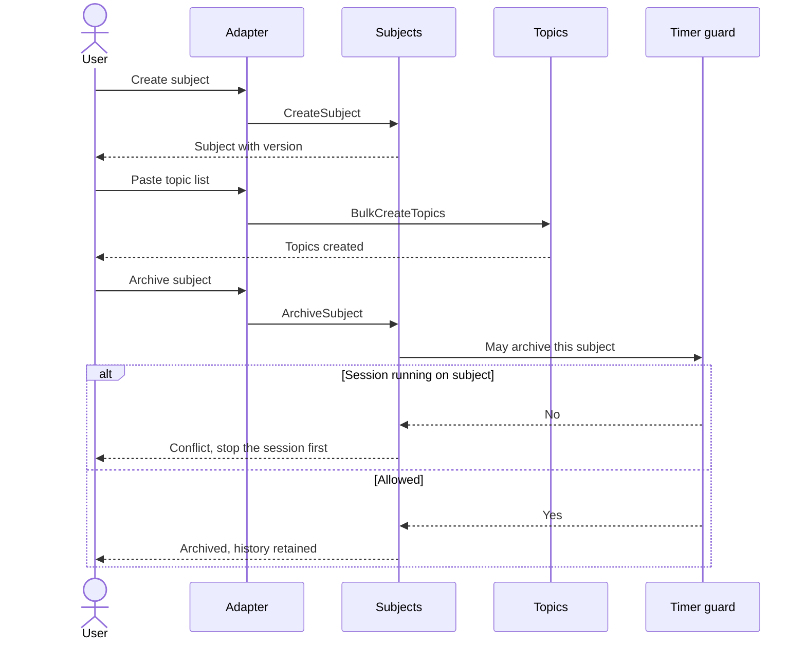

## 4. Study plan creation

**Trigger**: The user saves a plan entry from the form (MVP) or drags on the calendar (Phase 2).

**Actors**: Registered User; Study plans; Exams; Calendar.

**Steps**
1. Adapter validates subject, optional topic, date, start time and duration 5-480 min (FR-030).
2. Study plans loads the user's neighbouring entries and computes overlaps across all subjects for that user (EC-003).
3. If the entry overlaps another, the response is a warning that requires confirmation; the client resubmits with an explicit confirmation flag (BR-026, FR-034). Drag-and-drop follows the same rule (BR-027, FR-069).
4. If the subject has an upcoming exam and the entry falls after the exam date, a second warning requires confirmation (FR-038, BR-025).
5. On confirmation the entry is saved. Past entries are read-only except marking missed (BR-028, FR-035, FR-033).
6. Deleting an entry unlinks its sessions without deleting them (EC-022, BR-003).
7. Planned versus actual is displayed from plan minutes and linked or unlinked session minutes with signed variance (BR-004, FR-036); the two are stored separately (BR-002).

**State transitions**: upcoming -> past; past without linked session -> missed (flag).

**Validations**: Duration 5-480 min. Entries in the past are read-only except marking missed (BR-028, FR-035). Version check on edit (NFR-094).

**Failure paths**: Overlap or exam warning not confirmed: nothing saved. Stale version: conflict (EC-020). Edit of a past entry: refused except marking missed (BR-028).

**Requirement links**: FR-030..038, FR-065..069, BR-001..BR-005, BR-025, BR-026, BR-027, BR-028, EC-003, EC-020, EC-022.

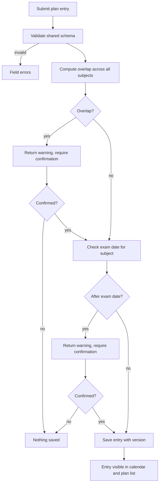

## 5. Study session lifecycle

**Trigger**: A timer stops or auto-closes, the user adds a manual entry, or the user edits or deletes a session.

**Actors**: Timer; Study sessions; Goals; Gamification; Analytics; job runner.

**Steps (timer-sourced)**
1. Timer calls RecordSession with subject, optional topic, optional plan entry, server-held start, end and pauses, and a client request key (FR-040, FR-041, FR-048).
2. Study sessions applies the thresholds from configuration: under 1 min is discarded (BR-008, FR-045); a Pomodoro with at least 5 min of focus counts as completed, 1 to under 5 min is saved as time only (BR-007, FR-058, EC-012).
3. Duration is computed from stored timestamps only (BR-012, NFR-090). The session stores the zone and local date at its start (NFR-091).
4. A session crossing local midnight is stored once and allocated to two days at read time (BR-016, FR-047, EC-009).
5. The save and the SessionCompleted event commit together; Goals, Gamification and Analytics react (MODULE-BOUNDARIES.md section 6).
6. A post-session prompt offers topic status and a note (FR-049).

**Steps (manual)**: A manual entry is validated: no future start or end, at most 24 h per entry, at most 24 h total per day, no overlap with a recorded session, which is rejected with a message naming the conflict (EC-011, U-7, FR-042). It is flagged manual, shown distinctly (FR-088), and excluded from XP and leaderboards (BR-010).

**Steps (edit and delete)**: Edit uses the same validations and a version check (FR-043, NFR-094). Delete is a real delete of the session; gamification receives a compensating adjustment event, ledger rows are never deleted (FR-044, FR-177, EC-017).

**State transitions**: running <-> paused -> completed or discarded (PRD section 5.7).

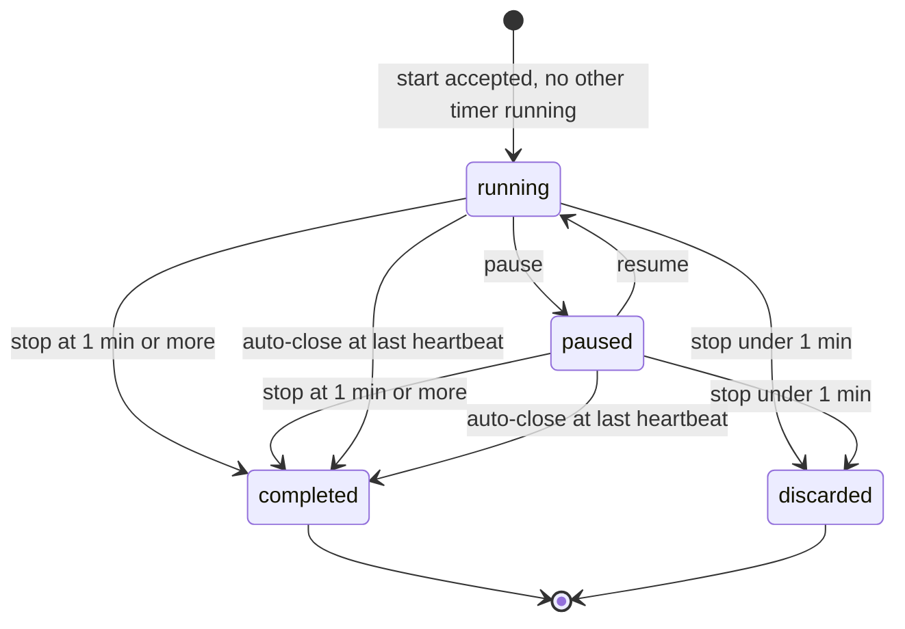

**Failure paths**: Duplicate save with the same request key returns the stored session (EC-021). Network failure leaves the client with a retry action, using the same key (NFR-054, NFR-053). Stale version on edit: conflict (EC-020). Manual overlap or future entry: validation error (EC-011).

**Requirement links**: FR-040..049, BR-003, BR-006, BR-008, BR-010, BR-012, BR-014, BR-016, NFR-051, NFR-053, NFR-090, NFR-091, EC-001, EC-006, EC-009..012, EC-021, EC-028.

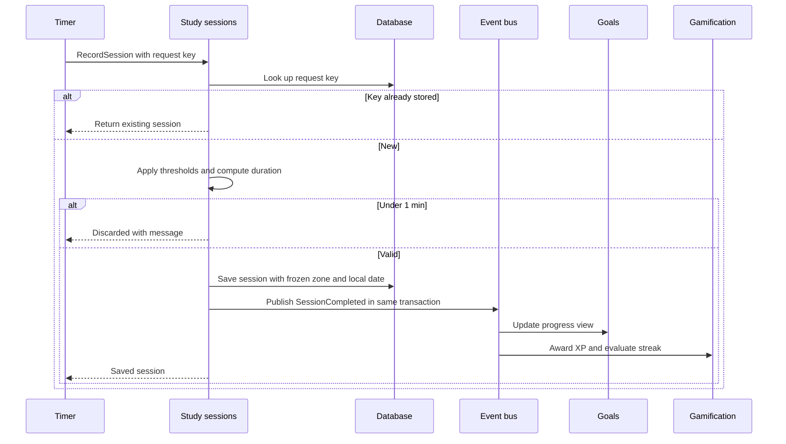

## 6. Timer lifecycle

**Trigger**: The user starts, pauses, resumes or stops a timer; a heartbeat arrives; the idle-session job runs; another device starts a timer.

**Actors**: Registered User; browser timer store; Timer; Study sessions; scheduled job.

**Steps**
1. **Start** (Pomodoro or stopwatch, FR-050, FR-051): Timer performs an atomic check-and-create. If the user already has a running or paused timer, the start is rejected with the prompt "Stop current session and start new?" (FR-053, EC-002). Confirming stops the first at server time, then starts the new one. Simultaneous starts: the first accepted wins (BR-011).
2. **Authoritative state**: The server stores timestamps at start, pause and resume and returns them with the state version. The browser derives the display from them and the server-time offset; no duration is sent (BR-012, EC-010).
3. **Heartbeat**: The client sends one every 60 s. The server records the last heartbeat time (EC-001).
4. **Pause and resume**: Break time between pause and resume is not study time (BR-009, FR-052).
5. **Pomodoro intervals**: At focus end the client notifies the user (FR-055, EC-024 if permission denied). Configured focus 1-120, break 1-60, long break 1-60, cycles 2-8 (FR-057, BR-009).
6. **Stop**: Timer finalizes the run and calls Study sessions (flow 5). A Pomodoro stopped at 5 min or more counts as completed; 1 to under 5 min is time only; under 1 min is discarded, and the user sees a message (BR-007, BR-008, EC-012).
7. **Refresh, tab close, network loss**: On reload the client fetches the state, shows the elapsed time within 2 s of server time and continues (FR-054, NFR-052, AC-E2E-03). During a network drop the display keeps counting from the stored start; the client resynchronizes on reconnect (EC-028).
8. **Auto-close**: A scheduled job runs every minute. A run with no heartbeat for more than 30 min is closed at its last heartbeat and saved as an auto-closed session. The job is idempotent: a run already closed is skipped (BR-006, FR-046, EC-001).
9. **Midnight**: The run is recorded once, and the day-allocations are computed by Study sessions (BR-016, EC-009).
10. **Convergence**: While a timer runs, clients poll every 3 s and refetch on focus; a stop on device B is seen on device A within 5 s (FR-059, EC-020, AC-E2E-04).

**State transitions**: As in the session lifecycle state diagram in flow 5.

**Validations**: Focus, break and cycle ranges; ownership; subject must be active (archived subjects are hidden from pickers).

**Failure paths**: Start while another timer runs gives a conflict prompt (EC-002). Pause or stop on a run that auto-closed returns a conflict with the stored session. Network failure on start shows retry; a start retried with the same key does not create a second run (NFR-053). A wrong client clock has no effect because only server time is used (EC-010). Autoplay or notification denial degrades to an in-app indicator (EC-024). Account deletion discards the running timer (EC-019).

**Requirement links**: FR-050..059, BR-006..BR-009, BR-011, BR-012, NFR-004, NFR-044, NFR-051, NFR-052, NFR-090, EC-001, EC-002, EC-010, EC-012, EC-020, EC-024, EC-028.

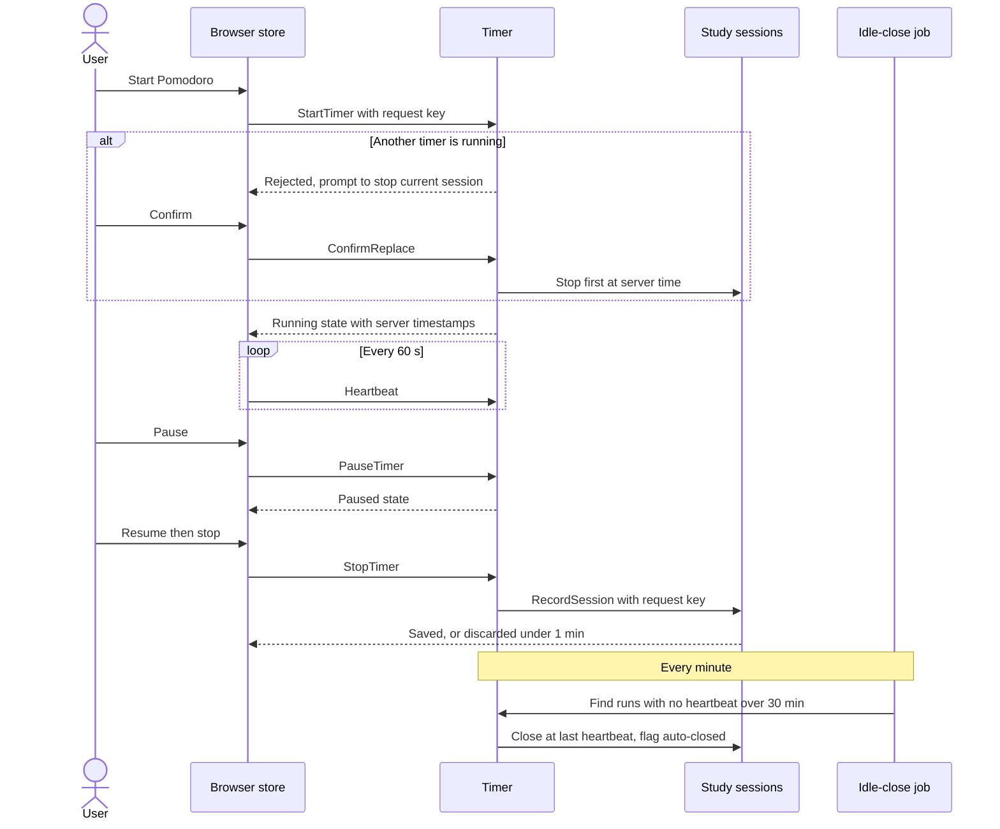

## 7. Daily goal calculation

**Trigger**: A session is saved, edited or deleted; the user opens the dashboard; the user changes the goal or the timezone.

**Actors**: Goals; Study sessions; User profile.

**Steps**
1. Goals asks User profile for the user's clock context: IANA zone and rollover hour (BR-014, FR-009).
2. Today's local date is derived from the current instant in that zone.
3. Progress is the sum of study minutes of sessions whose frozen local date equals today, plus the share of a midnight-crossing session allocated to today. Breaks are excluded (BR-001, BR-014, BR-016).
4. The target is taken from the target history by effective date: the target in force on that day. A change applies from today forward, and past days keep their earlier target (BR-015, FR-074, EC-005).
5. Goal met when progress is at least the target (BR-015, FR-073). The first time it flips to met in a day, GoalMet is published once per day.
6. If the timezone changed, only sessions whose frozen local date equals today's date in the new zone are counted. Past days are never recomputed (EC-006, AC-E2E-06).
7. Per-subject targets are evaluated the same way (FR-071).

**State transitions**: day: not met -> met. A day ending below the goal is marked "goal not met" in statistics and has no other consequence in the MVP (EC-004).

**Validations**: Goal 5-1440 minutes; 0 or above 1440 is rejected (EC-023, BR-013).

**Failure paths**: Invalid goal returns a validation error. Empty day shows 0 progress and no division by zero. DST days of 23 or 25 hours do not alter minute totals (EC-006).

**Requirement links**: FR-070..074, FR-072, BR-013..BR-016, EC-004..EC-006, EC-023.

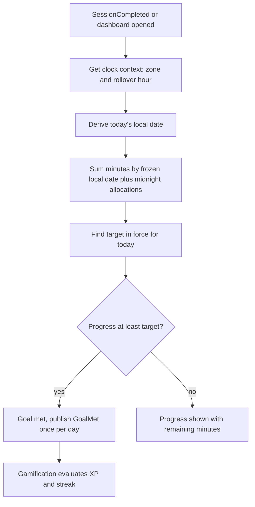

## 8. XP transaction (Phase 2)

**Trigger**: SessionCompleted, GoalMet, TodoCompleted, SessionEdited, SessionDeleted.

**Actors**: Gamification; Study sessions; Goals; Tasks.

**Steps**
1. Gamification receives the event inside the originating transaction.
2. Exclusions: manual entries and sessions under 5 min earn nothing (BR-018, BR-010, FR-174).
3. The award amount is computed from configuration: 1 XP per focused minute, +20 XP when the daily goal is met, +10 XP per completed High-priority to-do (BR-017, FR-170..172).
4. The daily cap of 600 XP is applied when the award is made, from the user's local-day total (BR-018, FR-173).
5. The ledger entry is inserted with uniqueness on user + source event + rule. A duplicate insert is a no-op, so retries and re-delivered events never double-award (EC-017, FR-176, NFR-095).
6. Editing or deleting a session adds a compensating adjustment entry. Ledger rows are never deleted (FR-177, BR-019).
7. Level is derived from cumulative XP using the threshold table 100*n*(n+1)/2 (FR-175, U-2).

**State transitions**: none on the ledger; level is derived.

**Failure paths**: A unique conflict on the ledger insert is treated as success. A system error during the insert rolls back the originating transaction, so a session is never saved without its award decision (EC-017). Cap reached: the award is reduced to the remaining allowance, possibly zero, and the summary says why. Re-delivery of the event: no-op.

**Requirement links**: FR-170..177, BR-017..BR-019, EC-017, NFR-095.

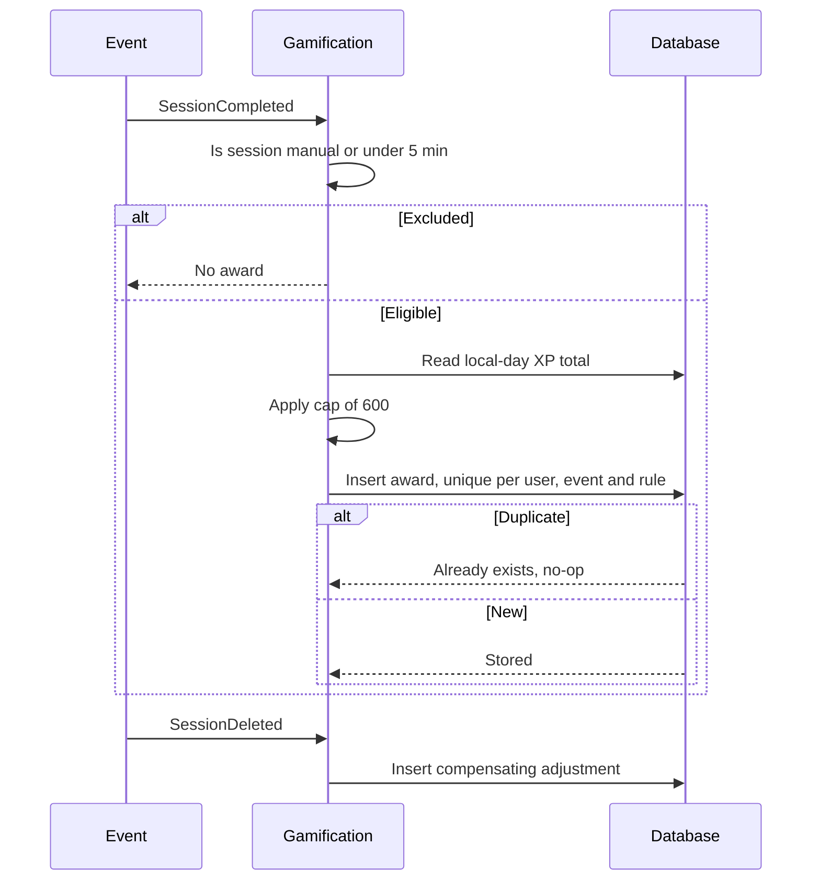

## 9. Streak calculation (Phase 2)

**Trigger**: GoalMet, and an end-of-local-day evaluation job.

**Actors**: Gamification; Goals; scheduled job.

**Steps**
1. A day counts when its goal is met (BR-020, decision (b), FR-160).
2. At each user's local day end, a job evaluates the day in the user's own zone. If the goal was met, the streak grows. If not, the streak resets to 0 unless a weekly freeze covers the day (BR-021, FR-161, FR-162, EC-004).
3. A covered freeze day does not add to the count. One freeze per week (FR-162).
4. The longest streak is stored (BR-022, FR-163).
5. A timezone change never reduces an existing streak. The evaluation uses each session's frozen local date (BR-022, FR-164, EC-006).
6. Evaluation is idempotent per user and local date.

**State transitions**: active -> reset, or active -> freeze-covered day -> active.

**Failure paths**: Job failure retries; because evaluation is keyed by user and local date, a retry never applies twice. Late-arriving sessions (auto-closed or edited after day end) trigger a re-evaluation of the affected day through the same keyed path.

**Requirement links**: FR-160..164, BR-020..BR-022, EC-004, EC-006.

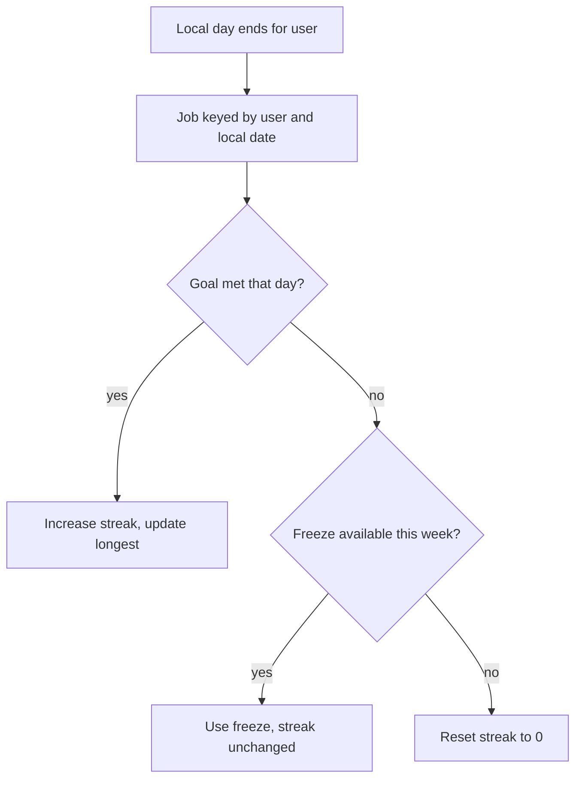

## 10. AI schedule generation (Phase 3)

**Trigger**: The user requests an AI schedule.

**Actors**: Registered User; AI scheduling; Study plans; Exams; Analytics; AI provider; job runner.

**Steps**
1. Prerequisites: at least one exam and its topics exist, and available weekly hours are entered (FR-190, FR-198).
2. Consent: if the user has not consented to sharing with the provider, the consent text is shown and the request is stopped until granted (FR-192, NFR-036). Consent is per feature and revocable.
3. Quota: no more than 5 generations per profile day (FR-196, U-4).
4. Inputs are assembled: exams, topics, weekly hours and 4 weeks of session history, reduced to aggregates (FR-190).
5. A generation job is queued, so the provider call does not hold a web request. The job calls the provider through the port with a 30 s timeout (FR-191, EC-016).
6. Validation: each entry is rejected if malformed, in the past, after the exam date, outside declared hours, of duration outside 5-480 min, referencing an unknown subject or topic, or if the total exceeds the declared weekly hours (EC-015, FR-194). Rejected entries are dropped and counted.
7. If zero entries are valid, an error is shown and nothing is saved (EC-015). Overlaps with existing entries produce warnings (BR-026).
8. A preview is stored as a transient proposal with its removed-entry count, such as "3 entries removed" (FR-193).
9. Accept creates plan entries through the Study plans use case; discard deletes the proposal (FR-195). Nothing else persists before accept.

**State transitions**: requested -> previewed -> accepted or discarded; requested -> failed.

**Validations**: As in step 6; user-visible quota.

**Failure paths**: Provider error or 30 s timeout shows an error, saves nothing and consumes no quota (EC-016, FR-197). A retry counts toward the 5-per-day limit only if a provider response was received (EC-015). Consent withdrawn between request and call: the call is not made.

**Requirement links**: FR-190..198, NFR-036, BR-025, BR-026, EC-015, EC-016, U-4.

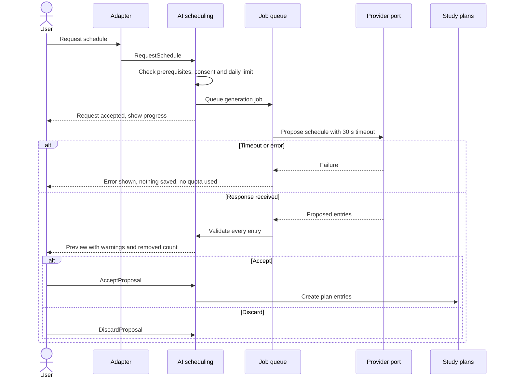

## 11. Exam preparation

**Trigger**: The user creates or edits an exam, ticks topics, or the exam date passes.

**Actors**: Registered User; Exams; Topics; Study plans; job runner.

**Steps**
1. Create: subject, title, date and topic checklist chosen from the subject's active topics (FR-120, FR-122, BR-023). A past date is rejected (EC-013).
2. Edit: editing to a past date is allowed; the exam is archived the next day (FR-121, EC-013). Version check applies (NFR-094).
3. Countdown: days remaining are computed in the user's zone (FR-123, AC-E2E-08).
4. Ticking a topic marks it done in the checklist and updates remaining counts.
5. Readiness (Phase 2): the sum of weights of completed topics divided by the sum of weights of all topics, labelled topic coverage (BR-024, FR-126..128). All complete gives 100%. An empty checklist shows an "add topics" empty state with no division by zero (EC-014).
6. Archived topics are removed from the denominator and the change is noted (EC-008).
7. Archive: a daily job archives exams whose date has passed at the start of the next day in the profile timezone; archived exams remain viewable (FR-124, FR-125, EC-013).
8. Plan entries scheduled after an exam date for that subject warn (flow 4).

**State transitions**: active -> archived.

**Failure paths**: Past date on create: validation error. Stale version: conflict (EC-020). Job re-run: no-op for already archived exams.

**Requirement links**: FR-120..128, FR-038, BR-023..BR-025, EC-008, EC-013, EC-014, EC-020.

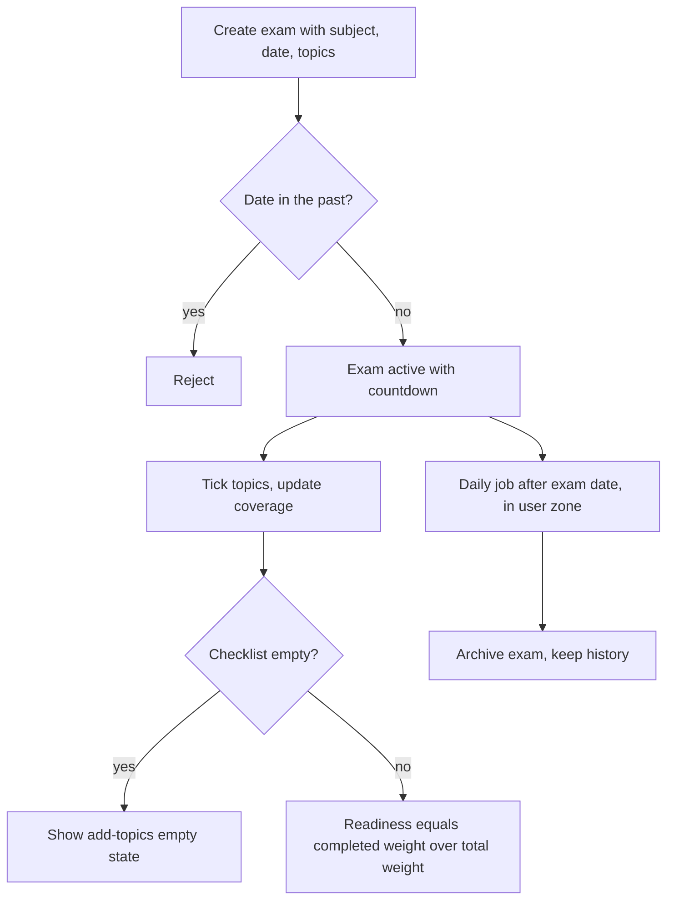

## 12. Group activity (Phase 3)

**Trigger**: A user creates a group, invites, joins, shares, leaves, is removed, or views the leaderboard.

**Actors**: Group Administrator; Group Member; Study groups; Study sessions; Notifications; job runner.

**Steps**
1. Create: the creator becomes the first administrator (FR-200).
2. Invite: an administrator generates an invite link or email invite that expires after 7 days (FR-201). Email goes through the notifications port.
3. Join: a signed-in user with a valid invite confirms; joins that exceed 20 members are refused (FR-202, FR-208, U-3).
4. Sharing: each user opts in per field (FR-206, NFR-037). Fields that are not shared are absent from responses without a hint (USER-ROLES-AND-PERMISSIONS.md section 5).
5. Leaderboard: a weekly job computes focused minutes of opted-in members. Only server-recorded timer sessions of at least 5 min count; manual entries and shorter sessions are excluded (FR-207, EC-025, BR-010).
6. Leave or removal: the member disappears at once from member list and leaderboards. Their own data is unaffected and rejoining needs a new invite (FR-203, FR-204, EC-018).
7. The last administrator cannot leave without transferring administration or dissolving the group, which needs confirmation (FR-205, FR-210, EC-018). If an administrator account is deleted, the oldest member is promoted (EC-018, EC-019).
8. Report: a member reports another with a reason; the reporter gets acknowledgement (FR-209).

**State transitions**: member joined -> left or removed; group active -> dissolved.

**Failure paths**: Expired or revoked invite: not found style message. Group full: refusal. Non-administrator attempting an admin action: denied (USER-ROLES-AND-PERMISSIONS.md section 3). Cross-group access to a group the user is not in: not found.

**Requirement links**: FR-200..212, NFR-037, BR-010, EC-018, EC-019, EC-025, U-3.

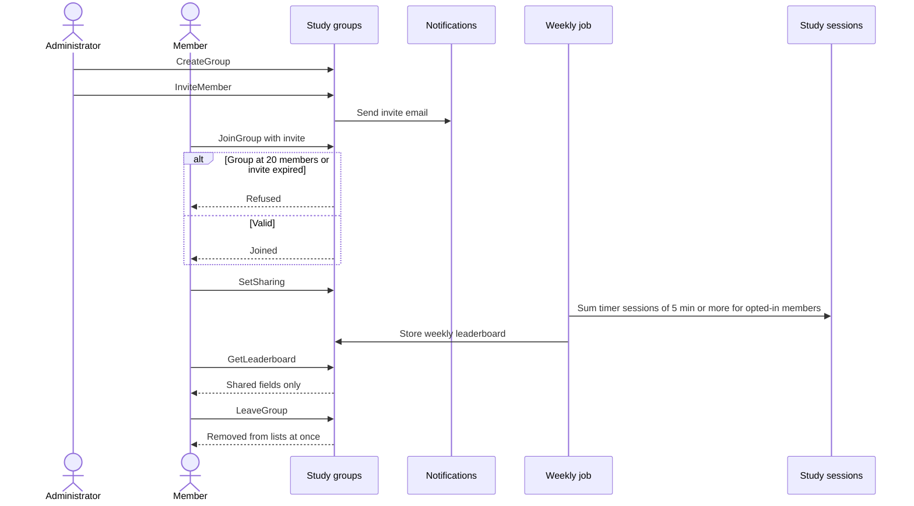

## 13. API authentication and request handling (Phase 3)

**Trigger**: A client sends a request to a `/v1` route with an API key.

**Actors**: API client; API integrations; target module; rate limiter.

**Steps**
1. Create key: a signed-in user names a key and chooses read or write per resource (write includes read). The key value is shown once; only its hash is stored (FR-220, FR-221, NFR-021).
2. Request: the adapter extracts the key, finds its hash, resolves the owning user and checks that the key is active (FR-226).
3. Rate limit: 60 requests per minute per key. Above that, HTTP 429 with a retry-after value (FR-222, U-9, EC-026).
4. Scope check: the route's resource and method are compared to the key's scopes; a missing scope returns the standard error (FR-225).
5. Validation: input parsed with the shared Zod schema.
6. The adapter calls the same application service as the internal API with the owning user's identity. Ownership is enforced in the data access layer, so a key can never reach another user's data (FR-221, NFR-016).
7. Response: JSON, UTC timestamps, pagination with default page size 50 and maximum 100 (FR-224).
8. Errors use `{code, message, details}` with a request ID (FR-225, NFR-063).
9. Revocation applies to the next request (EC-026).

**State transitions**: key active -> revoked.

**Validations**: Scopes, rate limit, schema, version prefix `/v1` (FR-223).

**Failure paths**: Unknown or revoked key: authentication error. Missing scope: authorization error with the standard format. Another user's resource: not found. Rate limit exceeded: 429 with retry-after. Dependency failure: standard server error with request ID. Every rejected request is logged without the key value (NFR-063).

**Requirement links**: FR-220..226, NFR-016, NFR-021, NFR-063, U-9, EC-026.

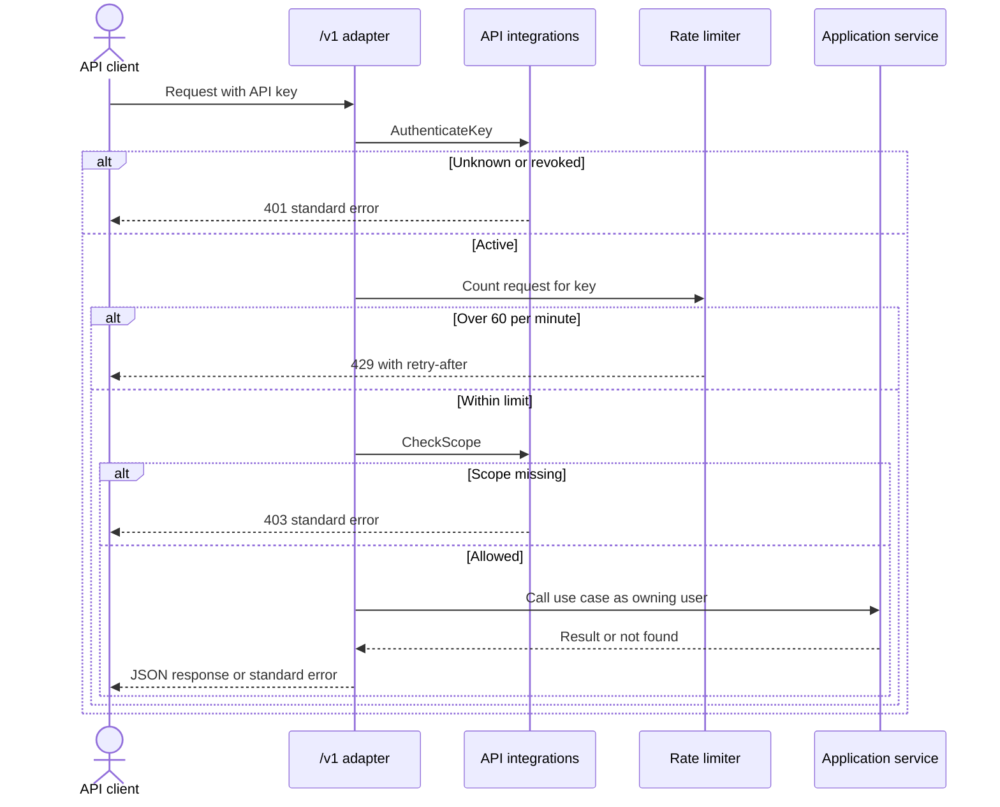
