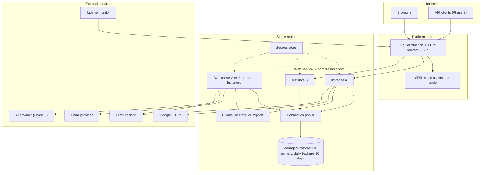

# Lumora Deployment Architecture

> Status: Proposal, pending approval. Source of truth: Phase 2 PRD and Phase 1 docs.

Platform decision: managed PaaS with managed PostgreSQL (D17, ADR-009). The vendor is not chosen (U-A1); this document is vendor-neutral and ends with the criteria used to pick one. No infrastructure code or configuration is written in this phase.

## 1. Topology

| Component | Role | Notes |
|---|---|---|
| Web service | Runs the Next.js application: pages, internal API, public API in Phase 3 | Stateless; at least 2 instances in production for availability (NFR-050) |
| Worker service | Runs pg-boss consumers from the same codebase (BACKGROUND-JOBS.md) | 1 instance at first; no public traffic |
| Managed PostgreSQL | Application data and job queue | Daily automated backups kept 30 days (NFR-100); point-in-time recovery if offered; TLS required |
| Connection pooler | Shares database connections among web and worker instances | Provided by the platform or run as a managed add-on |
| CDN and static hosting | Static assets and Phase 2 audio loops | Cache with long lifetimes and versioned names (R12) |
| Private file store | Export files, available 24 h | Object storage if the platform provides it; otherwise database-backed with the same interface (SYSTEM-ARCHITECTURE.md section 11) |
| Email provider | Password reset, invites, reminders | Behind the notifications port (U-A2) |
| Error tracking | Scrubbed error events | U-A7 |
| Secrets store | Runtime secrets per environment | NFR-019 |
| Uptime monitor | External checks of the sign-in page and a health endpoint | Evidence for NFR-050 |

## 2. Environments

| Environment | Purpose | Data | Deployment trigger |
|---|---|---|---|
| Local | Developer machine with a local PostgreSQL container and a fake email and AI provider | Seed data only | Manual |
| Preview | One short-lived environment per pull request for review and E2E smoke | Synthetic seed data; isolated database | Pull request opened or updated; destroyed on close |
| Staging | Production-like; load tests (NFR-002, NFR-003, NFR-070, NFR-072), restore drills (NFR-103), pre-release security checks (NFR-017) | Synthetic data, including a seeded account with 10,000 sessions and one with 100,000 sessions | Merge to main |
| Production | Real users | Real data; backups on | Manual approval after staging passes |

Real user data never enters local, preview or staging environments. Each environment has its own secrets, its own OAuth client, and its own email sender so that test emails cannot reach real users.

## 3. Configuration and secrets

- Behavioral configuration (defaults, limits) lives in the configuration module and is the same in all environments (SYSTEM-ARCHITECTURE.md section 16).
- Environment settings (database location, provider credentials, base URL) are injected from the secrets store at runtime. None is built into the client bundle (NFR-019).
- Feature availability by phase is controlled by configuration so Phase 2 and Phase 3 code can ship dark.

## 4. CI/CD pipeline

| Stage | Content | Gate |
|---|---|---|
| 1 Typecheck | Strict TypeScript across web, worker and tests | Must pass |
| 2 Lint and boundary check | Lint rules and the dependency rules from MODULE-BOUNDARIES.md section 8 (Phase 7 requirement) | Must pass; a boundary violation or cycle fails |
| 3 Unit tests | Domain rules, one or more tests per BR (NFR-061) | Must pass |
| 4 Integration tests | Against a PostgreSQL container: repositories, ownership contract tests for every resource (NFR-016), idempotency replay (NFR-053), concurrency (NFR-094) | Must pass |
| 5 End-to-end tests | Playwright against a preview deployment, covering AC-E2E-01..AC-E2E-10 plus axe accessibility checks; Chrome, Firefox, WebKit at desktop and 360 px widths (NFR-080, NFR-081, NFR-085, NFR-086) | Must pass |
| 6 Dependency scan | Vulnerability scan and client bundle secret inspection (NFR-018, NFR-019) | No unresolved critical or high at release |
| 7 Build | Container image for web and worker built once and promoted unchanged between environments | Must pass |
| 8 Deploy to staging | Automatic on merge; smoke checks after deploy | Health checks pass |
| 9 Migration step | Database migrations run as a distinct, ordered step before the new version receives traffic; owner and tooling are decided in Phase 4 (see D6). Only backwards-compatible migrations are allowed so the previous version can still run during rollout | Phase 4 decision |
| 10 Deploy to production | Manual approval; rolling deploy of web then worker, same version; automatic rollback on failed health check | Approval |
| 11 Post-deploy | Smoke test, uptime monitor green, error-rate check | Alert on failure |

Web and worker always ship from the same build so that module code and job handlers never diverge.

## 5. Scaling plan (NFR-070)

| Resource | MVP target | Growth action |
|---|---|---|
| Web instances | 2 instances, sized to serve 1,000 concurrent users with p95 reads under 300 ms and writes under 500 ms at 500 concurrent users (NFR-002) | Add instances; stateless design allows it |
| Timer polling load | Up to about 333 lightweight requests per second at 1,000 concurrent timing users (SYSTEM-ARCHITECTURE.md section 15) | Add instances; response caching per user; or adopt SSE (U-A5) |
| Worker | 1 instance | Add instances when queue age grows (BACKGROUND-JOBS.md section 7) |
| Database | Single primary sized for 5 million sessions; indexed access by user and date (NFR-070, NFR-071) | Increase instance size; add read replica for statistics; add pre-computed aggregates when p95 exceeds 700 ms; partition large session data (NFR-072) |
| Connections | Pooler limits total connections across web and worker | Raise pool size with database size; separate pools per service |
| Static assets | CDN | No action |

Load tests at the NFR-070 volumes run in staging before each major release (NFR-002, NFR-003, NFR-072).

## 6. Availability, backup and recovery

| Topic | Plan | Requirement |
|---|---|---|
| Availability target | 99.5% monthly excluding announced maintenance, which allows about 3.6 hours of downtime per 30-day month | NFR-050, U-5 |
| Redundancy | At least 2 web instances across availability zones when offered; managed database with automated failover if the plan includes it, otherwise restore as the recovery path | NFR-050 |
| Health checks | Liveness and readiness endpoints; platform restarts unhealthy instances | NFR-050 |
| Backups | Daily automated backups retained 30 days | NFR-100 |
| RPO | 24 hours or less (daily backups; point-in-time recovery would shorten it) | NFR-101, U-5 |
| RTO | 8 hours or less | NFR-102, U-5 |
| Restore drill | Quarterly: restore the latest backup into an isolated environment, measure time and data age, run the deleted-accounts re-purge and verify, record the result | NFR-103, NFR-104 |
| Deleted accounts after restore | The deletion register is replayed and a verification check confirms no deleted account is reachable before traffic resumes | NFR-104, NFR-031 |
| Maintenance windows | Announced in advance; counted outside the availability calculation | NFR-050 |
| Incident response | Alerts on error rate, latency, queue age, auto-close job misses and dead-letter jobs | NFR-050, NFR-051 |

## 7. Transport and network

TLS 1.2 or higher on all public endpoints, HTTP redirected to HTTPS, HSTS enabled (NFR-010). The database accepts connections only from the web and worker services over TLS. The private file store is not publicly addressable; downloads go through an authenticated route. Outbound calls use HTTPS.

## 8. Vendor-neutral checklist for choosing the PaaS (U-A1)

| Criterion | Required |
|---|---|
| Managed PostgreSQL | Current major version, extension support needed by the stack, TLS, connection pooling |
| Backups | Daily automated, 30-day retention, restore to a new instance, point-in-time recovery preferred (NFR-100..103) |
| Region | Region near the primary user base and compatible with the privacy policy; data stays in that region |
| Services | Separate worker service type that can run a long-lived process |
| Scaling | Horizontal scaling of web and worker without code change |
| Timeouts | Request time limits sufficient for the longest non-job request; no hard limits that break polling |
| Preview environments | Per-pull-request deployments with isolated databases |
| TLS and domains | Managed certificates with TLS 1.2+ (NFR-010) |
| Secrets | Per-environment secrets store |
| Availability SLA | Meets or approaches 99.5% for the combination of platform and database (NFR-050) |
| Portability | Container-based deploys; no proprietary runtime APIs required by the application |
| Cost | Predictable pricing at NFR-070 volumes; budget defined by the product owner |
| Observability | Log access, metrics, and log drain to a destination |
| Compliance | Data processing agreement available, relevant to NFR-030 and the privacy policy |

The default recommendation is to choose the vendor that meets every row marked required and has the lowest total cost at the NFR-070 volumes; the choice is recorded by updating ADR-009 once made.
