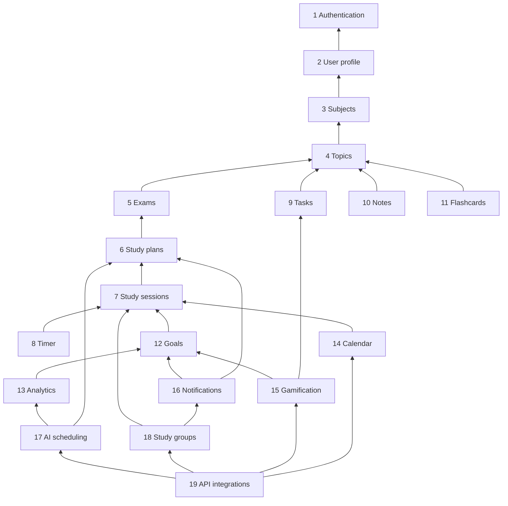

# Lumora Module Boundaries

> Status: Proposal, pending approval. Source of truth: Phase 2 PRD and Phase 1 docs.

The system is one deployable codebase divided into 19 modules. This document defines what each module owns, what it exposes, and what it may depend on. It does not define tables or code; persistence design is Phase 4. Rationale for the style is in [SYSTEM-ARCHITECTURE.md](SYSTEM-ARCHITECTURE.md) section 2 and ADR-003.

## 1. Layers and the dependency rule

| Layer | Modules | Purpose |
|---|---|---|
| Foundation | Authentication, User profile | Identity, timezone, account lifecycle |
| Catalog | Subjects, Topics | What the user studies; backbone every other feature attaches to |
| Activity | Study plans, Study sessions, Timer, Tasks, Notes, Exams, Flashcards | Things the user creates and does |
| Derived | Goals, Calendar, Analytics, Gamification | Values computed from activity |
| Composition | AI scheduling, Study groups, API integrations, Notifications | Features that combine modules or reach outside |

Fixed rules:

1. Dependencies are layered and acyclic. A lower layer never imports an upper layer. Within a layer, an explicit order (section 4) applies.
2. A module is used only through its public interface: named use cases and published event types. No module reads another module's persistence, internal domain types or repositories.
3. Cross-module effects that are not a direct query use domain events on an in-process bus. Events that start asynchronous work also write an outbox record in the same transaction (ADR-003, ADR-005).
4. Inversion points let lower layers call upward without importing upward (section 3).
5. Calendar and Analytics are read-only consumers: they never change activity data.
6. API integrations calls only public interfaces of other modules and adds no business rules of its own.

## 2. Module catalog

Phase column: MVP, 2, or 3 (when the module first ships features; a module may exist from MVP with later capabilities).

| Module | Responsibility | Owned concepts | Public interface (named use cases) | Allowed dependencies | Phase | FR range |
|---|---|---|---|---|---|---|
| Authentication | Sign-up, sign-in, sessions, password reset, lockout, auth audit log, current identity | Account credentials, sign-in sessions, lockout state, auth audit events | RegisterWithPassword, SignInWithPassword, SignInWithGoogle, SignOut, RequestPasswordReset, CompletePasswordReset, ListSignIns, RevokeSignIn, ResolveCurrentIdentity | none (uses the notifications port for reset email through an interface it defines) | MVP | FR-001..005, FR-008 |
| User profile | Display name, timezone, day-rollover hour, preferences, onboarding state, data export orchestration, account deletion and purge orchestration | Profile settings, onboarding progress, export requests, deletion requests | GetProfile, UpdateProfile, SetRolloverHour, GetUserClockContext, SetAppearance, RecordOnboardingStep, RequestExport, RequestAccountDeletion; registration points for export contributors and purge handlers | Authentication | MVP | FR-006, FR-007, FR-009, FR-130..132, FR-134..139 |
| Subjects | Subject lifecycle with archive and restore | Subject, order, color, archived flag | CreateSubject, EditSubject, ReorderSubjects, ArchiveSubject, RestoreSubject, ListSubjects; archive-guard registration | User profile | MVP | FR-010..014 |
| Topics | Topic lifecycle, weights, status, bulk paste | Topic, weight, status, order, archived flag | CreateTopic, EditTopic, ReorderTopics, BulkCreateTopics, ArchiveTopic, RestoreTopic, SetTopicStatus, ListTopics; events TopicArchived, TopicStatusChanged | Subjects | MVP | FR-015..019 |
| Exams | Exam date, topic checklist, countdown, archive, readiness | Exam, checklist membership, readiness value | CreateExam, EditExam, SetChecklist, TickTopic, GetCountdown, ListArchivedExams, ComputeReadiness | Subjects, Topics, User profile | MVP basic, 2 readiness | FR-120..128 |
| Study plans | Plan entries, overlap detection, past-entry rules, missed marking, exam-date warning | Plan entry, missed flag | CreatePlanEntry, EditPlanEntry, DeletePlanEntry, MarkMissed, CheckOverlap, ListPlanEntries, MovePlanEntry, ResizePlanEntry | Exams, Subjects, Topics, User profile | MVP, 2 drag-and-drop | FR-030..038, FR-065..069 (rules) |
| Study sessions | The core record: timer-sourced and manual sessions, edits, deletes, day-allocation, auto-close, idempotent save | Session, state, source, auto-closed flag, request key, frozen zone and local date | RecordSession, AddManualSession, EditSession, DeleteSession, AutoCloseIdleSessions, GetDayAllocations, ListSessions; events SessionCompleted, SessionEdited, SessionDeleted | Study plans, Subjects, Topics, User profile | MVP | FR-040..049 |
| Timer | Thin state machine over start, pause, resume, stop; heartbeat; one-running-timer rule; Pomodoro settings and classification; ambient audio preferences | Timer run state, settings, heartbeat, audio choice | StartTimer, PauseTimer, ResumeTimer, StopTimer, Heartbeat, GetTimerState, ConfirmReplace, UpdateTimerSettings, SetAudioPreference | Study sessions, Subjects, Topics, Study plans, User profile | MVP, 2 audio | FR-050..059, FR-180..184 |
| Tasks | To-dos with priority, due date, filter and sort | To-do | CreateTodo, EditTodo, DeleteTodo, SetTodoDone, ListTodos; event TodoCompleted | Subjects, Topics, User profile | MVP | FR-090..096 |
| Notes | Markdown notes per subject or topic, autosave, version conflicts, sanitization | Note, version | CreateNote, EditNote, ResolveConflict, RenderNote, DeleteNote, ListNotes | Subjects, Topics, User profile | MVP | FR-100..104 |
| Flashcards | Cards, daily review queue, rating, scheduling | Flashcard, rating history, next review date | CreateCard, EditCard, DeleteCard, GetReviewQueue, RateCard | Subjects, Topics, User profile | 2 | FR-107..112 |
| Goals | Daily and per-subject targets, progress, goal-met state, target history | Target, effective date, progress view | SetDailyGoal, SetSubjectGoal, GetProgress, GetGoalMetState, GetTargetForDay; event GoalMet | Study sessions, Subjects, User profile | MVP | FR-070..074 |
| Calendar | Read-only month heatmap, day detail, planned list | None (read models only) | GetMonthHeatmap, GetDayDetail, ListPlannedForRange | Study sessions, Study plans, Subjects, User profile | MVP | FR-060..062 |
| Analytics | Totals by day, week, month and subject, goal-hit rate, planned versus actual, statistics ranges | None (read models only; future pre-computed aggregates) | GetDailyTotals, GetWeeklyTotals, GetMonthlyTotals, GetTotalsBySubject, GetGoalHitRate, GetPlannedVsActual | Study sessions, Study plans, Goals, Subjects, Topics, User profile | MVP | FR-080..089 (and FR-024 data) |
| Gamification | Streaks, freezes, XP ledger, levels | Streak state, XP ledger entries, level | GetStreak, EvaluateDay, GetXpSummary, AwardForSession, AdjustForSessionChange, AwardForGoal, AwardForTodo | Study sessions, Goals, Tasks, User profile | 2 | FR-160..164, FR-170..177 |
| Notifications | Reminders, in-app notifications, push opt-in, email port, preferences | Notification, preference, push subscription | SendEmail (port), ScheduleReminders, ListNotifications, MarkRead, SetReminderPreferences | User profile, Study plans, Goals; consumes SessionCompleted and GoalMet events | MVP email port; 2 reminders | FR-150..154 (and FR-005, FR-201 delivery) |
| AI scheduling | Consent, quota, input assembly, provider call, validation, preview, accept | Generation request, consent record, usage count, proposal | RecordConsent, RevokeConsent, RequestSchedule, GetProposal, AcceptProposal, DiscardProposal | Study plans, Exams, Subjects, Topics, Analytics, User profile | 3 | FR-190..198 |
| Study groups | Groups, invites, membership, sharing preferences, weekly leaderboard, reporting | Group, membership, invite, sharing setting, leaderboard | CreateGroup, InviteMember, JoinGroup, LeaveGroup, RemoveMember, TransferAdministration, SetSharing, GetLeaderboard, ListMembers, ReportMember, DissolveGroup, RenameGroup | Study sessions, Notifications, User profile | 3 | FR-200..212 |
| API integrations | API keys, scopes, rate limit, versioned public adapters, standard error format | API key, scope set | CreateApiKey, ListApiKeys, RevokeApiKey, AuthenticateKey, CheckScope | Public interfaces of all other modules; User profile | 3 | FR-220..226 |

Notes on scope:

- **Dashboard (FR-020..024)** is a read-only view composed in the adapter layer from Goals, Timer, Study plans, Tasks and Analytics. It is not a module and owns no rules (PRD section 5.1).
- **Onboarding (FR-134..137)** is orchestrated in the adapter layer by calling Subjects, Goals and User profile; User profile records only progress.
- **Export (FR-130..132)** is orchestrated by User profile, which asks each registered module for its export contribution. Each module owns what is exported for its concepts.

## 3. Inversion points

Lower layers must sometimes react to facts known only by higher layers. They do so without importing upward, by defining a small contract and letting higher modules register an implementation at composition time.

| Contract owner | Contract | Registered by | Requirement |
|---|---|---|---|
| Subjects | Archive guard: "may this subject be archived now?" | Timer (a running session on that subject blocks archive) | EC-007 |
| User profile | Purge handler: "delete all of this user's data" | Every module that owns user data | BR-032, NFR-031, EC-019 |
| User profile | Export contributor: "provide this module's data for export" | Every module that owns exportable data | FR-130, NFR-032, EC-027 |
| Authentication | Notification port: "send password-reset email" | Notifications | FR-005 |
| Topics | Topic events: TopicArchived, TopicStatusChanged | Exams subscribes to drop archived topics from the readiness denominator | EC-008 |
| Study groups (Phase 3) | Membership removal on account deletion | Study groups via its purge handler | EC-018, EC-019 |

## 4. Dependency order and acyclicity proof

Each module has a rank. A module may depend only on modules of strictly lower rank. This is a topological order, so no cycle can exist.

| Rank | Module | Depends on (ranks) |
|---|---|---|
| 1 | Authentication | none |
| 2 | User profile | 1 |
| 3 | Subjects | 2 |
| 4 | Topics | 3 |
| 5 | Exams | 2, 3, 4 |
| 6 | Study plans | 2, 3, 4, 5 |
| 7 | Study sessions | 2, 3, 4, 6 |
| 8 | Timer | 2, 3, 4, 6, 7 |
| 9 | Tasks | 2, 3, 4 |
| 10 | Notes | 2, 3, 4 |
| 11 | Flashcards | 2, 3, 4 |
| 12 | Goals | 2, 3, 7 |
| 13 | Analytics | 2, 3, 4, 6, 7, 12 |
| 14 | Calendar | 2, 3, 6, 7 |
| 15 | Gamification | 2, 7, 9, 12 |
| 16 | Notifications | 2, 6, 12 (and event contracts of 7, 12) |
| 17 | AI scheduling | 2, 3, 4, 5, 6, 13 |
| 18 | Study groups | 2, 7, 16 |
| 19 | API integrations | 2 through 18 (public interfaces only) |

Check: for every row, all listed ranks are lower than the module's own rank. Event subscriptions follow the same direction: a module subscribes only to events published by a lower-rank module. Where information must flow from a higher rank to a lower rank, section 3 inversion points apply and the lower module owns the contract.

Specific decisions behind the order:

- **Timer depends on Study sessions, not the reverse.** Timer is a thin state machine; when a run completes it calls RecordSession with a client request key. Study sessions has no knowledge of the timer, so manual entries, edits and auto-close live there without a cycle (BR-011, FR-040, FR-048).
- **Study plans depends on Exams** to warn when an entry is scheduled after the exam date (FR-038, BR-025); Exams never reads plans.
- **Study sessions depends on Study plans** only to validate and store the optional link (FR-041, BR-003); plan deletion unlinks sessions through the plan module's event, not by editing sessions (EC-022).
- **Goals depends on Study sessions** for progress; Gamification depends on Goals for goal-met awards (FR-171).
- **Notifications** reacts to events (SessionCompleted, GoalMet) and reads plans and goals for reminders; no lower module depends on it except through the port in section 3.

## 5. Dependency diagram

The diagram shows the principal edges only; every module also depends on User profile for identity and timezone, and on Subjects and Topics where listed in section 2. Arrows point from dependent to dependency, so all arrows run toward lower ranks.

## 6. Domain events

| Event | Publisher | Consumers | Purpose |
|---|---|---|---|
| SessionCompleted | Study sessions | Goals (progress), Gamification (XP, streak), Analytics (cache invalidation when aggregates exist), Notifications (reminder suppression) | FR-040, FR-170..171, EC-017 |
| SessionEdited, SessionDeleted | Study sessions | Gamification (compensating adjustment), Goals | FR-043, FR-044, FR-177 |
| GoalMet | Goals | Gamification (daily goal XP, streak), Notifications | FR-171, FR-160 |
| TodoCompleted | Tasks | Gamification (High-priority XP) | FR-172 |
| TopicArchived, TopicStatusChanged | Topics | Exams | EC-008, FR-122 |
| PlanEntryDeleted | Study plans | Study sessions (unlink) | EC-022, BR-003 |
| ExamArchived | Exams (by the exam auto-archive job) | Notifications (stop exam reminders) | EC-013 |
| MemberLeft, GroupDissolved | Study groups | Notifications | EC-018 |

Events are delivered in-process within the originating transaction when the effect must be atomic (for example the XP ledger entry with the session save, EC-017). Effects that may be delayed are recorded as outbox records and executed as jobs.

## 7. Directory layout convention (prose; no files are created in this phase)

The repository has one top-level application. Inside it there is a directory per module. Each module directory has these sub-areas, named consistently:

- a public interface area (the only part other modules may import),
- a domain area (pure rules and entities),
- an application area (use cases and transactions),
- a persistence area (repository ports and their Drizzle adapters),
- an events area (published event types).

Separate top-level areas hold adapters (pages, route handlers, server actions, job handlers), shared kernel code (time module, configuration module, error envelope, result types, validation helpers, logger), and UI components. The shared kernel contains no business rules. Test directories mirror the module structure.

## 8. Boundary enforcement (requirement for Phase 7, not implemented now)

Enforcement is by tooling, not convention: a dependency-cruiser or ESLint boundaries configuration encodes the rank table in section 4, forbids imports other than a module's public interface area, and fails CI on a violation or on a cycle. The shared kernel may not import any module. Adapters may import any module's public interface. This requirement is recorded here so that Phase 7 includes the configuration in the first sprint.
