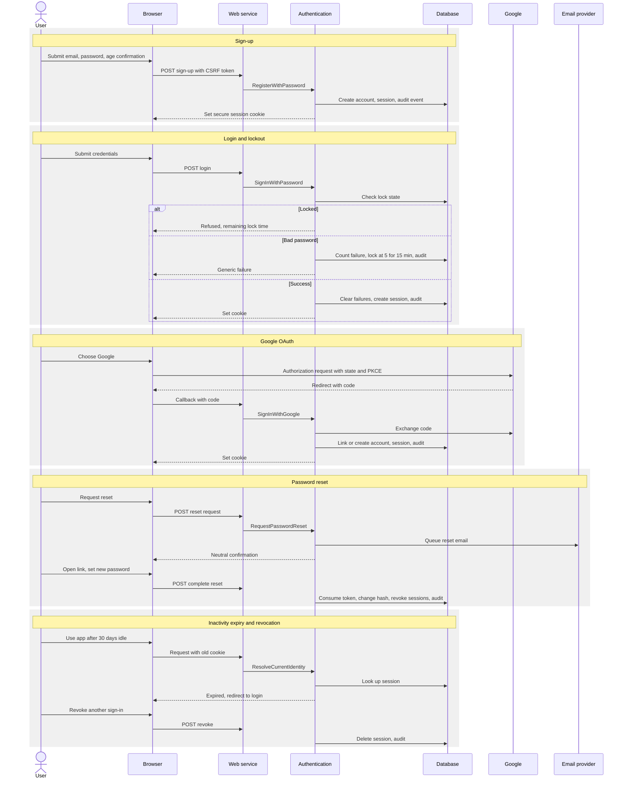

# Lumora Security Architecture

> Status: Proposal, pending approval. Source of truth: Phase 2 PRD and Phase 1 docs.

This document describes security mechanisms at architecture level. Implementation details, table design and concrete configuration belong to later phases. Technology choices are in [TECHNOLOGY-DECISIONS.md](TECHNOLOGY-DECISIONS.md) D7, D8, D10 and D20; error behavior is in [ERROR-HANDLING.md](ERROR-HANDLING.md).

## 1. Security objectives

1. No user can read or change another user's data (NFR-016, PG-6).
2. Credentials and personal data are protected in transit and at rest (NFR-010, NFR-011, NFR-019).
3. User-supplied content cannot execute in another browser or in the same one (NFR-014, NFR-015).
4. Authentication events are auditable (NFR-020) and abuse is rate limited (NFR-012, FR-222).
5. Privacy rights, export, deletion and consent, are enforced by design (NFR-031, NFR-032, NFR-035, NFR-036, NFR-037).

## 2. Authentication architecture

Authentication uses Better Auth inside the web service, with database-backed sessions (D7, ADR-004). The Authentication module exposes one capability to the rest of the system: "resolve the current identity from the request". No other module reads cookies or credentials.

| Capability | Design | Requirement |
|---|---|---|
| Password rules | At least 10 characters; stored only as a salted adaptive hash; a hash is never returned or logged | NFR-011, FR-001 |
| Google sign-in | OAuth authorization code flow with state and PKCE; the app stores the provider account link and email, no Google tokens beyond what sign-in needs | FR-003, NFR-030 |
| Session | Opaque random identifier in a cookie that is HttpOnly, Secure and SameSite; sessions are rows in the database that can be revoked | NFR-013, NFR-014 |
| Inactivity expiry | A session expires after 30 days without use; every use extends it | NFR-013 |
| Revocation | A user can list and revoke sign-ins; the session check hits the database on each request, so revocation takes effect within the 60 s requirement (immediately, bounded by any identity cache of at most 60 s) | NFR-013, FR-008 |
| Lockout | After 5 consecutive failed sign-ins on an account it is locked for 15 min; a locked account refuses even a correct password; the lock state is stored with the account and checked before verifying credentials | NFR-012 |
| Password reset | Single-use, time-limited token delivered by email through the notifications port; the response is identical whether or not the email exists; reset revokes other sessions | FR-005 |
| Age gate | Sign-up requires the 16+ confirmation (U-6) | NFR-035, FR-001 |
| Audit | Sign-in, failed sign-in, lockout, password reset, session revoke and account deletion write audit events retained 90 days | NFR-020 |

Risk and fallback: Better Auth is young. Before approval of Phase 7 work, a spike must prove NFR-012 (lockout) and NFR-013 (revocation within 60 s) against the library. If it cannot, Auth.js with custom lockout replaces it (ADR-004, U-A4).

## 3. Authorization model

Authorization is layered and defaults to deny.

| Layer | Check | Result on failure |
|---|---|---|
| Edge (route group guard) | An identity exists for `app` routes | Redirect to login with target preserved (FR-002); protected data returns an authentication error |
| Adapter | Required API key scope, Phase 3 | Standard authorization error (FR-225) |
| Application service | Role-based rule for group actions, Phase 3: administrator-only actions; last-administrator rule | Authorization error, or conflict for EC-018 rules |
| Repository | Every query is scoped to the owning user | Not found, identical to a missing record (NFR-016, USER-ROLES-AND-PERMISSIONS.md section 5) |

Rules:

1. Ownership checks live in the repository layer so that no code path can forget them. There is no repository function that reads by identifier alone.
2. Cross-user access returns not found, never forbidden (AC-E2E-10).
3. Group scoping (Phase 3): Group members see only the group name, member list and leaderboard fields each member opted in to share. Administrators gain management rights, not data access to subjects, notes, to-dos, plan entries or session details (USER-ROLES-AND-PERMISSIONS.md sections 2 and 3, NFR-037). Fields not shared are absent without a hint.
4. API keys act as exactly one user and never exceed that user's rights; a write scope includes read; revocation is immediate (R-2, FR-221, EC-026).
5. There is no in-app administrator. Operational access to production data is outside the product, limited to named staff, logged and governed by NFR-016, NFR-020 and NFR-030 (R-1).
6. An automated contract test iterates over every resource and asserts cross-user access returns not found; a failure is severity 1 (NFR-016).

## 4. CSRF and XSS strategy

| Threat | Strategy | Requirement |
|---|---|---|
| CSRF on state-changing requests | SameSite cookies, an anti-forgery token or origin header check on every state-changing request, and no state change on GET; server actions rely on framework origin checks plus the token; public API uses key headers and has no cookie authority | NFR-014 |
| Reflected and stored XSS | Output encoding by default in React; no raw HTML insertion except through the markdown pipeline; strict Content-Security-Policy with nonces; no inline event handlers | NFR-014, NFR-015 |
| Markdown notes | Rendering pipeline: markdown parse (remark), convert to HTML tree (rehype), sanitize with an allow-list (rehype-sanitize) that drops scripts, event handlers and unsafe URL schemes, add `rel` attributes to external links; sanitization runs on the server at render time, never trusted from stored content; tested against an XSS payload corpus with 0 failures | NFR-015, FR-101, ADR-007 |
| Clickjacking | Frame-ancestors none through CSP | NFR-014 |
| Content sniffing and referrer leaks | Standard security headers | NFR-014 |
| Third-party scripts | None for advertising or tracking | NFR-033 |

## 5. Secrets handling (NFR-019)

- Secrets (database credentials, session signing keys, OAuth client secret, email and AI provider keys) are held in the platform secrets store and injected at runtime; none is in the repository or in the build output delivered to the browser.
- Only variables explicitly marked public may reach the client bundle; a CI step inspects the shipped client bundle for secret patterns (NFR-019 verification).
- Separate secrets per environment; rotation procedure documented in Phase 7; the AI and email provider keys are usable only by the worker or server code.
- Logs and error reports are scrubbed of secrets, tokens and note content (NFR-063).

## 6. Transport security (NFR-010)

TLS 1.2 or higher on every connection, terminated by the platform; HTTP redirects to HTTPS; HSTS enabled; cookies are Secure. The database connection requires TLS. Outbound calls to Google, the email provider and the AI provider use HTTPS only.

## 7. Audit log

Authentication events listed in NFR-020 are written by the Authentication module with timestamp, event type, account reference, source IP and user agent (no passwords, no tokens). Records are retained 90 days; a daily retention job deletes older records (BACKGROUND-JOBS.md). Account deletion events are recorded without personal content beyond what retention requires, and the audit retention is aligned with purge requirements so that nothing identifying outlasts NFR-031 unless a documented legal reason applies (U-4 legal review note).

## 8. Privacy architecture

| Concern | Mechanism | Requirement |
|---|---|---|
| Data minimization | Fields are added only when an FR needs them; a release-time review compares collected fields to the FR list | NFR-030 |
| Deletion | A deletion request marks the account and revokes sessions at once; a purge job removes all personal data from every module through registered purge handlers within 30 days; running timer is discarded; group memberships are removed (EC-018, EC-019) | FR-007, NFR-031, BR-032 |
| Backups | Backups roll off at 30 days; deleted accounts are recorded in a deletion register that is replayed after any restore, before service resumes; the 35-day backup purge guarantee is met by retention of 30 days plus the replay | NFR-031, NFR-100, NFR-104 |
| Export | A user can export all of their own data as CSV and JSON; generated as a point-in-time snapshot; file available 24 h; sum of session durations reconciles with statistics | NFR-032, FR-130..132, EC-027, NFR-096 |
| Age gate | 16+ confirmation recorded at sign-up | NFR-035, U-6 |
| AI consent | Per-feature, revocable consent recorded before any outbound call; no call without it; data sent limited to exams, topics, hours and 4 weeks of history aggregates | NFR-036, FR-192 |
| Group sharing | Per-user, per-field opt-in; absent otherwise | NFR-037 |
| Analytics | If product analytics are added, events carry no name, email or free text and cannot be re-linked to an account | NFR-034 |
| Tracking | No advertising or cross-site tracking | NFR-033 |

## 9. API key security (Phase 3)

- A key is generated server-side with high entropy and shown exactly once at creation; only a hash plus a short non-secret hint are stored (NFR-021, FR-220).
- Keys are looked up by hash; comparison is constant-time.
- Scopes are per resource, read or write; checked in the adapter before any use case runs.
- Revocation is immediate: the next request is refused (EC-026, FR-226).
- Rate limit: 60 requests per minute per key, 429 with retry-after (FR-222, U-9).
- Keys never appear in logs; logs record only the key hint and request ID (NFR-063).

## 10. Rate limiting and abuse controls

| Endpoint class | Control | Source |
|---|---|---|
| Sign-in | Per-account lockout after 5 failures, plus a per-IP limit to slow credential stuffing against many accounts | NFR-012 |
| Password reset and sign-up | Per-IP and per-email limits behind the limiter port | FR-005 |
| Export requests | Limit on concurrent and daily export requests | FR-130 |
| AI generation | 5 per user per profile day | FR-196 |
| Public API | 60 requests per minute per key | FR-222 |
| General | A coarse per-IP limit on the whole app at the platform edge | NFR-050 |

The limiter sits behind a port; the MVP uses a Postgres-backed or in-memory implementation (D20).

## 11. Dependency and supply-chain scanning (NFR-018)

A vulnerability scan runs in CI for every pull request and again at release; no critical or high finding may remain unresolved at release. A lockfile is committed and installs are reproducible. New dependencies require a review note. Automated update proposals run weekly. The scan report is attached to each release.

## 12. OWASP ASVS Level 1 mapping (NFR-017)

| ASVS control family | Mechanism in this architecture | Section |
|---|---|---|
| V1 Architecture, design and threat modeling | This document, threat model in section 13, ADRs | 13 |
| V2 Authentication | Better Auth, password policy, lockout, reset, audit | 2 |
| V3 Session management | Database-backed revocable sessions, secure cookies, 30-day inactivity expiry | 2 |
| V4 Access control | Repository-level ownership, not-found rule, API scopes, group scoping | 3 |
| V5 Validation, sanitization and encoding | Shared Zod schemas, output encoding, markdown sanitization | 4 |
| V6 Stored cryptography | Adaptive password hashing; API keys hashed; platform-managed encryption at rest | 2, 9 |
| V7 Error handling and logging | Error envelope without internals, structured logs without secrets | ERROR-HANDLING.md |
| V8 Data protection | Minimization, no secrets in client, retention, deletion, export | 5, 8 |
| V9 Communication | TLS 1.2 or higher, HSTS | 6 |
| V10 Malicious code | Dependency scanning, no third-party tracking scripts | 11 |
| V11 Business logic | Idempotency keys, one running timer, rate limits, caps | SYSTEM-ARCHITECTURE.md section 14 |
| V12 Files and resources | No uploads; export files private and expiring | SYSTEM-ARCHITECTURE.md section 11 |
| V13 API and web service | Versioned API, key scopes, schema validation, standard errors | 9 |
| V14 Configuration | Secrets store, per-environment configuration, security headers | 5 |

The checklist audit before release (NFR-017 verification) walks these families.

## 13. Threat model

| Asset | Threat | Mitigation | Requirement |
|---|---|---|---|
| Account credentials | Credential stuffing, brute force | Lockout, per-IP limits, generic failure messages, audit | NFR-012, NFR-020 |
| Account credentials | Password database theft | Salted adaptive hashes, no reversible storage | NFR-011 |
| Sessions | Session theft or fixation | HttpOnly Secure SameSite cookies, new identifier at sign-in, revocation, inactivity expiry | NFR-013, NFR-014 |
| User data of other users | Insecure direct object reference | Repository-level ownership scoping, not-found, contract tests for every resource | NFR-016 |
| Notes content | Stored XSS through markdown | Allow-list sanitization on render, CSP, payload corpus tests | NFR-015 |
| Forms and actions | CSRF | SameSite, token or origin check | NFR-014 |
| API keys | Leak or theft | Hash only, shown once, scopes, rate limit, immediate revocation | NFR-021, EC-026 |
| Timer integrity | Forged durations or clock manipulation | Server timestamps only, client sends actions | NFR-090, EC-010 |
| Leaderboards | Fake sessions | Only server-recorded timer sessions of 5 min or more count | EC-025, BR-010 |
| Study data sent to AI provider | Unconsented disclosure | Consent gate in one adapter, aggregates only, revocable | NFR-036 |
| Group data | Over-sharing among members or to administrators | Per-field opt-in, administrators have no data rights | NFR-037, R-1 |
| Export files | Unauthorised download or long retention | Authenticated, ownership-checked route; expiry 24 h | FR-130..132 |
| Backups | Resurrection of deleted accounts | Deletion register replayed after restore | NFR-104, NFR-031 |
| Dependencies | Known vulnerabilities | Scanning in CI and at release | NFR-018 |
| Secrets | Exposure in client bundle or logs | Secrets store, bundle inspection, log scrubbing | NFR-019, NFR-063 |
| Availability | Request flooding | Edge limits, per-key limits, graceful degradation | NFR-050, FR-222 |
| Password reset | Account takeover via reset | Single-use short-lived token, identical responses, session revocation on reset | FR-005 |
| Operations staff | Excess access to production data | No in-app admin, least-privilege platform access, audit | R-1, NFR-016 |
