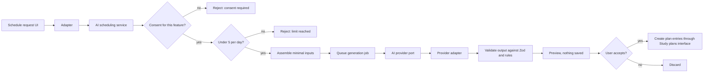
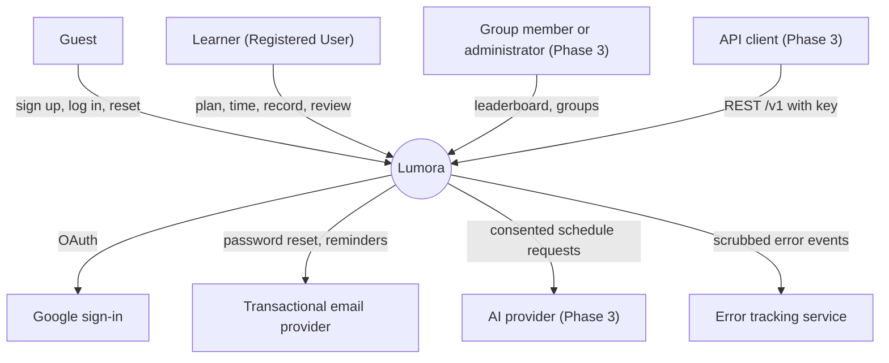
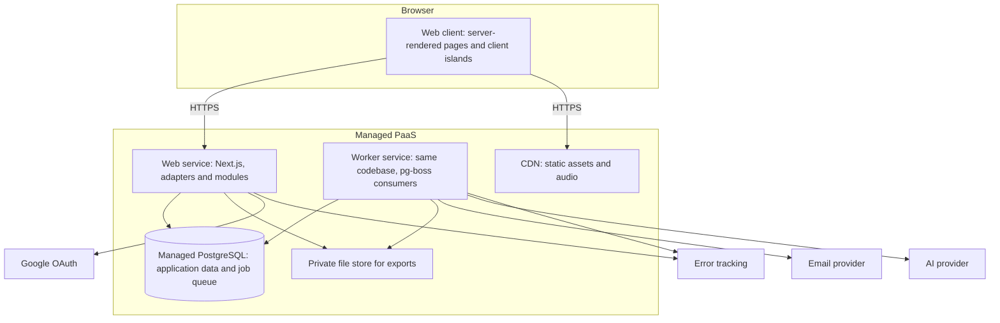
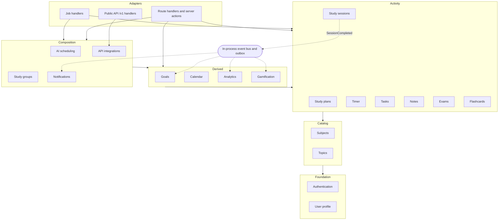

# Lumora System Architecture

> Status: Proposal, pending approval. Source of truth: Phase 2 PRD and Phase 1 docs.

Technology choices referenced here are justified in [TECHNOLOGY-DECISIONS.md](TECHNOLOGY-DECISIONS.md). Module names and dependency rules are in [MODULE-BOUNDARIES.md](MODULE-BOUNDARIES.md). No schema, table or column design appears here; that is Phase 4.

## 1. Overview and architectural drivers

Lumora is a responsive web application (no native apps, PRD section 4) used by one learner per account. The MVP is a single-user system; Phase 2 adds revision, gamification, drag-and-drop planning and reminders; Phase 3 adds AI scheduling, study groups and a public REST API.

The following requirements shape the architecture more than any others.

| Driver | Source | Architectural consequence |
|---|---|---|
| Timer accuracy within 2 s of server time, no tick-count durations | NFR-052, NFR-090, BR-012, EC-010 | Server timestamps are the only time source; the client sends actions, never durations. |
| No loss of a running session on refresh, tab close or network drop up to 30 min | NFR-051, EC-001, EC-028 | Timer state is persisted server-side at start, pause and resume; heartbeat every 60 s; scheduled auto-close. |
| One running timer per user, converging across devices within 5 s | BR-011, EC-002, EC-020, FR-059 | Server-authoritative timer; polling while a timer runs; atomic start. |
| Object-level authorization on every request | NFR-016 | Ownership scoping in the data access layer, not-found on cross-user access. |
| Idempotent writes | NFR-053, EC-017, EC-021 | Client request keys; uniqueness for XP awards. |
| UTC storage with frozen local date | NFR-091, BR-030, EC-006 | One time module; session stores zone and local date at start. |
| p95 300 ms reads and 500 ms writes at 500 concurrent users; statistics p95 1 s at 10,000 sessions | NFR-002, NFR-003, NFR-070 | Indexed access by user and date; pre-computed aggregates are a deferred option, not an MVP component. |
| Optimistic concurrency on editable records | NFR-094, EC-020 | Version carried in every editable record; stale saves rejected. |
| Accessibility, responsiveness, browser support | NFR-040..045, NFR-080..088 | Accessible primitives; server-rendered read pages; custom accessible timer and heatmap. |
| Data ownership, export, deletion | BR-032, NFR-031, NFR-032, NFR-104 | Purge job, export job, re-purge after restore. |
| Business rules testable and configurable | NFR-061, NFR-062 | Rules in domain modules with injected clock and configuration. |

## 2. Architecture style evaluation

| Criterion | Modular monolith | Microservices | Serverless functions |
|---|---|---|---|
| Fit for team size and product stage | Strong: one team, one product | Weak: operational overhead exceeds any benefit | Adequate |
| Cross-module consistency (session save with XP award, EC-017) | Strong: one transaction | Weak: needs sagas or eventual consistency | Adequate if one database |
| Timer acknowledgement within 200 ms (NFR-004) | Strong: warm instances | Adequate | Weak: cold starts |
| Database connection management | Strong: pooled, few instances | Adequate: many small pools | Weak: connection storms |
| Scalability to NFR-070 | Strong: horizontal web instances plus one database | Not needed | Strong |
| Testability | Strong: in-process, real database in CI | Adequate: contract tests needed | Adequate |
| Operability | Strong: two deployables | Weak | Adequate |
| Boundary enforcement | Needs tooling (dependency rules) | Enforced by network | Enforced by function boundaries |
| Future extraction | Strong if boundaries held | Not applicable | Adequate |

**Verdict: modular monolith.** One codebase, two runtime processes (web and worker), one database. Module boundaries are enforced by import rules and public interfaces, not by networks.

## 3. Extraction triggers

A module is extracted into its own service only when one of the following is observed and measured, never preemptively:

| Trigger | Example candidate | Condition |
|---|---|---|
| Independent scaling need | Analytics, public API | Its load forces the whole web tier to scale while other modules are idle, and cost is material. |
| Failure isolation | AI scheduling | Provider latency or errors endanger shared capacity even with the 30 s timeout (EC-016). |
| Different runtime or team | Possible future ML scheduling | A component requires another language or is owned by a separate team. |
| Security isolation | API integrations | Public traffic must be isolated from the authenticated web tier. |
| Database contention | Job queue | Queue polling measurably degrades p95 targets (NFR-002). |

Extraction is feasible because modules communicate through public interfaces and domain events only (MODULE-BOUNDARIES.md sections 1 and 6).

## 4. Frontend architecture

**Route groups.** Three groups share one application:

- `public`: landing, sign-up, login, password reset, Google callback. Guests only (FR-001..005).
- `app`: all authenticated pages (dashboard, subjects, plan, timer, calendar, statistics, to-dos, notes, exams, settings). A single guard redirects unauthenticated requests to login and preserves the target (FR-002, AC-E2E-10).
- `api`: route handlers for the internal API (consumed only by the web client, NFR-060) and, from Phase 3, the versioned public API under `/v1`.

**Server versus client components.**

| Surface | Rendering | Reason |
|---|---|---|
| Dashboard, statistics, calendar heatmap, exam list, to-do list | Server components with data passed down; interactive filters are client islands | LCP (NFR-001) and no secrets in the client (NFR-019) |
| Timer card, timer controls, ambient audio | Client component with the timer store | Instant feedback (NFR-004), audio autoplay rules (EC-024) |
| Forms | Client components with shared Zod schemas | Immediate field-level validation |
| Notes preview | Rendered with sanitization on the server | Single sanitization point (NFR-015) |

**Timer client store.** A small client store holds the server-provided start, pause and resume timestamps and the current server-time offset. The display is derived from `now minus start` every second; the count is never sent to the server (BR-012, EC-010). The store is rehydrated from the server on load, on tab focus and during polling.

**Heartbeat (EC-001).** While a timer runs the client sends a heartbeat every 60 s. A missed heartbeat does not stop the timer; the server decides closure (flow in APPLICATION-FLOWS.md section 6). If the network is down, the display keeps ticking from the stored start time and the client resynchronizes on reconnect (EC-028, NFR-051).

**Server-authoritative timer (EC-020).** The start, pause, resume and stop commands change server state and return the new authoritative state. The UI shows a pending state within 200 ms (NFR-004) and reconciles with the response.

**Accessibility.** Timer state changes are announced through a live region; the per-second count is not (NFR-044). Reduced-motion and color-scheme preferences are read from the browser and persisted preference (NFR-045, FR-138).

**Unsupported browsers.** A feature-detection check shows a notice instead of a broken page (NFR-082).

## 5. Backend layers

Dependencies point downward only.

| Layer | Responsibility | May depend on |
|---|---|---|
| Adapter (route handler, server action, worker job handler) | Authenticate, parse with shared schema, call one application service, map the result or error to the response envelope | Application service, error mapping |
| Application service (use case) | Own the transaction, orchestrate domain objects and repository ports, publish domain events, enforce idempotency keys and version checks | Domain, repository ports, other modules' public interfaces |
| Domain | Business rules as pure functions and entities (BR-001..BR-032); no I/O; clock and configuration are injected | Nothing outside the module's own domain |
| Repository port | Interface describing persistence the application service needs | Domain types |
| Repository adapter (Drizzle) | Implements the port; always scopes by owner | ORM, database |

Rules:

1. Adapters contain no business logic. A server action and the equivalent public API route call the same application service (Phase 3 `/v1` reuses internal use cases, section 9).
2. Application services own transactions. A repository never opens its own transaction when called inside a use case.
3. Domain code never reads the system clock; it receives a clock (NFR-090, testability).
4. All numeric defaults (Pomodoro, goal, XP, review limit) are read from the configuration module (section 16).
5. Domain events are published through an in-process bus; each event that triggers asynchronous work also writes an outbox record in the same transaction so the job is never lost (ADR-003, ADR-005).

## 6. Data access layer rules

- Every repository operation takes the owning user's identity and applies it to every query. There is no repository function that reads a record by identifier alone (NFR-016).
- A record that exists but belongs to another user is reported as not found, identical to a record that does not exist (USER-ROLES-AND-PERMISSIONS.md section 5, AC-E2E-10).
- Soft-deleted subjects and topics are included or excluded by explicit parameters: pickers exclude them; statistics include them labelled archived (BR-029, EC-007, NFR-093).
- Group-scoped reads (Phase 3) go only through the Study groups module, which returns only fields each member opted to share (NFR-037). No repository exposes another user's records to a group query.
- Writes that edit a record carry the expected version; the repository rejects stale versions (NFR-094, EC-020).
- Hard deletion happens only through the account purge (NFR-093, NFR-031).
- Statistics queries read in the user's local-day terms using the frozen local date on sessions (NFR-091).

## 7. Authentication architecture (summary)

Better Auth runs inside the application with database-backed sessions (D7). Application code never reads session cookies directly: the adapter layer resolves a "current user" and passes the user identity to application services. Lockout, audit and the age gate are application-owned and attached through the library's hooks. Details, the auth sequence diagram and the threat model are in [SECURITY-ARCHITECTURE.md](SECURITY-ARCHITECTURE.md); the decision and fallback are in ADR-004.

## 8. AI integration architecture (Phase 3)

- The AI scheduling module owns consent, daily usage count, input assembly and output validation (FR-190..198). It depends on Study plans, Exams, Subjects, Topics and Study sessions only through their public interfaces.
- The provider is reached only through a port with a single method "propose schedule" and a fixed 30 s timeout (EC-016, FR-197). The port is implemented by one provider adapter, chosen in U-A3.
- Output is untrusted. Each proposed entry is validated against all EC-015 rules before it reaches the preview. Rejected entries are counted, not shown as valid.
- Nothing persists until the user accepts; acceptance creates plan entries through the Study plans use case, which re-applies overlap warnings (BR-026).
- No outbound call occurs without recorded per-feature consent, which is revocable (NFR-036, FR-192). Prompts contain subject and topic names, exam dates and aggregated history only; no email, display name or notes content (NFR-030).
- A retry counts toward the 5-per-day limit only if a provider response was received (EC-015, EC-016).
- Generation runs as a background job so slow providers do not hold a web request (BACKGROUND-JOBS.md); the client polls the job state.

## 9. External API architecture (Phase 3)

| Aspect | Design |
|---|---|
| Version | Path prefix `/v1` (FR-223). Breaking changes require a new prefix. |
| Authentication | API key in a request header; keys are stored only as hashes and shown once (NFR-021, FR-220). A key resolves to exactly one owning user (R-2). |
| Authorization | Key scopes (read/write per resource, FR-221) checked in the adapter; ownership still enforced in the data access layer. A missing scope returns the standard error (FR-225). |
| Rate limit | 60 requests per minute per key (U-9, FR-222); 429 with a retry-after value (EC-026). |
| Revocation | Takes effect immediately for the next request (EC-026, FR-226). |
| Errors | Public envelope `{code, message, details}` mapped from the internal envelope (ERROR-HANDLING.md section 3). |
| Pagination, format | JSON with pagination (FR-224). |
| Documentation | OpenAPI 3.1 generated from the Zod schemas (D16). |
| Code sharing | `/v1` handlers are adapters over the same application services as the internal API. They never touch repositories directly. |
| Separation | Internal and public routes live in separate route trees, so internal routes are never accidentally documented or supported publicly (NFR-060). |

## 10. Background processing (summary)

A separate worker process of the same codebase consumes jobs from a PostgreSQL-backed queue (pg-boss). Handlers are adapters over application services, so business logic is not duplicated. Cron-style jobs handle auto-close, purge, archive and retention; event-driven jobs handle exports, reminders and AI generation. Full catalog in [BACKGROUND-JOBS.md](BACKGROUND-JOBS.md).

## 11. File and media storage

| Asset | Where | Reason |
|---|---|---|
| Ambient audio loops (Phase 2) | Static assets served by the CDN, self-hosted CC0 files | No third parties (NFR-033), licensing control (R12) |
| Export files (CSV, JSON) | Generated on demand by a job; stored privately (object storage, or temporary storage on the database if volumes are small) and available for 24 hours, then deleted (FR-130..132) | Point-in-time snapshot (EC-027), bounded retention |
| Notes | Database only; no attachments or images in the MVP | Simplicity and sanitization (NFR-015) |
| User uploads | None | Out of scope; reduces attack surface |

Export files are never publicly addressable: they are fetched through an authenticated route that checks ownership and expiry. Whether object storage is needed or whether a database-backed file suffices for the 10,000-session export (NFR-005) is a Phase 4/7 detail; the interface (file store port) is the same either way.

## 12. Logging and error handling (summary)

Every request has a request ID. Logs are structured, carry outcome and duration, and never include passwords, tokens, API keys or note content (NFR-063). Errors use one internal envelope and one stable code catalog, translated to user-facing messages at the edge. Full design in [ERROR-HANDLING.md](ERROR-HANDLING.md).

## 13. Time handling architecture

- All instants are stored in UTC (NFR-091, BR-030).
- A single time module is the only code that converts instants to local dates, using the user's IANA zone and day-rollover hour (BR-014, FR-009).
- Each session stores its zone and local date when it starts; they are never recomputed (EC-006). Today's progress counts sessions whose frozen local date equals today's date in the current zone.
- A session crossing local midnight is stored once and allocated to two days at read time using the frozen zone, so the displayed record is one session with two day-allocations (BR-016, EC-009, AC-E2E-05).
- Durations always come from stored start, end and pause timestamps taken on the server (BR-012, EC-010, NFR-090).
- DST days of 23 or 25 hours do not alter durations because they are UTC based (EC-006).
- The clock is an injected dependency, enabling tests with controlled time (D18).
- Jobs that depend on a user's local day (reminders, streak evaluation) compute the user's next boundary from their zone; they do not use a single global time (BACKGROUND-JOBS.md section 4).

## 14. Idempotency and concurrency

| Concern | Mechanism | Requirement |
|---|---|---|
| Duplicate session save (retry, double-click) | Client-generated request key stored with the session; same key returns the existing result | EC-021, FR-048, NFR-053 |
| Duplicate XP award | Uniqueness on user + source event + rule; repeat is a no-op; session edits and deletes add compensating entries | EC-017, FR-176, FR-177, NFR-095 |
| Two simultaneous timer starts | Atomic check-and-insert; first accepted wins; second gets the "Stop current session and start new?" prompt | EC-002, BR-011, FR-053 |
| Stale edits | Version carried in each editable record; compare-and-save; conflict error with the current record | EC-020, NFR-094 |
| Job re-delivery | Every job carries an idempotency key; handlers are safe to run twice | BACKGROUND-JOBS.md |
| Retry-after-timeout on writes | Writes accept a request key; clients retry with the same key (ERROR-HANDLING.md section 5) | NFR-053 |

The detailed decision is ADR-011.

## 15. Multi-device convergence (EC-020, FR-059)

Requirement: all clients converge on a timer change within 5 s. Decision: **poll every 3 s only while a timer is running, plus refetch on window focus and visibility change.** When no timer is running, no polling occurs.

| Option | Convergence | Cost | Verdict |
|---|---|---|---|
| Polling every 3 s while running | Worst case about 3 s plus latency, under 5 s | One light request per 3 s per running client; at 1,000 concurrent users, at most about 333 requests per second if all were timing, well within a small instance fleet | Chosen for MVP |
| Server-Sent Events | Near-instant | Long-lived connections per client, proxy and PaaS timeout behavior, reconnect handling | Phase 2 upgrade (U-A5) |
| WebSockets | Near-instant | Stateful infrastructure; not justified for a one-way notification | Rejected |

The polling response is a minimal timer-state payload (state, timestamps, version) designed to be cacheable at the instance level. U-A5 stays open until load testing shows whether polling cost matters.

## 16. Configuration architecture (NFR-062)

A single configuration module defines every tunable value with its default and range: Pomodoro defaults (BR-009), idle limit of 30 min (BR-006), heartbeat interval 60 s, short-session thresholds of 1 min and 5 min (BR-007, BR-008), manual entry caps of 24 h (EC-011), daily goal default and range (BR-013), XP values and cap (BR-017, BR-018), level thresholds (U-2), review limit 50 (U-3), group cap 20 (U-3), AI daily limit 5 (U-4), API rate limit 60 per minute (U-9), export expiry 24 h, lockout 5 failures and 15 minutes (NFR-012). Domain and validation code read from this module only. Environment-specific secrets and endpoints are separate, are injected at runtime, and are never delivered to the browser (NFR-019). Changing a value changes all behavior that depends on it (NFR-062 verification).

## 17. Diagrams

### 17.1 System context

### 17.2 Container architecture

### 17.3 Component (module) architecture

The precise allowed-dependency table and acyclicity proof are in MODULE-BOUNDARIES.md.

### 17.4 Deployment overview

The deployment topology, environments and pipeline are in [DEPLOYMENT-ARCHITECTURE.md](DEPLOYMENT-ARCHITECTURE.md); the container diagram above shows runtime relationships.
