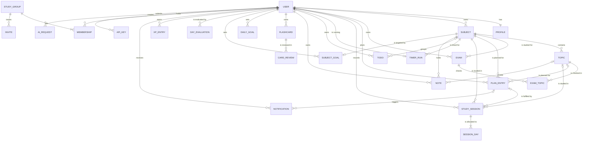

# Conceptual ERD

> Status: Proposal, pending approval. Source of truth: Phase 2 PRD and Phase 1 docs.

Entities and relationships only, with no attributes. Use this view to check that the model covers the product. Attributes are in [LOGICAL-ERD](LOGICAL-ERD.md), types and constraints in [PHYSICAL-ERD](PHYSICAL-ERD.md). Design rules are in [DATABASE-DESIGN](DATABASE-DESIGN.md).

The entity `STUDY_GROUP` is the table `groups`; the name avoids the SQL keyword. Authentication tables, exports, settings tables, the outbox, idempotency keys and rate-limit counters are infrastructure and omitted from this view.

## Relationships with optionality

| Relationship | Reading |
| --- | --- |
| USER to PROFILE | A user has exactly one profile; a profile belongs to exactly one user. |
| USER to SUBJECT | A user owns zero or many subjects; a subject belongs to exactly one user. |
| SUBJECT to TOPIC | A subject contains zero or many topics; a topic belongs to exactly one subject. |
| SUBJECT to EXAM | An exam is for exactly one subject; a subject may have zero or many exams (BR-023). |
| EXAM to EXAM_TOPIC to TOPIC | An exam checks zero or many topics of its own subject; a topic may appear in zero or many exams (FR-122). |
| PLAN_ENTRY to SUBJECT, TOPIC | A plan entry has exactly one subject and zero or one topic. |
| PLAN_ENTRY to STUDY_SESSION | A plan entry may have zero or many sessions; a session has zero or one plan entry (BR-003, EC-022). |
| STUDY_SESSION to SESSION_DAY | A session is allocated to one or many local days; a day row belongs to exactly one session (BR-016). |
| STUDY_SESSION to SUBJECT, TOPIC | A session has exactly one subject and zero or one topic. |
| USER to TIMER_RUN | A user has zero or one active timer; a timer run belongs to exactly one user (BR-011). |
| TIMER_RUN to SUBJECT | A timer run is for exactly one subject; a subject may have zero or many runs, but at most one per user. |
| TODO to SUBJECT | A to-do has zero or one subject; a subject groups zero or many to-dos. |
| NOTE to SUBJECT, TOPIC | A note has exactly one subject and zero or one topic. |
| FLASHCARD to CARD_REVIEW | A card has zero or many reviews; a review belongs to exactly one card. |
| USER to DAILY_GOAL | A user has one or many dated goal rows (history by effective date, BR-015). |
| SUBJECT to SUBJECT_GOAL | A subject has zero or one target per user (BR-013). |
| USER to DAY_EVALUATION | A user has zero or many evaluated days (BR-020..022). |
| USER to XP_ENTRY | A user has zero or many XP entries (BR-017..019). |
| PLAN_ENTRY to NOTIFICATION | A plan entry has zero or one reminder; a daily reminder has no plan entry (FR-150, FR-151). |
| USER to MEMBERSHIP to STUDY_GROUP | A user may belong to many groups; a group has one or many members, at least one an admin (R7). |
| STUDY_GROUP to INVITE | A group issues zero or many invites; an invite belongs to exactly one group. |
| USER to API_KEY | A user holds zero to ten active keys plus any revoked ones (FR-220). |
| USER to AI_REQUEST | A user submits zero or many requests, at most one pending (EC-016). |

## Ownership rule

Every entity except STUDY_GROUP is owned by exactly one USER. Deleting the user removes the owned entities (BR-032). STUDY_GROUP survives while any membership remains.
