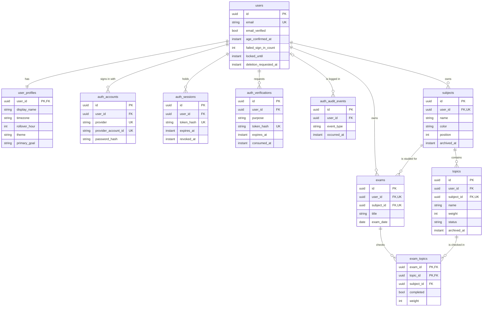
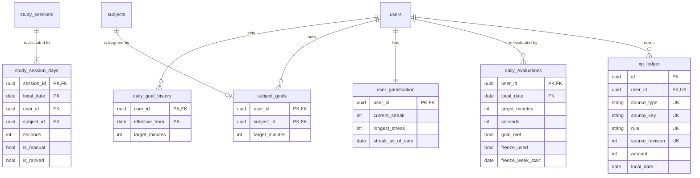

# Logical ERD

> Status: Proposal, pending approval. Source of truth: Phase 2 PRD and Phase 1 docs.

Entities with business attributes, logical types, keys and cardinality. No vendor types. Physical types, every column and the constraint detail are in [PHYSICAL-ERD](PHYSICAL-ERD.md) and [DATA-DICTIONARY](DATA-DICTIONARY.md). Entity overview: [CONCEPTUAL-ERD](CONCEPTUAL-ERD.md).

Logical types: `uuid`, `string`, `int`, `decimal`, `date`, `time`, `instant` (a UTC moment), `bool`, `json`, `binary`. Standard audit columns (`created_at`, `updated_at`, `version`) are left out of the diagrams; see the dictionary for which tables carry them. Markers: `PK` primary key, `FK` foreign key, `UK` unique. Relationship lines use crow's foot: `||` exactly one, `|o` zero or one, `o{` zero or many, `|{` one or many.

The model is split in four layers so each diagram stays readable. An entity drawn without attributes in a layer is defined in another layer.

## Layer 1. Foundation and catalog

Identity, profile, subjects, topics and exams.

Cross-layer notes: `subjects` and `topics` are referenced by layers 2, 3 and 4 through composite keys (subject with owner, topic with subject). `users` is referenced by every user-owned entity.

## Layer 2. Activity

What the user plans, does and writes.

```mermaid
erDiagram
    subjects ||--o{ plan_entries : "is planned for"
    topics |o--o{ plan_entries : "is planned for"
    subjects ||--o{ study_sessions : "is studied in"
    topics |o--o{ study_sessions : "is studied in"
    plan_entries |o--o{ study_sessions : "is fulfilled by"
    users |o--o| timer_runs : "is running"
    subjects ||--o{ timer_runs : "is timed for"
    plan_entries |o--o{ timer_runs : "is timed against"
    timer_runs ||--o{ timer_run_segments : "consists of"
    subjects |o--o{ todos : "groups"
    subjects ||--o{ notes : "holds"
    topics |o--o{ notes : "holds"
    users ||--o{ flashcards : "owns"
    flashcards ||--o{ card_reviews : "is reviewed in"

    plan_entries {
        uuid id PK
        uuid user_id FK, UK
        uuid subject_id FK
        uuid topic_id FK
        instant starts_at
        int duration_min
        string timezone
        date local_date
        instant missed_at
    }
    study_sessions {
        uuid id PK
        uuid user_id FK, UK
        uuid subject_id FK
        uuid topic_id FK
        uuid plan_entry_id FK
        string source
        string mode
        instant started_at
        instant ended_at
        int duration_seconds
        int pomodoros_completed
        bool auto_closed
        string timezone
        date local_date
        int day_rollover_hour
        string request_key UK
    }
    timer_runs {
        uuid id PK
        uuid user_id FK, UK
        uuid subject_id FK
        uuid topic_id FK
        uuid plan_entry_id FK
        string mode
        string state
        string phase
        instant phase_ends_at
        instant started_at
        instant last_heartbeat_at
    }
    timer_run_segments {
        uuid run_id PK, FK
        int seq PK
        instant started_at
        instant ended_at
    }
    timer_settings {
        uuid user_id PK, FK
        int focus_min
        int break_min
        int long_break_min
        int cycles_before_long_break
        string audio_loop
        int audio_volume
    }
    todos {
        uuid id PK
        uuid user_id FK
        uuid subject_id FK
        uuid topic_id FK
        string title
        date due_date
        string priority
        bool done
        instant completed_at
    }
    notes {
        uuid id PK
        uuid user_id FK
        uuid subject_id FK
        uuid topic_id FK
        string title
        string body
    }
    flashcards {
        uuid id PK
        uuid user_id FK
        uuid subject_id FK
        uuid topic_id FK
        string front
        string back
        date due_date
        int interval_days
        decimal ease
    }
    card_reviews {
        uuid id PK
        uuid card_id FK
        uuid user_id FK
        string rating
        instant reviewed_at
        date local_date
        string request_key UK
    }
```

Cross-layer notes: `timer_settings` and `flashcard_settings` are one-row-per-user settings tables keyed by `user_id`; the latter is omitted here for size (see the dictionary). A timer run is deleted when it stops, so a finished timer exists only as a `study_sessions` row.

## Layer 3. Derived and goal data

Targets, per-day allocation, streak and XP.

Cross-layer notes: `xp_ledger.source_key` refers to a session, to-do or date by value and has no foreign key, so removing the source never removes XP. `study_session_days` is rewritten whenever its session's times change.

## Layer 4. Composition, integration and system

Groups, notifications, AI, API access, exports and the shared kernel.

```mermaid
erDiagram
    users ||--o{ group_members : "holds"
    groups ||--|{ group_members : "has"
    groups ||--o{ group_invites : "issues"
    groups ||--o{ group_reports : "receives"
    users ||--o{ api_keys : "creates"
    users ||--o{ ai_consents : "decides"
    users ||--o{ ai_generation_requests : "submits"
    users ||--o{ notifications : "receives"
    plan_entries |o--o{ notifications : "triggers"
    users ||--o{ push_subscriptions : "registers"
    users ||--o{ data_exports : "requests"
    users ||--o{ idempotency_keys : "retries with"

    groups {
        uuid id PK
        string name
        int max_members
        uuid created_by FK
    }
    group_members {
        uuid group_id PK, FK
        uuid user_id PK, FK
        string role
        instant joined_at
        bool share_weekly_minutes
    }
    group_invites {
        uuid id PK
        uuid group_id FK
        uuid created_by FK
        string token_hash UK
        instant expires_at
        instant revoked_at
        uuid accepted_by_user_id FK
        instant accepted_at
    }
    group_reports {
        uuid id PK
        uuid group_id FK
        uuid reporter_user_id FK
        uuid target_user_id FK
        string reason
    }
    api_keys {
        uuid id PK
        uuid user_id FK
        string name
        binary key_hash UK
        string last4
        json scopes
        instant revoked_at
    }
    ai_consents {
        uuid id PK
        uuid user_id FK
        string feature
        bool granted
        string wording_version
        instant decided_at
    }
    ai_generation_requests {
        uuid id PK
        uuid user_id FK
        string status
        json params
        json proposal
        date quota_local_date
        bool counts_toward_quota
        instant accepted_at
    }
    notifications {
        uuid id PK
        uuid user_id FK
        string kind
        uuid plan_entry_id FK
        instant due_at
        date local_date
        instant delivered_at
        instant dismissed_at
    }
    push_subscriptions {
        uuid id PK
        uuid user_id FK
        string endpoint UK
    }
    data_exports {
        uuid id PK
        uuid user_id FK
        string format
        string status
        instant snapshot_at
        string file_key
        instant expires_at
    }
    idempotency_keys {
        uuid user_id PK, FK
        string scope PK
        string key PK
        string request_hash
        instant expires_at
    }
```

Cross-layer notes: `notification_preferences` (one row per user), `outbox_events`, `rate_limit_counters` and `account_deletion_log` have no relationships drawn: the first is a settings row keyed by `user_id`; the last three deliberately carry no foreign key to `users` (NFR-104 for the log, aged out by time for the others). `notifications.plan_entry_id` references a plan entry in layer 2.
