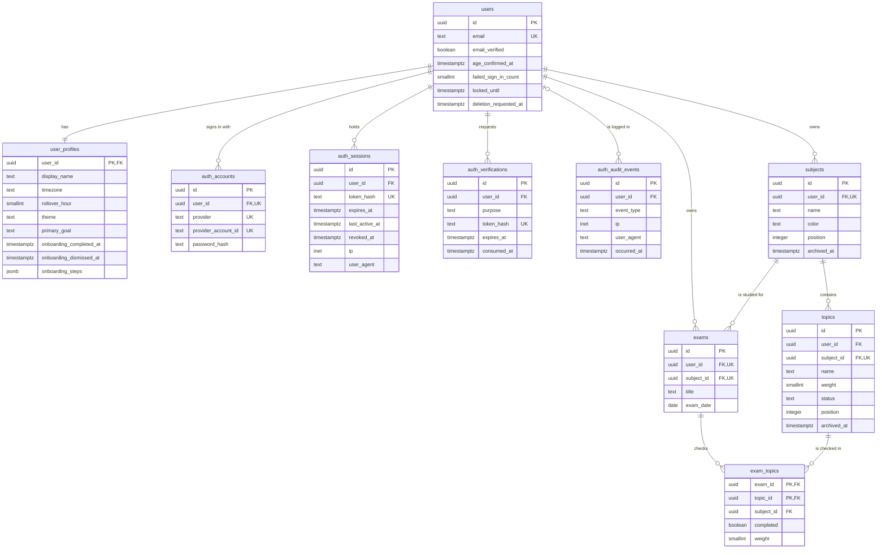
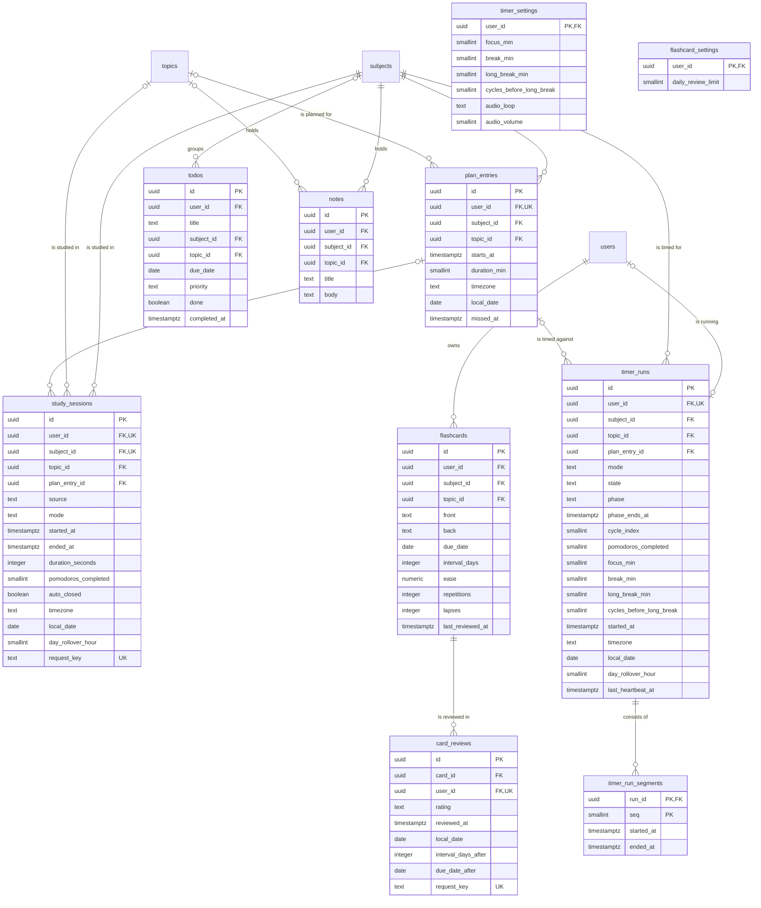
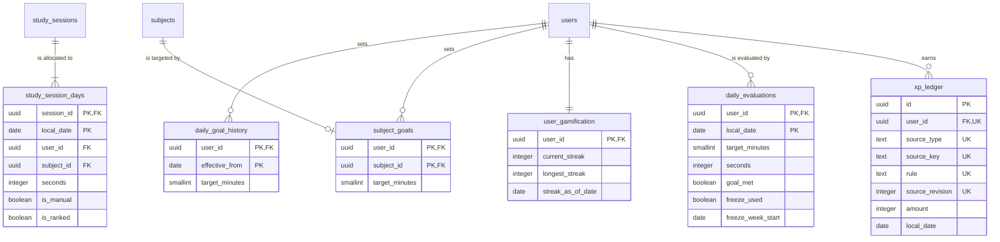

# Physical ERD

> Status: Proposal, pending approval. Source of truth: Phase 2 PRD and Phase 1 docs.

PostgreSQL 15 or newer tables, as they will be created in Phase 7 (MVP tables only are migrated then; Phase 2 and 3 tables are marked). Same four layers as [LOGICAL-ERD](LOGICAL-ERD.md). Full column constraints are in [DATA-DICTIONARY](DATA-DICTIONARY.md), constraint semantics in [DATABASE-CONSTRAINTS](DATABASE-CONSTRAINTS.md), index rationale in [INDEXING-STRATEGY](INDEXING-STRATEGY.md).

## Reading the diagrams

- Types are PostgreSQL types. `uuid` primary keys are UUIDv7 generated by the application.
- Markers: `PK`, `FK`, `UK`. A `UK` marker also covers partial and composite unique constraints; the exact form is in the lists below each diagram.
- Standard columns are not drawn. Every table has `created_at timestamptz NOT NULL DEFAULT now()` except `auth_audit_events`, `rate_limit_counters` and `account_deletion_log`, where the column list is complete as drawn. Mutable tables also have `updated_at timestamptz NOT NULL DEFAULT now()`. Tables marked (V) in the dictionary also have `version integer NOT NULL DEFAULT 1`.
- Nullability is not drawn. The dictionary is the source for NULL and defaults.
- Composite foreign keys are drawn as one `FK` marker per member column. The pattern is in DATABASE-CONSTRAINTS section 6.

## Layer 1. Foundation and catalog

Constraints (see DATABASE-CONSTRAINTS for names and requirements):

- Unique: `lower(users.email)`; `auth_accounts (provider, provider_account_id)` and `(user_id, provider)`; `subjects (id, user_id)`; partial unique `subjects (user_id, lower(btrim(name))) WHERE archived_at IS NULL`; `topics (id, subject_id)`; `exams (id, user_id)` and `(id, subject_id)`.
- Foreign keys: all `user_id` CASCADE; `topics (subject_id, user_id) -> subjects (id, user_id)` NO ACTION; `exams (subject_id, user_id) -> subjects` NO ACTION; `exam_topics (exam_id, subject_id) -> exams (id, subject_id)` CASCADE; `exam_topics (topic_id, subject_id) -> topics (id, subject_id)` NO ACTION.
- Check: `auth_accounts (provider = 'credential') = (password_hash IS NOT NULL)`; length and range checks per dictionary.

Indexes: `ix_auth_sessions_user`, `ix_auth_sessions_expires`, `ix_auth_verifications_user`, `ix_auth_verifications_expires`, `ix_auth_audit_user_time`, `ix_auth_audit_time`, `ix_subjects_user_position`, `ix_topics_subject_position`, `ix_topics_user`, `ix_exams_user_date`, `ix_exams_subject`, `ix_exam_topics_topic`.

## Layer 2. Activity

`flashcards`, `card_reviews` and `flashcard_settings` are Phase 2. `flashcards.ease` is `numeric(4,2)`.

Constraints:

- Unique: `plan_entries (id, user_id)`; `study_sessions (user_id, request_key)` and `(id, user_id, subject_id)`; `timer_runs (user_id)`; partial `timer_run_segments (run_id) WHERE ended_at IS NULL`; `card_reviews (user_id, request_key)`.
- Exclusion: `study_sessions EXCLUDE USING gist (user_id WITH =, tstzrange(started_at, ended_at, '[)') WITH &&)`.
- Foreign keys: composite subject/topic keys on every table that has them, all NO ACTION; `study_sessions` and `timer_runs` `(plan_entry_id, user_id) -> plan_entries (id, user_id) ON DELETE SET NULL (plan_entry_id)`; `timer_run_segments.run_id` and `card_reviews.card_id` CASCADE.
- Check (selected): `study_sessions` `ended_at > started_at`, `duration_seconds BETWEEN 60 AND 86400`, `duration_seconds <= extract(epoch from (ended_at - started_at))`, `(source = 'manual') = (mode IS NULL)`; `timer_runs (mode = 'pomodoro') = (phase IS NOT NULL)`; `todos done = (completed_at IS NOT NULL)`; `todos topic_id IS NULL OR subject_id IS NOT NULL`.

Indexes: `ix_study_sessions_user_started`, `ix_study_sessions_plan_entry`, `ix_study_sessions_subject`, `ix_study_sessions_topic`, GiST index of the exclusion constraint, `ix_plan_entries_user_starts`, `ix_plan_entries_user_date`, `ix_plan_entries_subject`, `ix_plan_entries_topic`, `ix_timer_runs_heartbeat`, `ix_timer_runs_subject`, `ix_timer_runs_topic`, `ix_timer_runs_plan_entry`, `ix_todos_user_list`, `ix_todos_open_due`, `ix_todos_subject`, `ix_todos_topic`, `ix_notes_user_subject`, `ix_notes_subject`, `ix_notes_topic`, `ix_flashcards_user_due`, `ix_flashcards_subject`, `ix_flashcards_topic`, `ix_card_reviews_user_date`, `ix_card_reviews_card`.

## Layer 3. Derived and goal data

`user_gamification`, `daily_evaluations` and `xp_ledger` are Phase 2. `study_session_days`, `daily_goal_history` and `subject_goals` are MVP.

Constraints:

- Foreign keys: `study_session_days (session_id, user_id, subject_id) -> study_sessions (id, user_id, subject_id) ON DELETE CASCADE ON UPDATE CASCADE`; `subject_goals (subject_id, user_id) -> subjects (id, user_id)` NO ACTION; all `user_id` CASCADE. `xp_ledger.source_key` has no foreign key.
- Unique: `uq_xp_ledger_award (user_id, source_type, source_key, rule, source_revision)`; partial `daily_evaluations (user_id, freeze_week_start) WHERE freeze_used`.
- Check: `study_session_days seconds > 0 AND seconds <= 86400`; `xp_ledger amount <> 0`; `daily_evaluations freeze_used = (freeze_week_start IS NOT NULL)`; `target_minutes BETWEEN 5 AND 1440` on goal tables.
- Grants: `xp_ledger` has no UPDATE or DELETE for the application role.

Indexes: `ix_study_session_days_user_date`, `ix_study_session_days_user_subject_date`, `ix_study_session_days_ranked`, `ix_subject_goals_subject`, `ix_xp_ledger_user_date`, `ix_xp_ledger_user_amount`.

## Layer 4. Composition, integration and system

```mermaid
erDiagram
    users ||--o{ group_members : "holds"
    groups ||--|{ group_members : "has"
    groups ||--o{ group_invites : "issues"
    groups ||--o{ group_reports : "receives"
    users ||--o{ api_keys : "creates"
    users ||--o{ ai_consents : "decides"
    users ||--o{ ai_generation_requests : "submits"
    users ||--o{ notifications : "receives"
    plan_entries |o--o{ notifications : "triggers"
    users ||--o{ push_subscriptions : "registers"
    users ||--o{ data_exports : "requests"
    users ||--o{ idempotency_keys : "retries with"
    users ||--|| notification_preferences : "configures"

    groups {
        uuid id PK
        text name
        smallint max_members
        uuid created_by FK
    }
    group_members {
        uuid group_id PK, FK
        uuid user_id PK, FK
        text role
        timestamptz joined_at
        boolean share_weekly_minutes
    }
    group_invites {
        uuid id PK
        uuid group_id FK
        uuid created_by FK
        text token_hash UK
        text email
        timestamptz expires_at
        timestamptz revoked_at
        uuid accepted_by_user_id FK
        timestamptz accepted_at
    }
    group_reports {
        uuid id PK
        uuid group_id FK
        uuid reporter_user_id FK
        uuid target_user_id FK
        text reason
    }
    api_keys {
        uuid id PK
        uuid user_id FK
        text name
        bytea key_hash UK
        char last4
        jsonb scopes
        timestamptz revoked_at
        timestamptz last_used_at
    }
    ai_consents {
        uuid id PK
        uuid user_id FK
        text feature
        boolean granted
        text wording_version
        timestamptz decided_at
    }
    ai_generation_requests {
        uuid id PK
        uuid user_id FK
        text status
        jsonb params
        timestamptz provider_responded_at
        boolean counts_toward_quota
        date quota_local_date
        jsonb proposal
        smallint entries_removed
        timestamptz proposal_expires_at
        timestamptz accepted_at
    }
    notification_preferences {
        uuid user_id PK, FK
        boolean daily_reminder_enabled
        time daily_reminder_time
        boolean plan_reminder_enabled
        smallint plan_reminder_lead_min
    }
    notifications {
        uuid id PK
        uuid user_id FK
        text kind
        uuid plan_entry_id FK
        timestamptz due_at
        date local_date
        text body
        timestamptz delivered_at
        timestamptz dismissed_at
        timestamptz push_attempted_at
    }
    push_subscriptions {
        uuid id PK
        uuid user_id FK
        text endpoint UK
        text p256dh
        text auth
        text user_agent
        timestamptz last_used_at
    }
    data_exports {
        uuid id PK
        uuid user_id FK
        text format
        text status
        timestamptz snapshot_at
        smallint progress_percent
        text file_key
        bigint file_bytes
        timestamptz expires_at
        text error_code
        timestamptz completed_at
    }
    idempotency_keys {
        uuid user_id PK, FK
        text scope PK
        text key PK
        text request_hash
        smallint response_status
        jsonb response_body
        timestamptz expires_at
    }
    outbox_events {
        bigint id PK
        text job_name
        text idempotency_key UK
        jsonb payload
        timestamptz relayed_at
    }
    rate_limit_counters {
        text bucket PK
        timestamptz window_start PK
        integer hits
    }
    account_deletion_log {
        uuid user_id PK
        timestamptz requested_at
        timestamptz purged_at
    }
```

Phase: `notification_preferences`, `notifications`, `push_subscriptions` Phase 2; `ai_consents`, `ai_generation_requests`, `groups`, `group_members`, `group_invites`, `group_reports`, `api_keys` Phase 3; the remaining tables MVP. `outbox_events`, `rate_limit_counters` and `account_deletion_log` have no foreign key. `rate_limit_counters` is `UNLOGGED`. `outbox_events.id` is `GENERATED ALWAYS AS IDENTITY`.

Constraints:

- Foreign keys: `notifications (plan_entry_id, user_id) -> plan_entries (id, user_id) ON DELETE CASCADE`; `group_members`, `group_invites`, `group_reports` `group_id` CASCADE; `groups.created_by`, `group_invites.accepted_by_user_id`, `group_reports.reporter_user_id` SET NULL; all other `user_id` CASCADE.
- Unique: `uq_notifications_daily`, `uq_notifications_plan`, `uq_ai_requests_pending`, `uq_data_exports_running` (partial forms in DATABASE-CONSTRAINTS section 4); `api_keys (key_hash)`; `outbox_events (idempotency_key)`; `push_subscriptions (endpoint)`.
- Check: `data_exports (status = 'completed') = (file_key IS NOT NULL)`; `api_keys jsonb_typeof(scopes) = 'object'`; `groups max_members BETWEEN 2 AND 100`.

Indexes: `ix_group_members_user`, `ix_group_invites_group`, `ix_group_invites_created_by`, `ix_group_invites_accepted_by`, `ix_group_reports_group`, `ix_group_reports_target`, `ix_group_reports_reporter`, `ix_groups_created_by`, `ix_api_keys_user`, `ix_ai_consents_user_feature`, `ix_ai_requests_user_quota`, `ix_notifications_user_due`, `ix_notifications_due_undelivered`, `ix_notifications_plan_entry`, `ix_push_subscriptions_user`, `ix_data_exports_user`, `ix_data_exports_expires`, `ix_idempotency_expires`, `ix_outbox_unrelayed`.

## Cross-layer reference

| From (layer) | To (layer) | Columns |
| --- | --- | --- |
| Activity | Foundation | `subject_id`, `topic_id`, `user_id` composite keys |
| Derived | Activity | `study_session_days.session_id` to `study_sessions` |
| Composition | Activity | `notifications.plan_entry_id` to `plan_entries` |
| All | Foundation | `user_id` to `users(id)` |
