# Information Architecture

> Status: Proposal, pending approval. Source of truth: Phase 1 to 4 docs.

This file fixes the page inventory, route map, hierarchy and phase gating for Lumora. Page IDs defined here are the shared contract: PAGE-SPECIFICATIONS.md, NAVIGATION-STRUCTURE.md and RESPONSIVE-DESIGN.md refer to pages by these IDs. Route groups follow `docs/03-architecture/SYSTEM-ARCHITECTURE.md` section 4 (public and app). Several routes below extend that list (decision U-D8, see DESIGN-PRINCIPLES.md).

## 1. Candidate page decisions

Reason for this table: the brief lists candidate pages by generic names; each is checked against the written requirements so that no page exists without a requirement behind it.

| Candidate | Decision | Reason |
|---|---|---|
| Dashboard | Include `/dashboard` | FR-020 to FR-024 define it. |
| Today | Merge into Dashboard | The Dashboard is today-centric by definition (FR-020 to FR-024); a second page would duplicate it. |
| Study Calendar | Include `/calendar` | FR-060 to FR-062; Phase 2 adds the week view (FR-065 to FR-069). |
| Subjects, Subject Details | Include `/subjects`, `/subjects/[id]` | FR-010 to FR-019 and FR-071. |
| Study Sessions | Include `/sessions` | FR-042 to FR-044 need a place to list, add manually, edit and delete sessions. Extends SYSTEM-ARCHITECTURE section 4 (decision U-D8). |
| Study Goals | No page. The daily goal is one setting in Settings > Study and a dialog from the Dashboard goal card; the per-subject goal lives in Subject details | FR-070 to FR-074 define one number plus optional per-subject numbers, not a feature area. |
| Tasks | Include as "To-dos" at `/todos` | Matches FR-090 to FR-096 and BR-031 wording. |
| Notes | Include `/notes`, `/notes/[id]` | FR-100 to FR-104. |
| Flashcards | Gated, Phase 2: `/flashcards`, `/flashcards/review` | FR-107 to FR-112. |
| Analytics | Name it "Statistics" at `/statistics` | FR-080 to FR-089 use the word statistics. |
| Exams | Include `/exams`, `/exams/[id]` | FR-120 to FR-125. |
| Study Groups | Gated, Phase 3: `/groups`, `/groups/[id]`, `/groups/join/[token]` | FR-200 to FR-212. |
| Settings | Include `/settings/...` | FR-006 to FR-009, FR-057, FR-070, FR-130 to FR-135, FR-138, plus Phase 2 and 3 additions. |
| Plan list | Include `/plan` (second tab of Calendar) | FR-030 to FR-038; the list view is FR-037. |
| AI schedule | Gated, Phase 3: `/plan/generate`, `/plan/generate/preview` | FR-190 to FR-198. |
| Onboarding | Include `/onboarding` | FR-134 to FR-137. |

## 2. Route inventory

Columns: Page ID, Name, Route, Group, Phase, Requirements. Requirements are the primary IDs only; PAGE-SPECIFICATIONS.md lists the full set per page.

### 2.1 Public (guests only)

| Page ID | Name | Route | Group | Phase | Requirements |
|---|---|---|---|---|---|
| PU-1 | Entry | `/` | Public | MVP | FR-002 |
| PU-2 | Sign up | `/signup` | Public | MVP | FR-001, NFR-035 |
| PU-3 | Log in | `/login` | Public | MVP | FR-002, FR-004 |
| PU-4 | Forgot password | `/forgot-password` | Public | MVP | FR-005 |
| PU-5 | Reset password | `/reset-password` | Public | MVP | FR-005 |
| PU-6 | Confirm age and timezone (first Google sign-in) | `/signup/confirm` | Public | MVP | FR-003 |

### 2.2 System pages

| Page ID | Name | Route | Group | Phase | Requirements |
|---|---|---|---|---|---|
| SY-1 | Not found | rendered for any unknown route and for another user's record id | System | MVP | NFR-016 |
| SY-2 | Something went wrong | rendered on unhandled error | System | MVP | NFR-016 |
| SY-3 | Unsupported browser notice | static notice, no route of its own | System | MVP | NFR-082 |

### 2.3 App, MVP

| Page ID | Name | Route | Group | Phase | Requirements |
|---|---|---|---|---|---|
| A-1 | Onboarding | `/onboarding` | App | MVP | FR-134 to FR-137 |
| A-2 | Dashboard | `/dashboard` | App | MVP | FR-020 to FR-024 |
| A-3 | Timer | `/timer` | App | MVP | FR-050 to FR-059 |
| A-4 | Sessions | `/sessions` | App | MVP | FR-040 to FR-049, FR-088 |
| A-5 | Calendar (month) | `/calendar` | App | MVP | FR-060 to FR-062 |
| A-6 | Plan list | `/plan` | App | MVP | FR-030 to FR-038 |
| A-7 | Subjects | `/subjects` | App | MVP | FR-010 to FR-019 |
| A-8 | Subject details | `/subjects/[id]` | App | MVP | FR-010 to FR-019, FR-071 |
| A-9 | To-dos | `/todos` | App | MVP | FR-090 to FR-096 |
| A-10 | Notes | `/notes` | App | MVP | FR-100, FR-104 |
| A-11 | Note editor | `/notes/[id]` | App | MVP | FR-100 to FR-103 |
| A-12 | Exams | `/exams` | App | MVP | FR-120 to FR-125 |
| A-13 | Exam details | `/exams/[id]` | App | MVP | FR-120 to FR-125 |
| A-14 | Statistics | `/statistics` | App | MVP | FR-080 to FR-089 |
| A-15 | Settings | `/settings/profile`, `/settings/study`, `/settings/appearance`, `/settings/security`, `/settings/data` | App | MVP | FR-006 to FR-009, FR-057, FR-070, FR-130 to FR-135, FR-138 |

### 2.4 App, Phase 2 (gated)

| Page ID | Name | Route | Group | Phase | Requirements |
|---|---|---|---|---|---|
| B-1 | Calendar week planner | `/calendar/week` | App | Phase 2 | FR-065 to FR-069 |
| B-2 | Flashcards | `/flashcards` | App | Phase 2 | FR-107 to FR-110 |
| B-3 | Flashcard review | `/flashcards/review` | App | Phase 2 | FR-111, FR-112 |
| B-4 | Settings, notifications | `/settings/notifications` | App | Phase 2 | FR-150 to FR-154 |

Phase 2 additions inside existing pages (no new route):

| Addition | Host page | Requirements |
|---|---|---|
| Ambient audio panel | A-3 Timer | FR-180 to FR-184 |
| Streak and XP strip | A-2 Dashboard | FR-160 to FR-164, FR-170 to FR-177 |
| Readiness arc | A-13 Exam details | FR-126 to FR-128 |
| Reminder bell with notification popover | Header (app shell) | FR-152 |

### 2.5 App, Phase 3 (gated)

| Page ID | Name | Route | Group | Phase | Requirements |
|---|---|---|---|---|---|
| C-1 | Generate schedule | `/plan/generate` | App | Phase 3 | FR-190 to FR-198 |
| C-2 | Schedule preview | `/plan/generate/preview` | App | Phase 3 | FR-190 to FR-198 |
| C-3 | Groups | `/groups` | App | Phase 3 | FR-200, FR-201 |
| C-4 | Group details | `/groups/[id]` | App | Phase 3 | FR-203 to FR-212 |
| C-5 | Join group | `/groups/join/[token]` | App | Phase 3 | FR-202 |
| C-6 | Settings, AI consent | `/settings/ai-consent` | App | Phase 3 | FR-190 to FR-198 |
| C-7 | Settings, API keys | `/settings/api-keys` | App | Phase 3 | FR-220 to FR-226 |

Reason for gating: only shipped features appear in navigation, and there are no "coming soon" entries. Phase 2 and 3 pages are specified now so that MVP structures (tabs, settings list, nav groups) leave room for them without redesign.

## 3. Page hierarchy

```mermaid
flowchart TD
  ROOT[Lumora]
  ROOT --> PUB[Public: guests only]
  ROOT --> APP[App: signed in]
  ROOT --> SYS[System pages]

  PUB --> PU1[PU-1 Entry]
  PUB --> PU2[PU-2 Sign up]
  PUB --> PU3[PU-3 Log in]
  PUB --> PU4[PU-4 Forgot password]
  PUB --> PU5[PU-5 Reset password]
  PU2 --> PU6[PU-6 Confirm age and timezone]

  SYS --> SY1[SY-1 Not found]
  SYS --> SY2[SY-2 Something went wrong]
  SYS --> SY3[SY-3 Unsupported browser]

  APP --> A1[A-1 Onboarding]
  APP --> TOP[Top]
  APP --> PLAN[Plan]
  APP --> LIB[Library]
  APP --> REV[Review]
  APP --> SOC[Social, Phase 3]
  APP --> FOOT[Footer]

  TOP --> A2[A-2 Dashboard]
  TOP --> A3[A-3 Timer]

  PLAN --> CAL[Calendar]
  CAL --> A5[A-5 Month]
  CAL --> A6[A-6 Plan list]
  CAL --> B1[B-1 Week, Phase 2]
  A6 --> C1[C-1 Generate schedule, Phase 3]
  C1 --> C2[C-2 Schedule preview, Phase 3]
  PLAN --> A9[A-9 To-dos]
  PLAN --> A12[A-12 Exams]
  A12 --> A13[A-13 Exam details]

  LIB --> A7[A-7 Subjects]
  A7 --> A8[A-8 Subject details]
  LIB --> A10[A-10 Notes]
  A10 --> A11[A-11 Note editor]
  LIB --> B2[B-2 Flashcards, Phase 2]
  B2 --> B3[B-3 Flashcard review, Phase 2]

  REV --> A4[A-4 Sessions]
  REV --> A14[A-14 Statistics]

  SOC --> C3[C-3 Groups]
  C3 --> C4[C-4 Group details]
  C3 --> C5[C-5 Join group]

  FOOT --> A15[A-15 Settings]
  A15 --> S1[Profile]
  A15 --> S2[Study]
  A15 --> S3[Appearance]
  A15 --> S4[Security]
  A15 --> S5[Data]
  A15 --> B4[B-4 Notifications, Phase 2]
  A15 --> C6[C-6 AI consent, Phase 3]
  A15 --> C7[C-7 API keys, Phase 3]
```

Reason: the app groups follow the core loop (Plan, Study, Record, Review, Revise) so the sidebar reads in the order a student works. Exact nav labels and breakpoint behavior are in NAVIGATION-STRUCTURE.md.

## 4. Object model: screens to features

| Object | Created in | Listed or edited in | Read in |
|---|---|---|---|
| Subject, Topic | A-7, A-8, A-1 | A-7, A-8 | A-2, A-3, A-5, A-6, A-9, A-10, A-12, A-14 |
| Plan entry | A-6, A-5 (day panel), A-2 (next plan), B-1 | A-6, A-5, B-1 | A-2, A-3 (link to planned session), A-14 |
| Study session | A-3, A-2 start form, A-4 (manual) | A-4 | A-2, A-5, A-14 |
| Daily goal | A-1, A-15 Study, A-2 goal dialog | A-15 Study, A-2 | A-2, A-14 |
| Per-subject goal | A-8 | A-8 | A-2, A-14 |
| Task | A-9, A-2 (tick only) | A-9 | A-2 |
| Note | A-8 (New note), A-10 | A-11 | A-8, A-10 |
| Exam | A-12 | A-12, A-13 | A-2, A-6 (date warning, FR-038), A-13 |
| Flashcard (Phase 2) | B-2 | B-2 | B-3 |
| Group (Phase 3) | C-3 | C-4 | C-3, C-5 |
| API key (Phase 3) | C-7 | C-7 | C-7 |
| Preferences (theme, timezone, timer durations) | A-15 | A-15, A-3 (timer durations dialog) | App-wide |
| Export | A-15 Data | A-15 Data | A-15 Data |

Reason: each object has exactly one primary editing page, so users learn one place per kind of data; other pages link to it.

## 5. Core loop to screens

| Loop stage | Screens | Phase |
|---|---|---|
| Plan | A-7 Subjects, A-6 Plan list, A-5 Calendar, A-12 Exams, A-9 To-dos | MVP |
| Study | A-2 Dashboard start form, A-3 Timer | MVP |
| Record | A-3 post-session panel, A-4 Sessions, A-10 Notes | MVP |
| Review | A-2 Dashboard, A-14 Statistics, A-5 Calendar | MVP |
| Revise | A-12 Exams (A-13 Exam details), B-2 Flashcards and B-3 Flashcard review | Exams MVP, Flashcards Phase 2 |

Reason: PRODUCT-VISION requires a session to start in 3 interactions or fewer, so the Study stage has two entry points (Dashboard form and Timer page) and the Dashboard remembers the last subject and mode.

## 6. Phase gating rules

1. A nav item, tab, button or link to a gated page renders only when that route ships and works. Reason: no "coming soon" entries.
2. Inside MVP pages, Phase 2 and 3 panels (audio, streak and XP, readiness arc, reminder bell) are absent, not disabled.
3. Settings sections are added to the Settings list as their phase ships: Notifications (Phase 2), AI consent and API keys (Phase 3).
4. The Calendar tab strip is Month and Plan list in the MVP; Week is added in Phase 2.
5. The Groups nav group is absent until Phase 3.

## 7. URL conventions

| Rule | Detail | Source |
|---|---|---|
| Format | Lowercase kebab-case path segments. | Reason: predictable and readable. |
| Detail pages | Opaque id segment (`[id]`, `[token]`), never a name or slug. | Reason: names are editable and may contain personal data. |
| Guest on an app URL | Redirect to `/login`; the original target is preserved and restored after sign-in. | FR-002 |
| Signed-in user on `/`, `/login`, `/signup` | Redirect to `/dashboard`. | Reason: signed-in users have no use for the entry pages. |
| Another user's record id | Render SY-1 Not found, identical to a missing record. | NFR-016 |
| Settings | One route per section under `/settings/`; `/settings` redirects to `/settings/profile`. | Reason: each section is linkable and keeps its own heading. |
| Calendar tabs | `/calendar` (Month), `/plan` (Plan list), `/calendar/week` (Week, Phase 2) share one tab strip. | Reason: plan and calendar are two views of the same entries. |
| Page titles | "<Page name> · Lumora" (details in NAVIGATION-STRUCTURE.md). | Reason: unique titles per page. |
