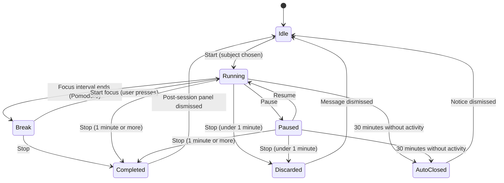
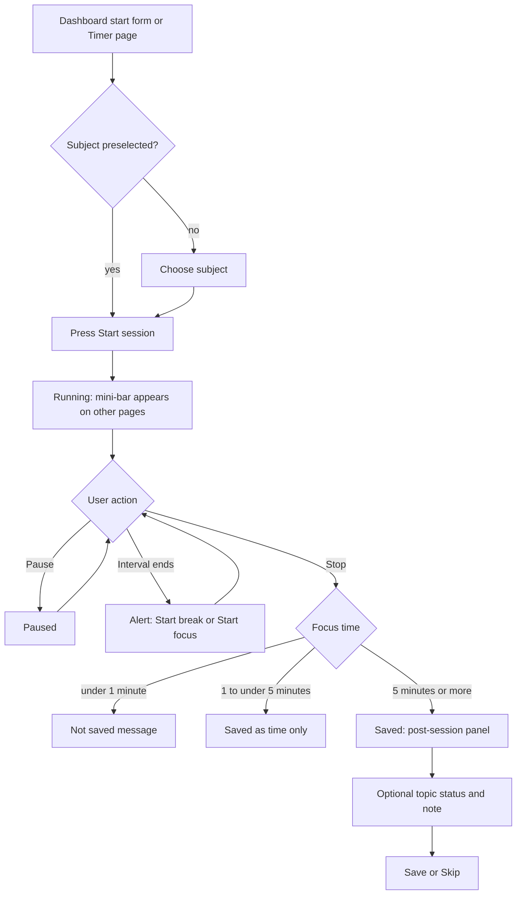
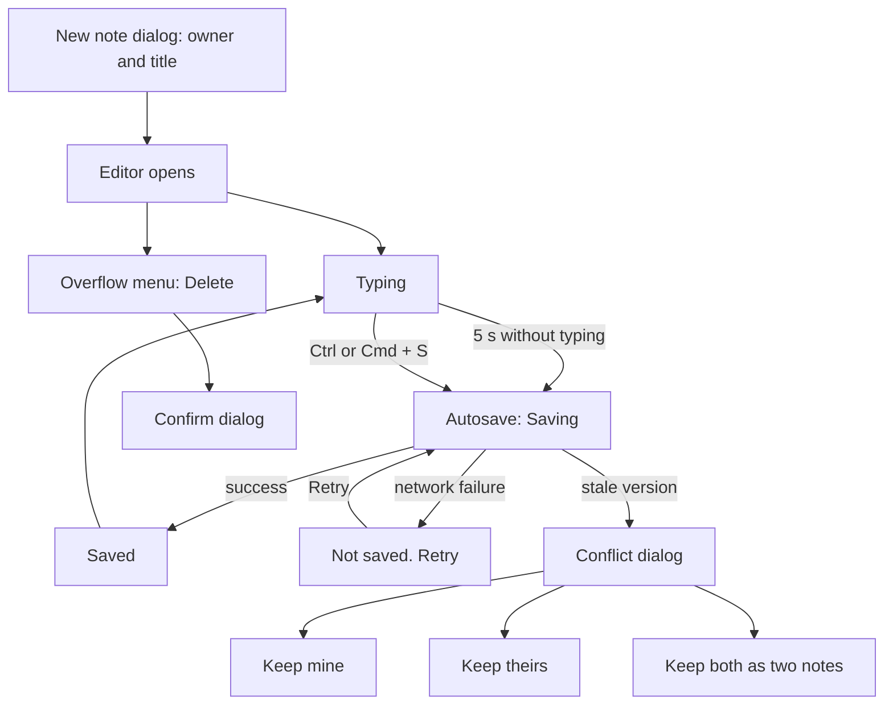
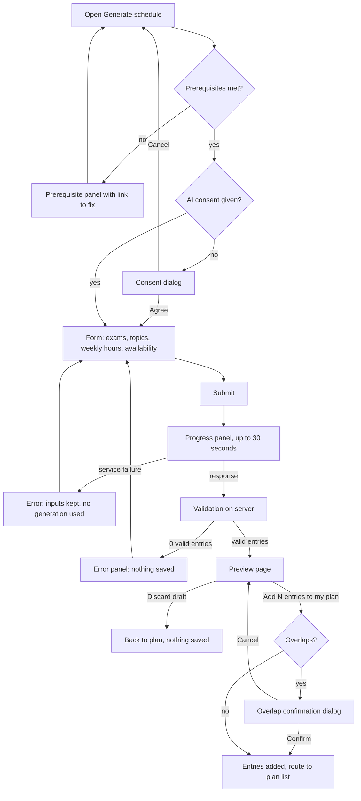

# Interaction Specifications

> Status: Proposal, pending approval. Source of truth: Phase 1 to 4 docs.

This file defines how Lumora behaves under input: trigger, states, pointer, touch, keyboard, screen reader announcements, errors and reduced motion. Page layout is in PAGE-SPECIFICATIONS.md, tokens are in DESIGN-SYSTEM.md and COLOR-TYPOGRAPHY.md, assistive technology rules are in ACCESSIBILITY.md. Page IDs refer to INFORMATION-ARCHITECTURE.md.

## Conventions used by every interaction

- **Pending within 200 ms.** Every action that writes to the server shows a pending state on the control within 200 ms (NFR-004). Reason: the server is the truth, so the UI shows "working" immediately and reconciles after.
- **Announcements.** All announcements go through the single global polite live region, except errors, which use the alert region. Reason: one region avoids duplicate or competing speech (NFR-044).
- **Reduced motion.** Lumora already uses only 0 or 120 ms color and opacity transitions. Under prefers-reduced-motion every transition becomes 0 ms, and no interaction below relies on motion to convey meaning (NFR-045). Each interaction repeats this in a one-line note only where something specific changes.
- **Touch and pointer.** Targets are at least 44 px under 1024 px and for coarse pointers (NFR-087). No interaction is hover-only or gesture-only.
- **Errors.** Error text says what happened and what to do, uses the catalog wording from ERROR-HANDLING.md, and never interrupts a running timer.
- **Copy.** Sentence case, no exclamation marks, no emoji, verb plus object on buttons.

## 1. Calendar drag-and-drop (Phase 2)

Requirements: FR-065, FR-066, FR-067, FR-068, FR-069, NFR-042, NFR-041, BR-026. Page: B-1 Calendar week planner.

Reason for three paths: a drag is never the only way to do anything (WCAG 2.5.7, NFR-042), so pointer drag, keyboard move mode and an edit form are equivalent.

| Path | Who it serves | Entry |
|---|---|---|
| (a) Pointer drag | Mouse, trackpad, stylus | Press and drag on the week grid |
| (b) Keyboard move mode | Keyboard and switch users | Tab to an entry, Space or Enter |
| (c) Edit form | Everyone, primary path on touch | Entry menu "Edit time" opens the same form as FR-031 |

Library: dnd-kit with the Pointer sensor and the Keyboard sensor (ADR-001). Reason: ADR-001 selects dnd-kit specifically for its keyboard sensor.

### States of an entry block

| State | Visual | Text carried |
|---|---|---|
| Idle | Subject dot, name, time range, border | Entry label |
| Focused | Focus ring (2 px, 2 px offset) | Same |
| Picked up (keyboard) | Raised surface plus 1 px border-strong outline | Live text "Moving" in the block label |
| Dragging (pointer) | Opacity change plus border-strong outline | Start and end text, for example "09:15 to 10:00" |
| Overlap target | 2 px accent-strong dashed outline | Label "Overlaps <entry>" |
| Past slot | Hatched pattern, `not-allowed` cursor | Cell label "Past, cannot be changed" |
| Saving | Reduced opacity | "Saving" in the block label |
| Failed | Original position restored | Inline error row under the grid with Retry |

### Pointer

- Dragging across empty slots creates an entry. The range snaps to 15 minutes. On release a plan entry popover opens asking for subject and topic (FR-031).
- Dragging the body of an entry moves it, snapped to 15 minutes. Dragging the top or bottom edge handle resizes it. The handle is a visible 4 px grip line with a 44 px high hit area created by padding. Reason: the line stays quiet, the target stays reachable.
- While dragging, the block shows the live range as text, for example "09:15 to 10:00" (example).
- Past slots show a hatched pattern and a `not-allowed` cursor. Dropping there cancels the move and announces "Past entries cannot be changed" (FR-065, FR-066).
- Overlap while dragging: the target block gets a 2 px accent-strong dashed outline and the label "Overlaps <entry>". On drop, a confirmation dialog names the conflicting entry with the buttons "Save anyway" and "Cancel". Cancel restores the original position (FR-069, BR-026). Reason: overlap is allowed but never silent.
- Duration is limited to 5 to 480 minutes while resizing. At a limit the block stops growing and the label shows "Minimum 5 min" or "Maximum 8 h".

### Touch

- Drag starts only from the grip handle (44 x 44) after a 250 ms press. Scrolling anywhere else works normally. Reason: a whole-block drag would fight page scroll.
- The edit form is the primary mobile path. Mobile shows the day view only, with creation through the "Add plan entry" form.
- No gesture exists without a button alternative.

### Keyboard

| Key | Action |
|---|---|
| Tab | Moves between entries and empty slot cells in visual order |
| Space or Enter on an entry | Picks it up (move mode) |
| Up / Down | Move 15 minutes earlier or later |
| Left / Right | Move one day earlier or later |
| Shift + Up / Down | Switches to resize-from-end; then Up / Down change duration in 15 minute steps |
| Space or Enter while moving | Drops and saves |
| Esc | Cancels and restores the original position |
| Enter on an empty slot cell | Starts creation (opens the popover form) |

Single-key shortcuts exist only inside move mode, where they are active for the picked-up entry alone. Reason: this avoids a global single-key shortcut (WCAG 2.1.4).

### Screen reader announcements (polite)

| Moment | Text |
|---|---|
| Pick up | "Picked up Physics, Tuesday 09:00 to 10:00" (example) |
| Move | "Moved to Tuesday 09:15 to 10:15" (example) |
| Overlap | "Overlaps Maths 09:30" (example) |
| Drop | "Dropped" |
| Cancel | "Cancelled, back to original time" |
| Blocked | "Past entries cannot be changed" |
| Limit | "Minimum 5 minutes" or "Maximum 8 hours" |

### Server write and errors

The write happens on drop. The block shows the Saving state (opacity change plus the word "Saving"). On failure the block returns to its previous position and an inline error row under the grid reads "The change was not saved. Try again." with a Retry button; the alert region announces it. A stale version (EC-020) shows the "This changed in another tab or device" panel with Reload.

Reduced motion: nothing animates, so nothing changes.

## 2. Timer controls

Requirements: FR-050 to FR-059, BR-009, EC-001, EC-002, EC-028, NFR-004, NFR-044. Page: A-3 Timer, plus the mini-bar on every other app page.

### State machine

Break exists only in Pomodoro mode. Break time is not study time (BR-009). Reason: the break label and the study total must never be confused, so Break is its own state with its own text.

### Transitions

| Transition | Button (pending text) | Announcement | Resulting UI | Error |
|---|---|---|---|---|
| Idle to Running | "Start session" (button loading, still labelled) | "Timer started. Physics, Focus." (example) | Setup collapses to a read-only summary line; controls become Pause and Stop; state text "Focus" or "Stopwatch"; amber dot plus word "Running" | `timer_already_running` opens the replace dialog; other failures: inline error under controls, button returns to Start |
| Running to Paused | "Pause" (loading) | "Timer paused" | Resume and Stop; state text "Paused"; dot removed | Clock keeps counting; inline "Pause was not saved. Try again." with Retry |
| Paused to Running | "Resume" (loading) | "Timer resumed" | Pause and Stop; state text restored | Inline "Resume was not saved. Try again." with Retry |
| Focus interval end | none | "Focus interval finished" | Persistent in-app alert region plus chime plus browser notification if permitted | Notification denied: in-app alert still shows |
| Break to Running | "Start focus" | "Focus started" | Cycle text updates "Focus 3 of 4" | As Start |
| Any active to Completed | "Stop" (loading) | "Session saved. Physics, 24 minutes." (example) | Post-session panel replaces setup | Inline "Stop was not saved. Try again." with Retry; clock state remains |
| Active to Discarded | "Stop" | "Not saved: shorter than 1 minute" | Message in the panel area | Same as Stop |
| Active to Auto-closed | none | Announced on next load | Notice described below | Not applicable, server-initiated |

Every action reaches the pending state within 200 ms (NFR-004). Reason: the user must know the press registered before the server answers.

### Rules

- **Start disabled until a subject is chosen**, with helper text "Choose a subject to start". Reason: a disabled control without an explanation is a dead end.
- **One running timer rule (FR-053, EC-002).** If another timer is running, the replace dialog opens. Title "Stop current session and start new?" Body "A timer for <subject> has been running for <elapsed>. It will be saved if it is at least 1 minute long." Buttons "Stop and start new" and "Keep current". The default focus is "Keep current". Reason: the destructive-looking choice is never the default.
- **Cross-tab convergence within 5 seconds (FR-059).** When another tab or device changes the timer, this tab updates and announces, for example "Timer paused on another device". Reason: the server owns the timer, so every client converges on it.
- **Tab title (FR-056).** While running: "24:31 Focus · Lumora" or "24:31 Stopwatch · Lumora" (example time). The title updates once per minute for assistive technology friendliness and per second visually only in the clock face; the title shows the elapsed value as last rendered.
- **Heartbeat** is invisible and has no UI (EC-001 depends on it).
- **Offline (EC-028).** A persistent banner under the page header reads "You are offline. The timer keeps counting and will sync when you reconnect." No dialog. Pause and Stop remain usable and show "Waiting to sync" as the status text until the server confirms.
- **Auto-closed notice (EC-001).** On next load a panel reads "Your session was closed automatically after 30 minutes without activity. It counts up to [last activity time]." with the link "Edit session" (opens A-4 Sessions with the entry). The Auto-closed chip appears in the Sessions list (BR-010).
- **Clock element.** `role="timer"` with `aria-live="off"`. State changes, not seconds, are announced (NFR-044).

Pointer: standard click. Touch: controls are full width and 56 px high (Start, Pause, Resume), Stop 48 px, on a 360 px phone (NFR-088). Keyboard: Tab order is subject, topic, plan entry, mode, controls; Space or Enter activates; no global shortcut.

Reduced motion: the arc updates instantly and the clock is text, so nothing changes.

## 3. Study session start, pause, resume, complete

Requirements: FR-049, FR-050 to FR-059, FR-020, BR-002, BR-009, EC-001, EC-012. Pages: A-2 Dashboard, A-3 Timer.

Reason for this flow: starting a session must take 3 interactions or fewer (PRODUCT-VISION), and the Dashboard form preselects the last used subject and mode so the usual case is one click.

### Interaction count

| Case | Interactions |
|---|---|
| Last subject and mode still wanted | 1 (Start session) |
| Different subject | 2 (choose subject, Start session) |
| Different subject and different mode | 3 (choose subject, choose mode, Start session) |

The optional topic and plan entry fields never block Start.

### Where each outcome message appears (EC-012)

All outcome messages appear in the post-session area on the Timer page, in place of the setup, and the same text is announced through the polite live region. When the user stops from the mini-bar, the app routes to `/timer` so the message has a stable place.

| Outcome | Text |
|---|---|
| Completed pomodoro | "Saved: Physics, 24 min" (example values; real at runtime) |
| Under 5 minutes of focus | "Saved as time only (under 5 minutes of focus)" |
| Under 1 minute | "Not saved: shorter than 1 minute" |

The post-session panel (FR-049) is non-modal, dismissible and never blocks. It holds the saved summary line, an optional topic status select (Not started, In progress, Done), an optional note textarea, and the buttons "Save" and "Skip". Reason: recording should never cost more than one extra click.

### Mini-bar

Shown on every app page except `/timer` while a timer runs or is paused. It holds a state icon (Play or Pause, Fill weight), the truncated subject name, the elapsed time in stat-sm, and a 44 x 44 Pause or Resume button. The rest of the bar is a link to `/timer`. It is `role="timer"` with `aria-live="off"`. Position: docked above the bottom tab bar on mobile, at the bottom of the content area on tablet, and in the sidebar timer item plus a bar on desktop as described in NAVIGATION-STRUCTURE.md.

### Pomodoro interval end

At the end of a focus interval: one short chime, a browser notification if permission was granted, and a persistent in-app alert "Focus interval finished. Take a 5 minute break." (5 is the example default; the real value comes from the user's settings) with a button "Start break". At the end of a break: "Break finished. Ready for the next focus interval." with "Start focus". The next interval starts only when the user presses the button (decision U-D4). Reason: FR-050 to FR-059 do not define auto-start, so the default is the user in control.

Permission for notifications is requested only after the explicit link "Enable alerts" (EC-024).

Reduced motion: no change.

## 4. Task creation and prioritization

Requirements: FR-090 to FR-096, BR-031, NFR-054. Page: A-9 To-dos.

### Quick-add row

| Element | Behavior |
|---|---|
| Title input | Required. Empty submit shows the inline error "Enter a task title". Over 200 characters is blocked with a visible count |
| Priority select | Values High, Medium, Low, default Medium. Each option has an icon plus text |
| Due date | Native date input, optional |
| Subject combobox | Optional |
| Enter | Adds the task |
| After add | Focus stays in the title field; the field clears; due date and subject are kept as set |

On mobile, subject and due date sit behind a "More fields" disclosure. Reason: the common case is a title only.

### Priority and ordering (FR-095)

The list sorts by priority, then due date. The sentence "Sorted by priority, then due date" is always visible. Reordering is rule-based, so there is no drag reordering. Reason: a manual order and a rule-based order would conflict.

| Priority | Icon | Text |
|---|---|---|
| High | CaretDoubleUp | High |
| Medium | Equals | Medium |
| Low | CaretDown | Low |

Overdue pattern: "Overdue by N days" as text with the Overdue chip. Due today: "Due today" chip. Otherwise "Due Mar 12" (example).

### Keyboard

| Key | Action |
|---|---|
| Space on the checkbox | Toggles done |
| Enter on the row title | Opens the edit dialog |
| Tab to the row menu button | Enter opens Edit, Delete |

### State changes

Completing a task keeps the row in place until reload or a filter change, with line-through plus the "Done" chip. A failed toggle reverts the checkbox and shows an inline error with Retry (ERROR-HANDLING client rules).

### Announcements (polite)

"Task added", "Task marked done", "Task marked open", "Priority changed to High, moved to position 2 of 8" (example numbers), "Task deleted".

### Focus handling

| Event | Focus goes to |
|---|---|
| Add | Stays in the title field |
| Delete | The next row; if none, the previous row; if the list is empty, the title field |
| Filter change | Stays on the filter control; the result count is announced "8 tasks" (example) |
| Edit dialog close | The row's menu button or title that opened it |

Delete confirmation names the object: "Delete task 'Read chapter 4'?" with the button "Delete task".

Errors: title blank or too long (field error), network failure (inline error with Retry, typed values kept, NFR-054).

Reduced motion: row re-sorting is instant.

## 5. Notes editing

Requirements: FR-100 to FR-104, EC-020, NFR-054. Pages: A-10 Notes, A-11 Note editor.

### Save indicator

A text status with an icon, `role="status"`, polite. State is never color alone.

| State | Text | Icon |
|---|---|---|
| Unchanged | "Saved" | CheckCircle |
| Saving | "Saving" | Spinner |
| Failed | "Not saved. Retry" (Retry is a button) | WarningCircle |
| Offline | "Offline. Changes are kept on this device." | Warning |

### Rules

- Autosave runs after 5 seconds without typing (FR-102). Ctrl or Cmd + S saves immediately. Reason: this is a page-local shortcut on a text field, active only while the editor has focus, so it is not a global shortcut.
- Unsent text is kept locally and restored on return (NFR-054).
- The leave-page guard appears only when unsent local text exists. Wording: "You have changes that are not saved. Leave this page?" with "Stay" and "Leave". Reason: a guard on every navigation would train users to ignore it.
- Preview is server-sanitized (FR-101). At 1024 and up, edit and preview sit side by side; below 1024 a tab control switches Edit and Preview. Preview is a labelled region.
- Conflict dialog (FR-103, EC-020): two labelled panes "Your version" and "Saved elsewhere". Differences are identified by pane labels, not color. Buttons "Keep mine", "Keep theirs", "Keep both as two notes". Focus starts on the dialog heading.
- Delete: confirm dialog "Delete note 'Week 3 summary'?" (example title) with the button "Delete note". After delete, route to the notes list with the announcement "Note deleted".

Keyboard: Tab leaves the textarea normally (no Tab capture). Reduced motion: no change.

## 6. Flashcard review (Phase 2)

Requirements: FR-107 to FR-112, FR-111, EC-021, WCAG 2.1.4. Page: B-3 Flashcard review.

Reason for a focused view: review is one repeated task, so everything unrelated is removed.

### Layout and flow

- Full-width view with a minimal header: "Exit review" link, text "Card 12 of 50" (example numbers), and a progress bar with `role="progressbar"` and value text.
- The card front sits in a plain bordered panel with stat-size text.
- "Show answer" (Enter or Space) reveals the back in the same panel.
- After reveal, four buttons: Again, Hard, Good, Easy. Equal size, 56 px high, labels only, no color carrying meaning.

### Keyboard

| Key | Action |
|---|---|
| Space | Show answer |
| 1, 2, 3, 4 | Rate Again, Hard, Good, Easy (only after the answer is shown) |
| Tab | Normal order: Exit, shortcuts switch, card, buttons |

Shortcuts are active only inside the review view. A visible switch "Keyboard shortcuts" in the header turns them off (WCAG 2.1.4). The state of the switch is remembered. Reason: single-character shortcuts must be disableable.

### Announcements

When a card appears, focus moves to the card region and its text is read. After a rating: "Rated Good. Next card." (polite).

### Edge states

| Case | Text |
|---|---|
| End of queue | Summary with counts of Again, Hard, Good, Easy from real data and the link "Back to flashcards" |
| Empty queue | "No cards due today" |
| Daily limit reached (FR-111) | "You reached today's review limit of 50. Remaining cards stay due." (50 is the default limit) |
| Rating save failure | Inline error "The rating was not saved. Try again." with Retry; the retry is idempotent (EC-021) |

Touch: buttons stack full width on 360. Pointer: standard. Reduced motion: the answer appears with no transition.

## 7. AI schedule review and approval (Phase 3)

Requirements: FR-190 to FR-198, FR-034, BR-026. Pages: C-1 Generate schedule, C-2 Schedule preview. Gated to Phase 3; the entry icon is CalendarPlus.

Reason for the draft-then-approve flow: the AI output is a proposal. Nothing reaches the plan until the user accepts it.

### Prerequisites (FR-198)

A panel replaces the form when the user has no upcoming exam or no topics on the chosen exams. Each message names the missing item and links to where it is created, for example "Add an exam to generate a schedule" with the link "Add exam".

### Consent dialog

An unchecked checkbox with the sentence listing the data categories sent: exams, topics, weekly hours and the last 28 days of sessions. The wording is marked "[LEGAL REVIEW PENDING]" until PRD item U-4 and decision U-D5 are resolved. Buttons "Agree and continue" (disabled until checked) and "Cancel". Withdrawal lives in Settings, page C-6.

### Form

| Field | Behavior |
|---|---|
| Exams | Multi-select showing only upcoming exams |
| Topics | Checklist limited to the chosen exams |
| Weekly hours | Number, 1 to 168 |
| Availability | Windows per weekday with start and end time (native time inputs) and an "Add window" button |
| Quota | Text such as "3 of 5 generations left today" (example), from FR-196 |

Typed input is kept on any failure (WCAG 3.3.7, FR-197).

### Submit and progress

Submit shows an indeterminate progress panel with `role="status"`: "Generating a draft schedule. This can take up to 30 seconds." Repeated submits are ignored while pending (NFR-053). Failure keeps the inputs and reads "The AI service is unavailable. Nothing was saved and no generation was used." with Retry (alert region).

### Preview

- Summary sentence with real numbers, for example "12 entries proposed, 3 removed by checks, 2 overlap your plan" (example numbers).
- Entries grouped by date: time range, duration, subject dot and name, topic, and the chip "Proposed".
- Overlapping rows carry a Warning icon and text naming the overlapped entry.
- Entries cannot be edited on this page; users edit them after adding.
- A sticky action bar holds "Discard draft" (secondary) and "Add N entries to my plan" (primary, N is real). Scroll padding keeps focused rows clear of the bar (WCAG 2.4.11).
- If overlaps exist, a confirmation dialog lists them, with "Add anyway" and "Cancel".
- Accept is safe against double press: the button shows pending and ignores further presses.
- On success the app routes to `/plan` with the status message "N entries added".
- With 0 valid entries: error panel "No usable entries. Nothing was saved." with "Back".

Copy avoids marketing terms, and no sparkle or magic icons are used.

Reduced motion: the progress panel is static text plus a non-animated indicator when motion is reduced.

## 8. XP and streak feedback (Phase 2)

Requirements: FR-160 to FR-164, FR-170 to FR-177, BR-017 to BR-022, EC-004. Pages: A-2 Dashboard strip, A-3 post-session panel.

Reason: rewards are effort-based, so feedback is plain text lines. No confetti, modals, sounds, count-up numbers or toasts.

### Dashboard strip

| Element | Text (example numbers) |
|---|---|
| Streak | "Current streak 6 days" and "Longest 14 days" |
| Level | "Level 3" |
| XP progress | Labelled progressbar with text "320 of 600 XP" |

### Post-session lines

After a session saves, the post-session panel adds plain lines in this order. A line appears only when it applies.

| Order | Condition | Text |
|---|---|---|
| 1 | XP awarded (FR-170) | "+24 XP" (example) |
| 2 | Daily goal newly met (FR-171) | "Daily goal met" with the amber Check icon |
| 3 | Streak changed (FR-160) | "Streak: 7 days" (example) |
| 4 | Daily cap reached (FR-173) | "Daily XP limit of 600 reached" (example limit) |
| 5 | Level up (FR-175) | "You reached level 4" (example) |

### Other messages

| Case | Text |
|---|---|
| Freeze used (FR-162) | Dashboard note "A streak freeze covered yesterday." |
| Missed day without freeze (FR-161) | Streak value 0 with "Streak reset. Longest: 14 days." (example). No penalty language (BR-021, EC-004) |
| Manual entry (FR-174) | "No XP for manual entries" |
| Session under 5 minutes (FR-174) | No XP line is shown |
| Session edited or deleted (FR-177) | Post-save line "XP adjusted: -12 XP" (example) |

Announcements: the polite live region reads the lines once per saved session, joined in the same order. Reason: repeating each line separately would be noisy.

Reduced motion: no change, because nothing animates.

## 9. Group interactions (Phase 3)

Requirements: FR-200 to FR-212, FR-207, EC-025 where applicable. Pages: C-3 Groups, C-4 Group details, C-5 Join group.

| Interaction | Behavior | Errors and edge cases |
|---|---|---|
| Create (FR-200) | "Create group" dialog; name 1 to 60 characters; on success route to the group page and announce "Group created" | Name length field error |
| Invite (FR-201) | Admin generates a link with a 7-day expiry shown as text; copy button; email invite; active invites list with Revoke | Copy: button text changes to "Link copied" for 3 seconds and the polite region announces "Link copied". If the clipboard is blocked, the link stays selectable and the text reads "Copy failed. Select the link and copy it." |
| Join (FR-202) | C-5 shows the group name and member count before "Join group" and "Cancel" | Invalid, expired or revoked: "This invite is no longer valid. Ask for a new one." with no group details. Group full (FR-208): "This group is full." |
| Sharing switch (FR-206) | Off by default. Saves immediately with inline "Saved". Sentence: "Only your weekly focused minutes are shared. Subjects, notes and sessions are never shared." | Failure reverts the switch and shows an error with Retry |
| Leaderboard (FR-207) | Table with Rank, Name, Focused minutes; the viewer row says "You" in text. Reading order is rank order. Ties share a rank and the next rank is skipped, for example 1, 2, 2, 4 (example) | Empty: "No one has shared their weekly total yet" with a sentence explaining opt-in |
| Leave (FR-203) | Confirm dialog "Leave group 'Study club'?" with the button "Leave group" | Last administrator blocked with `last_administrator` and the message "You are the only administrator. Transfer administration first." with a link to the action |
| Remove member (FR-204) | Confirm names the member: "Remove Sam Lee from the group?" (example name), button "Remove member" | Not found if already gone |
| Transfer admin (FR-205) | Select a member, confirm, announce "Administration transferred to <name>" | Target left the group: error with refresh |
| Dissolve (FR-210) | Dialog requires typing the group name; the button "Dissolve group" stays disabled until it matches | Wrong name keeps the button disabled with a helper line |
| Report (FR-209) | Dialog; reason 1 to 500 characters; acknowledgement "Report sent. The member is not told who reported." | Reason length field error |
| Rename (FR-212) | Dialog; 1 to 60 characters | Stale version: panel "This changed in another tab or device" with Reload (EC-020) |

Keyboard: destructive actions are last in menus and separated. Focus returns to the trigger after each dialog closes, or to the heading of the page when the object no longer exists.

Reduced motion: the "Link copied" text change is instant.

## 10. Other defined interactions

### Theme switch (FR-138)

Trigger: Settings > Appearance radio group Light, Dark, System. The change applies immediately and persists to the account. There is no flash on load: the saved theme is applied before first paint. System follows the device setting live. Announcement: "Theme set to Dark". Reduced motion: colors change at 0 ms.

### Onboarding flow (FR-134 to FR-137)

Steps: primary goal, first subject, daily goal and timezone, guided first session. Each step moves focus to its h1. "Skip this step" and "Leave setup" are always available. The step indicator is the text "Step 2 of 4" plus a labelled progress bar. Save failure keeps typed values with Retry. Reopen from Settings > Data with "Open setup guide" (FR-135). The guided session uses the Timer UI with one dismissible hint line under each control (FR-136).

### Export progress (FR-130 to FR-132)

Buttons "Export as CSV" and "Export as JSON". After a press, a labelled progressbar and a status line appear ("Preparing your export"). On completion, a download link appears and the status reads "Export ready". Only one export runs at a time; a second request shows `export_limit_reached` as "An export is already in progress. Wait for it to finish." Failure: "The export failed. Try again." with Retry.

### Manual session entry validation (FR-042, EC-011)

Fields validate on blur and on submit. Messages are field errors with an icon.

| Rule | Code | Text |
|---|---|---|
| Start in the future | `manual_entry_in_future` | "Start time cannot be in the future." |
| Duration over 24 hours | not applicable (code per ERROR-HANDLING) | "Duration cannot be longer than 24 hours." |
| Daily cap | not applicable (code per ERROR-HANDLING) | "That would exceed 24 hours of study on this day." |
| Overlap | `manual_entry_overlaps_session` | "This overlaps your Physics session from 09:00 to 09:40." (example; names the real session) |

Typed values are kept on failure. Manual entries carry the Manual chip afterward (BR-002).

### Goal edit (FR-072, FR-074)

Trigger: "Edit goal" on the Dashboard goal card or Settings > Study. Dialog with a number field, range 5 to 1440. Out of range shows `goal_out_of_range` as "Enter a goal between 5 and 1440 minutes." Helper text: "Past days keep their targets." The change applies from today. Announcement: "Daily goal set to 120 minutes" (example). The arc updates instantly.

### Archive and restore (EC-007, EC-008, FR-013, FR-014)

Archive uses a confirm dialog naming the object and its effect, for example "Archive subject 'Physics'? Its sessions stay in your statistics." Archive is blocked while a session runs on the subject (`subject_has_running_session`) with a message naming the subject. Restore is one action from the Archived tab; a name conflict (`duplicate`) opens a rename field. After archive or restore, focus moves to the next row and the polite region announces "Subject archived" or "Subject restored".

### Unsupported browser (NFR-082)

A static notice page (SY-3) shows one h1, one sentence naming the supported browsers, and no script-dependent controls. No interaction beyond reading and following the one link.

### Subject and topic reordering (FR-016, FR-018)

Pointer drag by a drag handle, plus "Move up" and "Move down" buttons in the row menu (WCAG 2.5.7). Keyboard users use the menu buttons. Announcement: "Moved Physics to position 2 of 6" (example). The list order saves immediately; failure restores the previous order with an inline error and Retry.

## Requirement trace

| Interaction | Main IDs |
|---|---|
| 1 Calendar drag-and-drop | FR-065 to FR-069, NFR-041, NFR-042, BR-026 |
| 2 Timer controls | FR-050 to FR-059, BR-009, EC-001, EC-002, EC-028, NFR-004, NFR-044 |
| 3 Session start to complete | FR-049, FR-050 to FR-059, EC-012 |
| 4 Tasks | FR-090 to FR-096, BR-031 |
| 5 Notes | FR-100 to FR-104, EC-020, NFR-054 |
| 6 Flashcard review | FR-107 to FR-112, EC-021 |
| 7 AI schedule | FR-190 to FR-198 |
| 8 XP and streak | FR-160 to FR-164, FR-170 to FR-177, BR-021, EC-004 |
| 9 Groups | FR-200 to FR-212 |
| 10 Other | FR-138, FR-134 to FR-137, FR-130 to FR-132, FR-072, FR-074, EC-007, EC-008, EC-011 |
