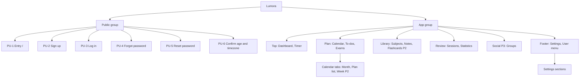

# Navigation Structure

> Status: Proposal, pending approval. Source of truth: Phase 1 to 4 docs.

This file defines how a user moves through Lumora: the primary navigation, how it changes per breakpoint, the running-timer mini-bar, and the supporting navigation devices (skip link, breadcrumbs, page titles, settings navigation). Page IDs and routes come from INFORMATION-ARCHITECTURE.md. Tokens (stat-sm, primary-soft, label, body-sm) come from COLOR-TYPOGRAPHY.md and DESIGN-SYSTEM.md. This file holds no hex values.

## 1. Rules

1. Order follows the core loop: Plan, Study, Record, Review, Revise. Reason: the menu teaches the product's workflow in the order a student uses it.
2. A nav item appears only when its route is shipped and working. Nothing "coming soon". Reason: dead entries break trust and are an antislop violation (R-24).
3. Labels are plain nouns, sentence case, no icons without text in the full sidebar. Reason: text labels are the most reliable cue (NFR-043).
4. The same items appear in the same order at every breakpoint where they are shown. Reason: consistent location reduces relearning (WCAG 3.2.3).

## 2. Primary navigation (signed-in app)

| Group | Item | Route | Page ID | Phase |
|---|---|---|---|---|
| Top | Dashboard | `/dashboard` | A-2 | MVP |
| Top | Timer | `/timer` | A-3 | MVP |
| Plan | Calendar | `/calendar` | A-5 | MVP |
| Plan | To-dos | `/todos` | A-9 | MVP |
| Plan | Exams | `/exams` | A-12 | MVP |
| Library | Subjects | `/subjects` | A-7 | MVP |
| Library | Notes | `/notes` | A-10 | MVP |
| Library | Flashcards | `/flashcards` | B-2 | Phase 2 |
| Review | Sessions | `/sessions` | A-4 | MVP |
| Review | Statistics | `/statistics` | A-14 | MVP |
| Social | Groups | `/groups` | C-3 | Phase 3 |
| Footer | Settings | `/settings/profile` | A-15 | MVP |
| Footer | User menu | (menu, not a route) | none | MVP |

Notes:

- Calendar contains the tabs Month (`/calendar`, A-5), Plan list (`/plan`, A-6) and, in Phase 2, Week (`/calendar/week`, B-1). The Calendar nav item is active on all three routes. Reason: Plan list is the list view of the same planning data (FR-037), so it is a tab, not a separate nav item.
- The Social group has no heading or items until Groups ships (FR-200..212).
- Onboarding (A-1) is reached by redirect and from Settings > Data, never from the nav (FR-134, FR-135).
- Group headings (Plan, Library, Review, Social) use the label style at weight 500 in muted color, sentence case, not uppercase. The Top group has no heading. Reason: uppercase tracking labels are an AI-template tell (R-06).
- Plan and Calendar page IDs for the Exams item: A-12 list, A-13 details; the nav item stays active on both.
- User menu: initials avatar button (32 px circle on primary-soft) opening a menu with display name (non-interactive heading), Settings, Log out. Reason: logging out belongs with identity, and the menu keeps it out of the main list.

## 3. Breakpoint behavior

| Width | Navigation |
|---|---|
| 1024 and up | Fixed sidebar 256 px: wordmark at top, the groups above, footer with Settings and user menu. Active item: primary-soft background, Fill-weight icon, weight 600, `aria-current="page"`. The Timer item shows a state suffix as text ("Running 24:31", "Paused 12:04") in stat-sm tabular, plus an amber dot only for running. No top bar; the page header lives in content. |
| 768 to 1023 | Icon rail 72 px (24 px icons, tooltips and accessible names) plus a Menu button that opens the full list in a left drawer (focus trapped, Esc closes). A running timer shows the mini-bar docked at the bottom of the content area. |
| 360 to 767 | Top app bar 56 px (page title as h1 text, user menu button). Bottom tab bar 64 px plus safe area: Dashboard, Timer, Calendar, To-dos, More. More opens a bottom sheet listing Subjects, Notes, Exams, Sessions, Statistics, Settings (and Flashcards, Groups when shipped). Tab items are at least 44 px with the icon above a 12 px label. A running timer shows a 48 px mini-bar docked above the tab bar. |

Reasons:

- Sidebar at desktop: all destinations are visible at once, so no hidden navigation. Reason: nine MVP destinations do not fit a top bar.
- Rail plus drawer on tablet: keeps content width while the full labeled list is one press away. Reason: icons alone are not sufficient, so the drawer carries labels.
- Bottom tab bar on mobile: reachable with one thumb (NFR-087, NFR-088). Reason: the five most frequent daily tasks (see, time, plan, tick, more) sit in the thumb zone. Statistics sits under More (decision U-D10).
- The state suffix on the Timer item is text, so state is never carried by the dot alone (NFR-043).
- Active state combines background, icon weight and font weight, never color alone (NFR-043).

### Interaction rules per form

| Form | Keyboard and focus | Accessible name |
|---|---|---|
| Sidebar | `nav` landmark labelled "Main"; Tab moves through items in visual order; Enter follows the link | Item text |
| Icon rail | Same as sidebar; tooltips show on focus and hover, dismiss with Esc, hoverable and persistent while focused (WCAG 1.4.13) | Item text as the accessible name, not only the tooltip |
| Drawer | Opened by the Menu button; focus moves to the first item; focus is trapped; Esc closes and returns focus to Menu | Dialog labelled "Main menu" |
| Tab bar | `nav` landmark labelled "Main"; five links/buttons; the active tab has `aria-current="page"` and a Fill icon plus weight 600 label | Item text |
| More sheet | Bottom sheet, focus trapped, Esc or Close button closes, focus returns to More | Dialog labelled "More" |

Both the rail and the tab bar must have exactly one `nav` landmark named "Main" in the DOM at any width. Reason: duplicate landmarks confuse screen reader users.

## 4. Mini-bar

Shown on every app page except `/timer` while a timer is running or paused (FR-050..059).

| Part | Specification |
|---|---|
| State icon | Play or Pause icon in Fill weight, with the state as text (see below). |
| Subject | Subject dot and name, truncated with an ellipsis; the full name is in the accessible name. |
| Elapsed | stat-sm, tabular numerals. |
| Action | One Pause or Resume button, 44 x 44, with accessible name "Pause timer" or "Resume timer". |
| Link | The whole bar except the button is a link to `/timer`, named "Open timer: <subject>, <state>". |
| Role | `role="timer"` with `aria-live="off"`. State changes are announced by the global polite live region, not per second (NFR-044). |
| Placement | 1024 and up: not shown; the Timer nav item carries the state suffix. 768 to 1023: docked at the bottom of the content area. 360 to 767: 48 px, docked above the tab bar. |
| Break state | Text "Break" and remaining time; break is not study time (BR-009). |

Reason: a running timer must stay one action away from any page without taking over the screen. Reason for no per-second announcements: they make screen readers unusable (NFR-044).

Pause or Resume from the mini-bar shows pending state within 200 ms (NFR-004). A failed action leaves the clock running and shows the inline error on `/timer`; on other pages a toast with Retry is allowed only because the mini-bar also shows the true state (ERROR-HANDLING section 5).

When the timer is also running in another tab, the mini-bar converges within 5 s (FR-059) and the live region announces "Timer paused on another device" when it changes.

## 5. Skip link and landmarks

- The skip link is the first focusable element on every page. Text: "Skip to main content". It is visible only on focus and moves focus to `main` (WCAG 2.4.1).
- Landmarks: `header` (top app bar or page header), `nav` (Main), `main` (one per page), and footer only on public pages.
- One h1 per page, inside `main`. Reason: stable structure for assistive technology (WCAG 1.3.1, NFR-040).

## 6. Breadcrumbs

| Where | Trail |
|---|---|
| Subject details (A-8) | Subjects > <subject name> |
| Exam details (A-13) | Exams > <exam title> |
| Note editor (A-11) | Notes > <note title> |
| Group details (C-4, Phase 3) | Groups > <group name> |

- Only on detail pages. List pages have no breadcrumb. Reason: the nav already shows where a list page is.
- Markup: `nav` with `aria-label="Breadcrumb"`, ordered list, current page as plain text with `aria-current="page"`. Separators are decorative.
- Under 768 px the trail collapses to a single link "Back to <parent>", for example "Back to Subjects". Reason: a full trail wraps on 360 px screens (NFR-086).
- Schedule preview (C-2) and Join group (C-5) have no breadcrumb; they offer explicit buttons ("Discard draft", "Cancel").

## 7. Page titles and focus on route change

| Situation | Document title |
|---|---|
| Any page | "<Page name> · Lumora" (middle dot), for example "Statistics · Lumora" |
| Detail page | "<Item name> · <Section> · Lumora" |
| Timer running or paused, Pomodoro focus | "24:31 Focus · Lumora" [example time] |
| Stopwatch running | "24:31 Stopwatch · Lumora" [example time] |

The running-timer title is required by FR-056. The title time may update each second visually in the tab strip; it is not announced (NFR-044).

On every client-side route change, focus moves to the new h1 (which has `tabindex="-1"`), the document title updates, and the global polite live region does not repeat the title. Reason: this gives keyboard and screen reader users the same orientation a page load gives (WCAG 2.4.3).

## 8. Settings navigation

| Width | Pattern |
|---|---|
| 1024 and up | Vertical list in a left column 220 px wide, next to the section content. Active item: primary-soft background, weight 600, `aria-current="page"`. |
| Under 1024 | Horizontal tab list that scrolls inside a labelled region ("Settings sections"); the active tab is shown by underline plus weight 600. |

| Section | Route | Page ID | Phase |
|---|---|---|---|
| Profile | `/settings/profile` | A-15 | MVP |
| Study | `/settings/study` | A-15 | MVP |
| Appearance | `/settings/appearance` | A-15 | MVP |
| Security | `/settings/security` | A-15 | MVP |
| Data | `/settings/data` | A-15 | MVP |
| Notifications | `/settings/notifications` | B-4 | Phase 2 |
| AI consent | `/settings/ai-consent` | C-6 | Phase 3 |
| API keys | `/settings/api-keys` | C-7 | Phase 3 |

Reason: one place for preferences, split by task, so no single settings page grows long. Notifications, AI consent and API keys appear only once shipped (R-24).

## 9. Global actions and shortcuts

- No floating action button. Reason: each page has its own single focal action (see DESIGN-PRINCIPLES.md principle 2), and a floating button would add a second one.
- No global keyboard shortcuts in the MVP. Reason: single-character shortcuts risk WCAG 2.1.4 failures and conflict with screen reader keys.
- Global keyboard features are the skip link and Esc for closing overlays (NFR-041).
- Phase 2 reminder bell: in the page header area (sidebar footer on desktop, top app bar on mobile), opens a popover of recent in-app notifications (FR-152). Absent in the MVP.
- Theme switching is in Settings > Appearance only (FR-138); there is no header toggle. Reason: avoids a second control for the same setting.

## 10. Guest navigation (public group)

| Element | Specification |
|---|---|
| Header | Wordmark "Lumora" at left (links to `/`); "Log in" link and "Create account" button at right. No other links (R-24). |
| Footer | Terms and Privacy links appear only once those pages exist (decision U-D5). |
| Form pages | PU-2 to PU-6 show the same header; the current page's own link is omitted (no "Log in" on `/login`). |
| Redirects | Guests opening an app URL go to `/login` with the target preserved (FR-002). Signed-in users opening `/`, `/login` or `/signup` go to `/dashboard`. Another user's record id renders Not found (SY-1, NFR-016). |
| Onboarding | `/onboarding` (A-1) is a full-screen flow with no sidebar or tab bar; it offers "Skip this step" and "Leave setup" (FR-134, FR-135). |

Reason: a guest has two choices, so the header offers two.

## 11. Navigation hierarchy

## 12. Route coverage check

Every route above exists in INFORMATION-ARCHITECTURE.md. Routes reachable without a nav item: `/onboarding`, `/signup/confirm`, `/reset-password`, `/plan/generate`, `/plan/generate/preview`, `/groups/join/[token]`, `/flashcards/review`. Each is reached from a named button or link on its parent page. Reason: these are step screens in a flow, not destinations.
