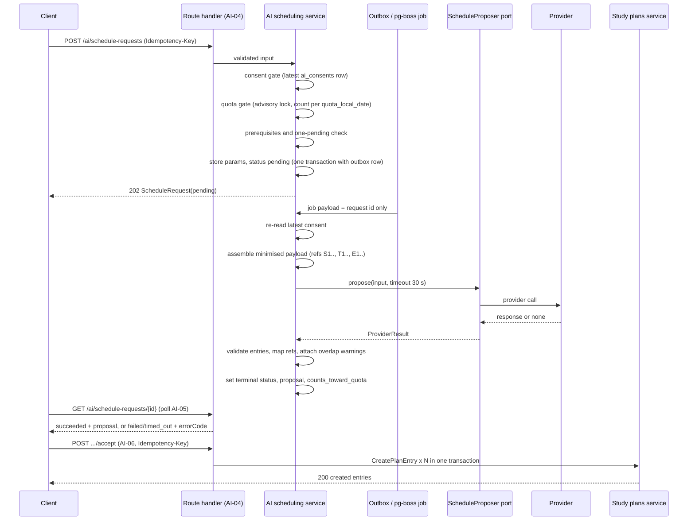

# Lumora AI Integration

> Status: Proposal, pending approval. Source of truth: Phase 2 PRD and Phase 1 docs.

This document specifies how the Phase 3 AI schedule generation feature (FR-190..198, EC-015, EC-016) is integrated: the request flow, the provider port, prompt management, input assembly, output validation, quota and consent, failure handling, accept, cost controls, privacy and the testing contract. It builds on [ADR-010](../adr/ADR-010-ai-integration-adapter.md), [ADR-011](../adr/ADR-011-idempotency-and-concurrency.md), [SYSTEM-ARCHITECTURE.md](../03-architecture/SYSTEM-ARCHITECTURE.md) section 8, [BACKGROUND-JOBS.md](../03-architecture/BACKGROUND-JOBS.md) ("AI schedule generation", "AI proposal expiry"), [SECURITY-ARCHITECTURE.md](../03-architecture/SECURITY-ARCHITECTURE.md), [DATA-DICTIONARY.md](../04-database/DATA-DICTIONARY.md) section 14 (`ai_consents`, `ai_generation_requests`) and [DATA-LIFECYCLE.md](../04-database/DATA-LIFECYCLE.md). Endpoint contracts AI-01..AI-07 are in [API-ENDPOINTS.md](API-ENDPOINTS.md), schemas in [API-SCHEMAS.md](API-SCHEMAS.md), error codes in [API-ERRORS.md](API-ERRORS.md), conventions (idempotency, rate classes) in [API-CONVENTIONS.md](API-CONVENTIONS.md). All contracts are Phase 3 and non-binding until that phase starts. Provider selection remains open (U-A3); consent wording remains open (U-4) and is deliberately NOT written here.

## 1. Flow

The request is asynchronous: AI-04 returns 202 with a `pending` request, the worker calls the provider, the client polls AI-05, then accepts with AI-06 or discards with AI-07. No web request waits on the provider.



Rules: the job payload contains only the request id (NFR-063, section 11). The only transition out of `pending` happens once, guarded by a status check (section 8). Closing the page does not cancel the request; the proposal waits for 24 hours (FR-191, FR-193).

## 2. Provider abstraction

The application depends on one port (ADR-010, SYSTEM-ARCHITECTURE section 8). No code outside the adapter knows the vendor.

| Item | Decision |
|---|---|
| Port | `ScheduleProposer.propose(input: ScheduleProposalInput, opts: { timeoutMs: 30000, signal: AbortSignal }): Promise<ProviderResult>` |
| Result | `ProviderResult = { kind: "response", entries: unknown, usage: { inputTokens, outputTokens } }` or `{ kind: "no_response", reason: "timeout" \| "network" \| "provider_error" }` |
| Selection | Config `AI_PROVIDER`; `fake` is the default in development and test; the real value is pending U-A3 |
| Timeout | 30 s hard limit, enforced with `AbortSignal` and a wall-clock guard in the job (FR-191, FR-197, EC-016) |
| Entries type | `unknown` on purpose: the adapter never trusts the provider shape; validation is section 6 |
| SDK | The Vercel AI SDK or a direct SDK may be used inside the adapter as an implementation detail (U-A3) |

Fake adapter scenarios required by ADR-010:

| Scenario | Behaviour | Expected terminal result |
|---|---|---|
| `valid` | All entries pass validation | `succeeded`, quota counted |
| `partially_invalid` | Some entries break rules | `succeeded`, `entriesRemoved` > 0, quota counted |
| `all_invalid` | Every entry breaks rules | `failed`, `ai_no_valid_entries`, quota counted |
| `malformed_json` | Response is not parseable or fails the schema | `failed`, `ai_no_valid_entries`, quota counted |
| `slow` | Does not answer within 30 s | `timed_out`, `ai_provider_timeout`, quota not counted |
| `error_5xx` | Provider error | `failed`, `ai_provider_unavailable`, quota not counted |

Selection criteria for the real provider (the owner uses this table to close U-A3):

| Criterion | Requirement |
|---|---|
| Data use | Zero data retention or contractual opt-out of training on inputs (NFR-036, section 11) |
| Data processing | Data processing agreement available |
| Output | JSON or structured-output mode usable with a Zod schema |
| Region | EU or region option, to align with the hosting region |
| Price | Published token pricing (feeds section 10) |
| Latency | p95 under 30 s for up to 4,000 output tokens, with margin under the hard limit |
| Integration | SDK or HTTP API usable behind the port without leaking types |

## 3. Prompt management

| Rule | Decision |
|---|---|
| Storage | Versioned files in the repository: `prompts/schedule/v1.md` holds the system text and a Zod-typed variable block |
| Identification | `promptVersion`, for example `schedule.v1` |
| Change control | Any change goes through pull request review and re-runs the fake-provider contract tests (section 12) |
| Observability | `promptVersion`, provider, model and token counts are written to structured logs and metrics only. There is no database column for them (no-migration rule). Optional **CR-2** to Phase 4: add per-request cost columns to `ai_generation_requests` if product wants cost reporting per request |
| Logging | No prompt text and no response text is logged anywhere (NFR-063) |

## 4. Input assembly and validation

AI-04 validates the body with Zod `.strict()` ([API-CONVENTIONS.md](API-CONVENTIONS.md) section 2). The validated input is stored in `ai_generation_requests.params` so a failed request can be retried from AI-04 prefilled (FR-197).

| Field | Rule | Source |
|---|---|---|
| `examIds` | 1..10 ids, all upcoming exams of the caller (a past exam is rejected) | FR-190 |
| `weeklyHours` | Integer 1..168 | FR-190, DATA-DICTIONARY `ai_generation_requests.params` |
| `availability` | 1..21 windows `{ weekday: 1..7 (Monday = 1), startTime: "HH:mm", endTime: "HH:mm" }`; start before end, same day, in the profile zone, no overlap between windows | FR-190, BR-026 |
| Horizon | From now rounded up to the next 15 minutes to the latest selected exam date, maximum 120 days; longer gives `validation_failed` | Phase 6 decision |
| Topics | At most 200 active topics across the selected exams; excess gives `input_too_large` | Phase 6 decision (token control) |

Prerequisites (FR-198): at least one upcoming exam, at least one active topic for that exam's subject, declared weekly hours and availability. A failure returns `validation_failed` with `details.missing`, a list drawn from `exam`, `topic`, `weeklyHours`, `availability`. Nothing is sent to the provider when a prerequisite is missing.

Payload sent to the provider, and nothing else:

| Key | Content |
|---|---|
| `timezone` | IANA profile zone |
| `today` | Local date in the profile zone |
| `weeklyHours` | The declared limit |
| `availability[]` | The declared windows |
| `subjects[]` | `{ ref: "S1".., name }` |
| `topics[]` | `{ ref: "T1".., subjectRef, name, weight, status }`; archived topics excluded |
| `exams[]` | `{ ref: "E1".., subjectRef, date, topicRefs[] }` |
| `history[]` | `{ subjectRef, weekStart, minutes }` aggregates for the last 4 weeks (FR-190), at most 12 subjects |

NOT sent: email, display name, user id, note content, exam title, to-dos, individual session details, any database id. Refs are mapped back to ids on the server; any ref not present in the request is invalid output. Other caps: `maxOutputTokens` 3000; at most 100 proposed entries are kept, extra entries are dropped and counted (reason `too_many_entries`). A user with empty history still gets a request built from exams and topics (FR-198).

## 5. Output schema

The provider is asked for, and the server parses with a Zod schema that is strict on entries:

```json
{
  "entries": [
    {
      "examRef": "E1",
      "subjectRef": "S1",
      "topicRef": "T3",
      "date": "2026-11-09",
      "startTime": "18:00",
      "durationMin": 90
    }
  ]
}
```

| Field | Type | Required |
|---|---|---|
| `examRef` | string ref | yes |
| `subjectRef` | string ref | yes |
| `topicRef` | string ref | no |
| `date` | `YYYY-MM-DD` local date | yes |
| `startTime` | `HH:mm` local time | yes |
| `durationMin` | integer | yes |

The provider returns local date and time. The time module converts them to UTC with the profile zone (ADR-006); the provider performs no time-zone arithmetic. The stored `ProposedEntry` is `{ subjectId, topicId or null, examId, startsAt (UTC), durationMin, localDate, warnings: [] }`.

## 6. Schedule validation

Validation runs on the server for every entry independently, entries processed sorted by start (FR-194, EC-015). The first failing check drops the entry and increments `removedByReason[reason]`. The removal reasons are exactly these ten:

| Order | Reason | Check |
|---|---|---|
| 1 | `malformed` | Entry does not match the Zod schema |
| 2a | `unknown_ref` | A ref does not exist in the request |
| 2b | `topic_subject_mismatch` | Topic does not belong to the subject, or exam does not belong to the subject |
| 3 | `in_past` | Start is not strictly after now |
| 4 | `after_exam_date` | Local date is after the exam date of `examRef` |
| 5 | `outside_availability` | `[start, start + duration]` does not lie inside one availability window on that weekday |
| 6 | `duration_out_of_range` | Duration outside 5..480 minutes |
| 7 | `overlaps_proposal_entry` | Overlaps an earlier-kept entry of the same proposal |
| 8 | `weekly_hours_exceeded` | Cumulative minutes in a Monday-start local week (profile zone) would exceed `weeklyHours * 60`; later entries are dropped |
| - | `too_many_entries` | More than 100 entries kept (applied after the checks above) |

Overlap with the user's EXISTING plan entries is not a removal: it attaches the warning `{ "code": "overlap", "planEntryId": "..." }` to the entry and the user confirms at accept time (FR-193, BR-026). The total removed count is stored in `entries_removed` and returned by AI-05 as `entriesRemoved` together with `removedByReason`, so removals are never hidden (FR-193, EC-015).

If zero valid entries remain the request ends `failed` with `errorCode` `ai_no_valid_entries`, nothing is stored as a proposal, and the quota is still counted because a provider response was received (FR-196, AC-FR-196-3). The server re-validates the proposal at accept time (section 9).

## 7. Quota and consent

| Topic | Rule |
|---|---|
| Consent record | AI-02 appends an `ai_consents` row (`feature = ai_schedule`, `granted`, `wording_version`, `decided_at`); the current decision is the latest row (NFR-036, FR-192). Revocation is a new row with `granted = false` |
| Consent gate 1 | AI-04 returns `consent_required` when the latest row is missing or not granted; nothing is queued (AC-FR-191-4) |
| Consent gate 2 | The job re-reads the latest row immediately before the provider call. If it is no longer granted the request ends `failed` with `consent_required`, no provider call is made and the quota is not counted |
| Wording | Versioned through `wording_version`; the text is subject to legal review (U-4) and is not written in this document |
| Quota limit | 5 per user per profile day, from `AI_DAILY_LIMIT_PER_USER` (FR-196, U-4, NFR-062) |
| Quota counting | `counts_toward_quota` is set true only when a provider response was received. **Quota counts only when a provider response was received**, including malformed or all-invalid output. Timeout, network failure and provider errors leave it false (EC-015, EC-016, AC-FR-196-2, AC-FR-196-3) |
| Quota check | At AI-04, under the per-user advisory lock, count rows with `counts_toward_quota` for the current `quota_local_date`; at the limit return `ai_daily_limit_reached` with `details.limit`, `details.used` and `details.resetsOnLocalDate` |
| One in flight | The unique partial index `UNIQUE (user_id) WHERE status = 'pending'` enforces one request; a second submission returns `generation_in_progress` (AC-FR-191-3, EC-016) |
| Display | AI-03 returns `{ limit, used, remaining, resetsOnLocalDate }` so the screen shows 0..5 remaining (AC-FR-196-4) |

## 8. Failure handling

| Scenario | Terminal status | `errorCode` | Quota counted | User message intent | Retry |
|---|---|---|---|---|---|
| No provider answer within 30 s | `timed_out` | `ai_provider_timeout` | No | The service did not answer in time; nothing was saved or counted | Immediately allowed from AI-04, inputs prefilled. A late response is ignored: the call is aborted with `AbortController` and the status guard moves `pending` to a terminal status only once |
| Connection failure before any response | job retried once after 5 s; if it fails again, `failed` | `ai_provider_unavailable` | No | The AI service is currently unavailable; no data was saved or counted | The job never retries after a timeout (BACKGROUND-JOBS: one retry only if no provider response was received) |
| Provider 4xx, 5xx or its own rate limit | `failed` | `ai_provider_unavailable` | No | As above | User may retry |
| Malformed JSON or schema failure | `failed` | `ai_no_valid_entries` | Yes | The generated schedule could not be used; nothing was saved | User may regenerate within the quota |
| Zero valid entries after validation | `failed` | `ai_no_valid_entries` | Yes | As above | User may regenerate within the quota |
| Consent revoked before the call | `failed` | `consent_required` | No | Consent is required | After granting consent again |
| Worker crash mid-call | pg-boss retries with the same request id | none yet | Unchanged | none | If the row is already terminal the handler is a no-op |

Inputs persist in `params`, so a retry from AI-04 is prefilled (FR-197). A request stuck in `pending` for more than 2 minutes is marked `failed` with `ai_provider_timeout` by the AI-05 read path (lazy sweep) so the unique pending index never blocks the user. These codes appear as `errorCode` in the AI-05 body (HTTP 200), not as the HTTP status of the poll ([API-ERRORS.md](API-ERRORS.md)). A provider failure never affects the rest of the product (FR-197).

## 9. Accept

AI-06 behaves as follows (FR-195, BR-026):

1. Load the request; the caller must own it, otherwise `not_found`. A discarded or missing proposal is `not_found`.
2. Return `proposal_stale` if the proposal is null, older than its 24 h `proposal_expires_at`, or any entry start is now at or before the current time.
3. Re-validate each entry against current data (exam still upcoming, topic still active, subject not archived); a failure returns `proposal_stale`.
4. Call the Study plans `CreatePlanEntry` use case for every entry inside ONE transaction, together with the idempotency row ([API-CONVENTIONS.md](API-CONVENTIONS.md) section 7). All entries are created or none (FR-195).
5. Overlap with existing entries requires `confirmedWarnings: ["overlap"]`; otherwise the request returns `overlap_confirmation_required` and nothing is saved. Exam-date warnings cannot occur because step 3 and section 6 rule them out.
6. Set `accepted_at`. Accepted entries behave exactly like manual plan entries (FR-195).

AI-07 sets `proposal` to NULL, returns 204 and is idempotent.

## 10. Token and cost controls

| Config key | Default | Meaning |
|---|---|---|
| `AI_SCHEDULING_ENABLED` | true | Global kill switch. When false the entry point is hidden and AI-04 returns 502 `ai_provider_unavailable` without creating a request or counting quota (no dedicated code is added) |
| `AI_DAILY_LIMIT_PER_USER` | 5 | FR-196, U-4 |
| `AI_PROVIDER_TIMEOUT_MS` | 30000 | FR-191, EC-016 |
| `AI_MAX_OUTPUT_TOKENS` | 3000 | Output cap |
| `AI_MAX_TOPICS` | 200 | Input cap |
| `AI_MAX_PROPOSED_ENTRIES` | 100 | Kept-entry cap |

All values live in the configuration module (NFR-062).

Worst-case input estimate: tokens is roughly the characters of all topic, subject and ref text divided by 4, plus the fixed prompt tokens. Maximum spend per user per day is 5 x (input tokens + 3,000 output tokens) x the provider price. The price is unknown until U-A3 closes and is a parameter, not a number in this document. Request floods on AI-04 are limited by RL-HEAVY (30 per minute) on top of the daily quota ([API-CONVENTIONS.md](API-CONVENTIONS.md) section 10).

Metrics: requests, success rate, timeouts, tokens in and out, entries-removed ratio, p95 latency. Alert when the removed ratio exceeds 50 percent over 50 requests (signal of a prompt regression).

## 11. Privacy controls

| Control | Decision |
|---|---|
| Consent | Explicit, per feature, revocable, recorded before any outbound call (NFR-036, FR-192) |
| Minimisation | Only the payload table in section 4; aggregates for history ([SECURITY-ARCHITECTURE.md](../03-architecture/SECURITY-ARCHITECTURE.md)) |
| Logs, error tracking, queues | No AI payload or response text in logs, error tracking or queue payloads; the job payload is the request id only (NFR-063) |
| Proposal lifetime | `proposal` set to NULL at 24 hours by the "AI proposal expiry" job; the request row is deleted at 30 days ([DATA-LIFECYCLE.md](../04-database/DATA-LIFECYCLE.md)) |
| Export | Includes consent history only, not provider payloads |
| Provider terms | Must forbid training on inputs (section 2) |
| Account purge | Deletes `ai_consents` and `ai_generation_requests` by cascade (DATA-DICTIONARY section 19) |
| Consent wording | Legal review pending (U-4); text not written here |

## 12. Testing contract

Phase 7 must cover:

| Area | Tests |
|---|---|
| Fake scenarios | Replay each scenario in section 2 and assert terminal status, `errorCode` and quota effect |
| Validation | One test per removal reason in section 6, plus the order of checks |
| Consent | Revoked between enqueue and call: no provider call, `consent_required`, quota not counted; no outbound call without consent (AC-NFR-036) |
| Quota matrix | Timeout and unavailable: unchanged; malformed and all-invalid: plus 1; success: plus 1; limit reached at 5; reset at the next profile day |
| Concurrency | Second submission while pending gives `generation_in_progress`; stale `pending` sweep after 2 minutes |
| Late response | A response arriving after the abort is ignored and cannot overwrite a terminal status |
| Accept | Idempotent replay with the same key; `proposal_stale` on expiry and on a past start; overlap needs confirmation; all-or-nothing on failure |
| Privacy | Payload contains none of the excluded fields; no prompt or response text in logs |
