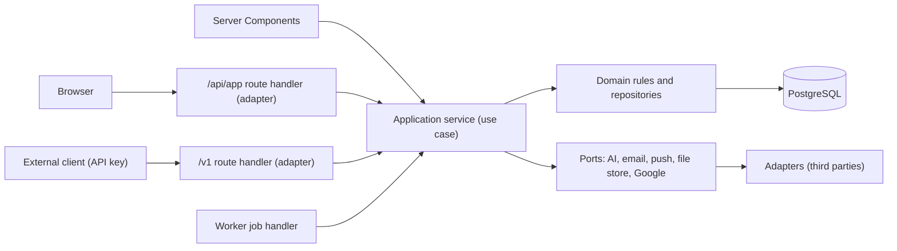

# Lumora API Strategy

> Status: Proposal, pending approval. Source of truth: Phase 2 PRD and Phase 1 docs.

This document decides, for every capability, whether it is an internal server function, an internal REST endpoint, a public REST endpoint, a third-party integration, a webhook, or background processing, so that no REST endpoint exists without a reason. It builds on [ADR-008](../adr/ADR-008-api-strategy.md), [MODULE-BOUNDARIES.md](../03-architecture/MODULE-BOUNDARIES.md), [BACKGROUND-JOBS.md](../03-architecture/BACKGROUND-JOBS.md) and [SYSTEM-ARCHITECTURE.md](../03-architecture/SYSTEM-ARCHITECTURE.md). Wire rules are in [API-CONVENTIONS.md](API-CONVENTIONS.md), per-endpoint contracts in [API-ENDPOINTS.md](API-ENDPOINTS.md), error codes in [API-ERRORS.md](API-ERRORS.md), security in [API-SECURITY.md](API-SECURITY.md), third parties in [EXTERNAL-INTEGRATIONS.md](EXTERNAL-INTEGRATIONS.md), the AI flow in [AI-INTEGRATION.md](AI-INTEGRATION.md), the webhook decision in [WEBHOOKS.md](WEBHOOKS.md) and the public contract document in [OPENAPI-PLAN.md](OPENAPI-PLAN.md).

## 1. Decisions settled by the product owner

| # | Decision | Consequence |
|---|---|---|
| 1 | Every client-driven call is a route handler under `/api/app`; Next.js server actions are not used for data | One adapter pattern for auth, CSRF, rate limit, idempotency and error mapping (ADR-008, NFR-060) |
| 2 | Cursor pagination for unbounded lists and for the public `/v1` API; none for small bounded lists | Rules in [API-CONVENTIONS.md](API-CONVENTIONS.md) section 4 (FR-224) |
| 3 | No outbound webhooks through Phase 3; inbound provider webhooks are reserved only | [WEBHOOKS.md](WEBHOOKS.md) is a decision record |
| 4 | Full contracts are written for all phases, tagged MVP, 2 or 3 | Phase 2 and 3 contracts are non-binding until that phase starts |

## 2. Decision matrix

Mechanism values: **Server function** (application service call from a Server Component, event handler or job), **Internal REST** (`/api/app`), **Public REST** (`/v1`, Phase 3), **Third party**, **Webhook**, **Background** (pg-boss job, [ADR-005](../adr/ADR-005-background-jobs.md)). A capability may use several mechanisms. A page that only displays data uses a server function; an endpoint exists only when the browser must call back after load (mutation, polling, interactive refresh) (API-CONVENTIONS section 14).

### 2.1 The 19 modules

| Module (phase) | Capability | Mechanism | Justification |
|---|---|---|---|
| Authentication (MVP) | Sign-up, sign-in, sign-out, password reset, sign-in management | Internal REST (AUTH-01..09), Server function | Forms post JSON; app-owned endpoints keep lockout and age-gate rules (FR-001, FR-002, FR-005, FR-008, NFR-012) |
| Authentication | Google sign-in | Third party (Google OAuth), Internal REST (AUTH-03 redirect) | FR-003; see [EXTERNAL-INTEGRATIONS.md](EXTERNAL-INTEGRATIONS.md) |
| Authentication | Password-reset email | Background (Password-reset email), Third party (email provider) | FR-005; never blocks the request |
| User profile (MVP) | Read and update profile, onboarding | Internal REST (PROF-01..03), Server function for page load | FR-006, FR-009, FR-134..138 |
| User profile | Account deletion | Internal REST (PROF-04) then Background (Account purge) | FR-007, BR-032; returns 202 |
| User profile | Data export | Internal REST (PROF-05..08), Background (Export generation) | FR-130..132, NFR-005; user-visible async returns 202 plus a status resource |
| Subjects (MVP) | CRUD, order, archive, restore | Internal REST (SUBJ-01..07), Public REST (PUB-01..05) | FR-010..014; FR-220 lists subjects as a public resource |
| Topics (MVP) | CRUD, order, bulk paste, archive, restore | Internal REST (TOP-01..08), Public REST (PUB-06..10) | FR-015..019; bulk is internal only |
| Exams (MVP, readiness 2) | CRUD, checklist, countdown, archive list | Internal REST (EXAM-01..06), Public REST (PUB-32..36), Background (Exam auto-archive) | FR-120..128 |
| Study plans (MVP, 2 drag) | Plan entries, overlap check, missed marking | Internal REST (PLAN-01..06), Public REST (PUB-16..21) | FR-030..038; overlap check is folded into create/update (409 confirmation) |
| Study sessions (MVP) | List, view, manual add, edit, delete | Internal REST (SESS-01..05), Public REST (PUB-11..15) | FR-042..044; timer sessions are created by the timer, not by POST /sessions |
| Study sessions | Idle auto-close | Background (Idle-session auto-close) | BR-006, EC-001; no endpoint |
| Timer (MVP, audio 2) | Start, pause, resume, stop, heartbeat, state, settings | Internal REST (TIM-01..08) | FR-050..059; polling and commands must be HTTP; not public (FR-220) |
| Tasks (MVP) | To-do CRUD, completion | Internal REST (TODO-01..06), Public REST (PUB-22..26) | FR-090..096 |
| Notes (MVP) | CRUD, render | Internal REST (NOTE-01..06), Public REST (PUB-27..31) | FR-100..104, ADR-007; render stays internal |
| Flashcards (2) | CRUD, review queue, rating, settings | Internal REST (FLASH-01..08) | FR-107..112; not a public resource (FR-220) |
| Goals (MVP) | Daily and subject targets, progress | Internal REST (GOAL-01..05) | FR-070..074; target history stays internal to `GetTargetForDay` |
| Calendar (MVP) | Month heatmap, day detail | Internal REST (CAL-01..02) | FR-060..062; read-only |
| Analytics (MVP) | Daily, weekly, monthly, by-subject, goal-hit rate, planned vs actual | Internal REST (STAT-01..06) | FR-080..089; read-only, no write endpoints |
| Gamification (2) | Streak, XP, level read | Internal REST (GAME-01), Background (Streak and XP evaluation) | FR-160..164, FR-170..177; evaluation is job and event driven |
| Notifications (MVP port, 2) | Reminders, in-app list, preferences, push subscription | Internal REST (NOTIF-01..07), Background (Reminders, Push delivery), Third party (email, Web Push) | FR-150..154 |
| AI scheduling (3) | Consent, quota, request, poll, accept, discard | Internal REST (AI-01..07), Background (AI schedule generation), Third party (AI provider) | FR-190..198; 202 plus poll, never blocks on the provider ([ADR-010](../adr/ADR-010-ai-integration-adapter.md)) |
| Study groups (3) | Groups, invites, members, sharing, reports | Internal REST (GRP-01..14, GRP-16), Background (Invite email, Group invite expiry) | FR-200..212 |
| Study groups | Weekly leaderboard | Internal REST (GRP-15), computed on read | FR-207, FR-208; reconciliation row 3 in [API-CONVENTIONS.md](API-CONVENTIONS.md) |
| API integrations (3) | API key create, list, revoke | Internal REST (KEY-01..03) | FR-220, FR-221, FR-226; keys cannot manage keys |
| API integrations | Public data access | Public REST (PUB-01..37) | FR-220..226 |

### 2.2 Planning 6 section 3 areas

Planning 6 lists 15 areas. Each maps to modules above; the three that are not 1:1 are explained here.

| Planning 6 area | Module(s) | Mechanism | Note |
|---|---|---|---|
| Statistics | Analytics (plus Calendar for the heatmap) | Internal REST STAT-01..06, CAL-01..02 | Read models only |
| Leaderboards | Study groups | Internal REST GRP-15 | One endpoint, not a separate module (NFR-037: opted-in members only) |
| Tasks | Tasks | Internal REST TODO-01..06 | API name `todos`, matching FR-220 |
| All other areas | Same-named module | As in 2.1 | |

### 2.3 Mechanisms that do not become endpoints

| Capability | Mechanism | Why not REST |
|---|---|---|
| Dashboard (FR-020..024) | Server function (server component) | Page data is loaded server-side; client islands reuse timer, goals, plan, todo and stats endpoints |
| Outbound webhooks | None through Phase 3 | No FR requires them ([WEBHOOKS.md](WEBHOOKS.md)) |
| Inbound provider webhooks | Reserved route, not in the inventory | Waits on U-A2 |
| Error tracking, uptime monitor, CDN, PaaS | Third party | Operational, no product API |

### 2.4 Background processing that users trigger or observe

Names and policies are copied from [BACKGROUND-JOBS.md](../03-architecture/BACKGROUND-JOBS.md) section 2. Rule: any user-visible async operation returns `202` and a status resource; no web request blocks on a third party.

| Job | Trigger | Retry policy | Phase | User-facing surface |
|---|---|---|---|---|
| Export generation | Event on export request | standard (3 attempts, exponential backoff from 30 s) | MVP | PROF-05 returns 202; poll PROF-07; download PROF-08 |
| Account purge | Event on deletion request, plus daily sweep | patient (8 attempts, backoff up to 1 h) | MVP | PROF-04 returns 202 |
| Password-reset email | Event on reset request | standard | MVP | AUTH-05 returns a neutral 202 |
| Reminders (daily study, plan entry) | Delayed jobs at the user's local time | standard | 2 | NOTIF-01 list, NOTIF-04 preferences |
| Push delivery | Event from reminder job | standard | 2 | NOTIF-05..07 |
| AI schedule generation | Event on request; 30 s provider timeout | one retry only if no provider response received | 3 | AI-04 returns 202; poll AI-05 |
| Invite email | Event on invite | standard | 3 | GRP-07 |

Jobs with no user-facing surface (idle-session auto-close, exam auto-archive, export file expiry, audit retention cleanup, token and session cleanup, AI proposal expiry, group invite expiry, streak and XP evaluation, exam readiness refresh, rate limit counter cleanup, backup re-purge, deferred daily rollups) are listed in the source catalog and are not repeated. "Group leaderboard weekly compute" is not needed by the API because GRP-15 computes on read.

## 3. Layering

Cutover rules:

1. Adapters (route handlers) hold no business rules. They perform only: authentication, origin/CSRF check, rate limit, Zod parse, idempotency handling, version header extraction, and error mapping ([API-CONVENTIONS.md](API-CONVENTIONS.md), [API-ERRORS.md](API-ERRORS.md)).
2. Every `/v1` handler calls the same application service as its internal twin, with its own DTO schemas and mappers; internal schemas are never re-exported (NFR-060).
3. Application services receive `userId` only and never read HTTP objects; repositories scope every query to the user (NFR-016).
4. Third parties are reached only through ports owned by the calling module, so a vendor change touches one adapter (ADR-010, U-A2, U-A3).
5. Server Components call application services directly; there is no self-HTTP.

## 4. Module evaluation

Counts come from the inventory tables in [API-ENDPOINTS.md](API-ENDPOINTS.md). "Rows" are inventory rows; "operations" are HTTP operations. They differ only for the public API: PUB-05 (archive, restore) and PUB-10 (archive, restore) are one row each and two operations each. All internal rows are one operation each.

### 4.1 Planning 6 modules (internal)

| Planning 6 area | IDs | MVP | Phase 2 | Phase 3 | Total | Rationale and intentional omissions |
|---|---|---|---|---|---|---|
| Authentication | AUTH-01..09 | 9 | 0 | 0 | 9 | App-owned endpoints; the Better Auth catch-all is restricted to the Google callback ([API-SECURITY.md](API-SECURITY.md)). No email-verification endpoint (no FR) |
| User profile | PROF-01..08 | 8 | 0 | 0 | 8 | Profile 3, deletion 1, exports 4. No avatar or email-change endpoint (no FR) |
| Subjects | SUBJ-01..07 | 7 | 0 | 0 | 7 | No hard delete; archive only (FR-013) |
| Topics | TOP-01..08 | 8 | 0 | 0 | 8 | Bulk create is internal only |
| Study plans | PLAN-01..06 | 6 | 0 | 0 | 6 | Drag and resize (Phase 2) reuse PLAN-04 |
| Study sessions | SESS-01..05 | 5 | 0 | 0 | 5 | Timer-sourced sessions are created by TIM-05 only; `source` is immutable |
| Goals | GOAL-01..05 | 5 | 0 | 0 | 5 | No history endpoint; history is internal to `GetTargetForDay` |
| Tasks | TODO-01..06 | 6 | 0 | 0 | 6 | Completion is an idempotent PUT |
| Notes | NOTE-01..06 | 6 | 0 | 0 | 6 | Render is a separate read so lists stay light |
| Flashcards | FLASH-01..08 | 0 | 8 | 0 | 8 | Reviews are idempotent writes |
| Statistics | STAT-01..06 | 6 | 0 | 0 | 6 | No write endpoints; no pre-computed rollups at MVP |
| Exams | EXAM-01..06 | 6 | 0 | 0 | 6 | Readiness is a field on EXAM-03, not an endpoint |
| Study groups | GRP-01..14, GRP-16 | 0 | 0 | 15 | 15 | Admin-only routes enforce `group:admin` |
| Leaderboards | GRP-15 | 0 | 0 | 1 | 1 | No separate module; computed on read |
| AI scheduling | AI-01..07 | 0 | 0 | 7 | 7 | 202 plus poll; accept and discard are separate commands |
| **Subtotal** | | **72** | **8** | **23** | **103** | |

### 4.2 Internal areas outside the Planning 6 list

| Area | IDs | MVP | Phase 2 | Phase 3 | Total | Rationale |
|---|---|---|---|---|---|---|
| Timer | TIM-01..08 | 8 | 0 | 0 | 8 | Audio fields in TIM-07/08 are Phase 2 content inside MVP endpoints |
| Calendar | CAL-01..02 | 2 | 0 | 0 | 2 | Read-only |
| Gamification | GAME-01 | 0 | 1 | 0 | 1 | Read-only; evaluation is background |
| Notifications | NOTIF-01..07 | 0 | 7 | 0 | 7 | Reminder creation is a job, not an endpoint |
| API keys | KEY-01..03 | 0 | 0 | 3 | 3 | Session-authenticated only |
| System | SYS-01 | 1 | 0 | 0 | 1 | Health check |
| **Subtotal** | | **11** | **8** | **3** | **22** | |

### 4.3 Totals

| Surface | MVP | Phase 2 | Phase 3 | Rows | Operations |
|---|---|---|---|---|---|
| Internal (`/api/app` plus SYS-01) | 83 | 16 | 26 | 125 | 125 |
| Public `/v1` | 0 | 0 | 37 | 37 | 39 |
| **All** | **83** | **16** | **63** | **162** | **164** |

Check: internal subtotals 103 + 22 = 125; Phase 2 is FLASH 8 + GAME 1 + NOTIF 7 = 16; Phase 3 internal is AI 7 + GRP 16 + KEY 3 = 26.

### 4.4 Public API by resource

| Resource | IDs | Rows | Operations | Scope |
|---|---|---|---|---|
| Subjects | PUB-01..05 | 5 | 6 | `subjects:read` / `subjects:write` |
| Topics | PUB-06..10 | 5 | 6 | `topics:*` |
| Sessions | PUB-11..15 | 5 | 5 | `sessions:*` |
| Plan entries | PUB-16..21 | 6 | 6 | `plan_entries:*` |
| To-dos | PUB-22..26 | 5 | 5 | `todos:*` |
| Notes | PUB-27..31 | 5 | 5 | `notes:*` |
| Exams | PUB-32..36 | 5 | 5 | `exams:*` |
| OpenAPI document | PUB-37 | 1 | 1 | none (RL-DOC) |
| **Total** | | **37** | **39** | |

The public resources are exactly those named in FR-220; timer, groups, AI, goals, statistics, flashcards and notifications are not exposed.

## 5. Rollout by phase

Phase 2 and 3 contracts are non-binding until that phase starts.

| Phase | Endpoint IDs | Count |
|---|---|---|
| MVP | AUTH-01..09, PROF-01..08, SUBJ-01..07, TOP-01..08, EXAM-01..06, PLAN-01..06, SESS-01..05, TIM-01..08, TODO-01..06, NOTE-01..06, GOAL-01..05, CAL-01..02, STAT-01..06, SYS-01 | 83 |
| 2 | FLASH-01..08, GAME-01, NOTIF-01..07 | 16 |
| 3 internal | AI-01..07, GRP-01..16, KEY-01..03 | 26 |
| 3 public | PUB-01..37 (39 operations) | 37 rows |

Phase 2 features that extend MVP endpoints without new IDs: exam readiness fields in EXAM-03 and optional topic weight in EXAM-06 (FR-127), drag and resize on PLAN-04 (FR-065..069), audio fields on TIM-08 (FR-180..183).

## 6. Open decisions carried

None blocks this document. Detail and closing criteria are in [EXTERNAL-INTEGRATIONS.md](EXTERNAL-INTEGRATIONS.md) and [AI-INTEGRATION.md](AI-INTEGRATION.md).

| Id | Decision | Effect on the API | Closing input |
|---|---|---|---|
| U-A2 | Transactional email provider | Port `SendEmail` is fixed; the inbound bounce route in [WEBHOOKS.md](WEBHOOKS.md) is built only if the chosen provider supports it | Owner picks a vendor against the criteria |
| U-A3 | AI provider and SDK | Port `ScheduleProposer` is fixed; adapter is `fake` until chosen | Owner closes the selection table in [AI-INTEGRATION.md](AI-INTEGRATION.md) before Phase 3 build |
| U-A4 | Better Auth acceptance versus fallback | AUTH-01..09 contracts do not change; only the Google callback path depends on the library | Phase 7 spike proving NFR-012 and NFR-013 |
| U-A5 | Polling versus SSE for timer convergence | TIM-01 is polled every 3 s while running; SSE would be an additive Phase 2 endpoint | Load or latency evidence |
| U-A7 | Error-tracking vendor | No endpoint; scrubbing contract applies | Owner picks a vendor |
| U-4 | AI daily limit and consent wording | Limit is 5 per profile day; wording text is not written in these docs | Legal review |
| Push approach | Web Push delivery (FR-153) | Proposed: standard Web Push with VAPID keys, no vendor; affects NOTIF-05..07 only | Owner approval |
