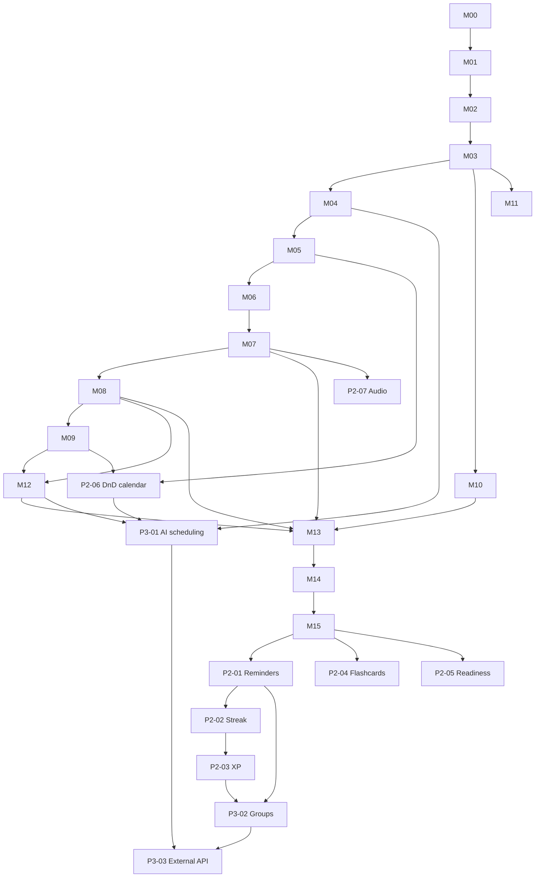

# Lumora Development Roadmap

> Status: Proposal, pending approval. Source of truth: Phase 2 PRD and Phase 1 docs.

## 1. Purpose

This roadmap fixes what ships in which phase, in what order, and why. Milestone facts (scope, tables, endpoints, checklists) live in [MILESTONES.md](MILESTONES.md); the execution procedure is in [IMPLEMENTATION-PLAN.md](IMPLEMENTATION-PLAN.md). The roadmap contains no calendar dates. Sizes are relative (S, M, L, XL) and describe complexity, not duration. The plan assumes one developer working sequentially.

## 2. Prioritization method

Inputs:

- Value, Effort, Risk, Dependency scores (1 to 5) and MoSCoW from [FEATURE-PRIORITIZATION.md](../FEATURE-PRIORITIZATION.md). Scores are judgment, not measurements.
- Dependency rank from [MODULE-BOUNDARIES.md](../03-architecture/MODULE-BOUNDARIES.md) section 4.
- Risk notes from [ASSUMPTIONS-AND-RISKS.md](../01-product-discovery/ASSUMPTIONS-AND-RISKS.md).

Rule: a feature's phase is the maximum of its value-based phase and the phase of any hard dependency. A feature never ships before a module it depends on. Within a phase, features are ordered by dependency rank first, then by risk (the riskiest feature on the core loop goes earliest, so surprises appear while little code depends on it).

Reconciliation: FEATURE-PRIORITIZATION marks Exam management (basic) as Should / MVP and the read-only Calendar as Should / MVP. Both stay in the MVP.

## 3. Feature buckets

Scores are Value / Effort / Risk / Dependency from FEATURE-PRIORITIZATION; "n/a" where the feature is not scored there.

### 3.1 MVP

| Feature | Milestone | V/E/R/D | Rationale (dependency or risk) | Size |
|---|---|---|---|---|
| Technical spike and decisions | M00 | n/a | Auth, id, OpenAPI and pooler risks closed before code | S |
| Project foundation | M01 | n/a | Boundary enforcement and CI must exist before any module | L |
| Authentication and profile | M02 | 5/3/2/1 | Rank 1 and 2; every resource is user-owned; security-critical | XL |
| Subjects and topics | M03 | 5/2/1/2 | Rank 3 and 4; target of every link | M |
| Exam management (basic) | M04 | 4/3/2/3 | Rank 5; needed by plans for FR-038 | M |
| Study plans | M05 | n/a (core loop) | Rank 6; planned side of planned versus actual | M |
| Study hours tracking | M06 | 5/3/3/3 | Rank 7; the core record; time-zone risk R3 | L |
| Pomodoro timer and stopwatch | M07 | 5/3/3/3 | Rank 8; R1, R2, R16; highest-risk MVP item | XL |
| Daily study goals | M08 | 4/2/2/4 | Rank 12; needs sessions | M |
| Study activity calendar (read-only) | M09 | 4/3/2/4 | Rank 14; read models over sessions and plans | M |
| To-do list and priorities | M10 | 4/2/1/2 | Rank 9; needs only Topics | M |
| Notes (basic) | M11 | 3/3/2/2 | Rank 10; needs only Topics; R6 XSS | L |
| Daily and monthly statistics | M12 | 4/3/2/4 | Rank 13; needs goals and sessions; R5 | L |
| Onboarding and dashboard | M13 | 4/2/1/3 | Composition over goals, timer, plans, tasks, analytics; R14 | M |
| Data export and account deletion | M14 | 3/2/1/3 | Needs every module's hooks; BR-032, NFR-031 | L |
| MVP hardening and release | M15 | n/a | Acceptance bar, release gate | L |

### 3.2 Phase 2

| Feature | Milestone | V/E/R/D | Rationale (dependency or risk) | Size |
|---|---|---|---|---|
| Reminders and notifications | P2-01 | 4/3/3/3 | Retention (R9); rank 16 needs plans and goals | L |
| Habit streak | P2-02 | 4/2/2/4 | Rank 15; needs goals; R10 opt-out | M |
| XP gamification | P2-03 | 2/3/4/5 | Depends on streak and tasks; low value, high risk; gate G3 | M |
| Revision tools / flashcards | P2-04 | 4/4/3/3 | Rank 11; needs only Topics; deferred by scope | L |
| Exam readiness score | P2-05 | 3/2/3/4 | Derived from topic status; R15 label | S |
| Drag-and-drop study calendar | P2-06 | 3/4/4/4 | R7 touch and keyboard; needs calendar and plans | L |
| Focus timer ambient audio | P2-07 | 2/2/3/3 | Needs only Timer; R12 licensing | S |

### 3.3 Phase 3

| Feature | Milestone | V/E/R/D | Rationale (dependency or risk) | Size |
|---|---|---|---|---|
| AI-generated study schedule | P3-01 | 3/5/5/5 | Needs DnD, statistics, exams; R13; vendor and consent gates | L to XL |
| Study groups and leaderboards | P3-02 | 3/5/5/5 | Needs XP and notifications; R11 | XL |
| REST API for external integrations | P3-03 | 2/4/4/4 | Rank 19; depends on all; R17 | XL |

### 3.4 Future considerations (no milestone)

| Item | Trigger or blocker | Source |
|---|---|---|
| Google Calendar integration | Not scheduled | EXTERNAL-INTEGRATIONS.md |
| Notion integration | Not scheduled; keep notes basic (R19) | EXTERNAL-INTEGRATIONS.md |
| Anki import (poll the public API with a key; webhook W-4) | After P3-03 | WEBHOOKS.md |
| Additional languages | Not scheduled | PRODUCT-SCOPE.md |
| Daily statistics rollups | Measured p95 above 700 ms for the 24-month, 10,000-session case (ADR-005) | BACKGROUND-JOBS.md |
| Read replica and session partitioning | Growth beyond NFR-072 targets | DEPLOYMENT-ARCHITECTURE.md section 5 |
| SSE for the timer | Polling load becomes a problem (U-A5) | DEPLOYMENT-ARCHITECTURE.md section 5 |
| Inbound email webhook route (W-2) | After U-A2 email provider is chosen | WEBHOOKS.md |
| Notes search | Needs a new FR (DATABASE-DESIGN unresolved item 7) | DATABASE-DESIGN.md |
| Native apps, LMS features | Not planned | PRODUCT-SCOPE.md |

## 4. Candidate sequence versus final sequence

| Candidate position | Candidate item | Final position | Reason for change |
|---|---|---|---|
| none | Spike | M00 | Auth, id generation, OpenAPI and pooler risks need proof first |
| 1 | Foundation | M01 | Unchanged; adds boundary tooling and CI |
| 2 | Authentication | M02 | Adds profile and email port (FR-005 delivery) |
| 3 | Subjects and topics | M03 | Unchanged |
| later | Exams | M04 | Moved before plans: FR-038 and BR-025 |
| later | Study plans | M05 | After exams |
| later | Study sessions | M06 | After plans (rank 7 depends on rank 6) |
| later | Timer | M07 | Directly after sessions: highest risk, core loop |
| later | Daily goals | M08 | After timer; needs sessions |
| later | Calendar | M09 | After goals; read-only |
| earlier | Tasks | M10 | Independent of the activity chain; free after M03 |
| earlier | Notes | M11 | Independent; free after M03 |
| later | Statistics | M12 | Before Dashboard (FR-024 uses STAT-04) |
| earlier | Dashboard | M13 | After everything it composes |
| omitted | Onboarding | M13 | Included with Dashboard |
| omitted | Data export, account deletion | M14 | Needs every module's hooks |
| omitted | Hardening and release | M15 | Release gate |
| 16 | Ambient audio | P2-07 | Phase 2 per FEATURE-PRIORITIZATION |
| single item | Habits and XP | P2-02, P2-03 | Streak first, XP second; gate G3 |
| omitted | Reminders, flashcards, exam readiness, drag-and-drop calendar | P2-01, P2-04, P2-05, P2-06 | Phase 2 items the candidate omitted |
| later | AI scheduling | P3-01 | After DnD and Statistics |
| later | Study groups | P3-02 | After Gamification and Notifications |
| last | External REST API | P3-03 | Rank 19 |

## 5. Milestone dependency graph

M10 and M11 are drawn from M03; in sequential execution they run after M09. All Phase 2 and Phase 3 milestones also require M15. The edge P2-01 to P2-02 is an ordering preference, not a technical dependency.

## 6. Complexity summary

| ID | Size | Driver |
|---|---|---|
| M00 | S | Four proofs and vendor decisions; no merged code |
| M01 | L | Boundary tooling, CI, shared kernel, outbox, design tokens |
| M02 | XL | Security-critical; vendor library fit; email provider; ownership pattern |
| M03 | M | Two modules, simple rules, bulk paste |
| M04 | M | Date logic in user timezone; checklist replace semantics |
| M05 | M | Overlap and past-entry rules; exam warning |
| M06 | L | Day allocation across midnight and DST; idempotency; concurrency |
| M07 | XL | Server-authoritative timer; multi-device; auto-close; accessibility |
| M08 | M | Goal history with effective dates |
| M09 | M | Read-only, accessible heatmap |
| M10 | M | Ordering and filtering |
| M11 | L | Sanitization, autosave, version conflicts |
| M12 | L | Performance targets; reconciliation; DST buckets |
| M13 | M | Composition and wizard states |
| M14 | L | Cross-module purge and export; backup re-purge; time bounds |
| M15 | L | Full acceptance, load, security and accessibility evidence |
| P2-01 | L | Timezone-aware scheduling; push |
| P2-02 | M | Day-end evaluation across timezones |
| P2-03 | M | Ledger idempotency and compensation |
| P2-04 | L | Scheduling algorithm; review UI |
| P2-05 | S | Derived value; wording |
| P2-06 | L | Drag, touch and keyboard parity |
| P2-07 | S | Licensing; client playback rules |
| P3-01 | L to XL | Provider, privacy, validation |
| P3-02 | XL | Membership, visibility, abuse reporting |
| P3-03 | XL | Public surface, 35 endpoints, OpenAPI |

Highest-risk milestones:

| Milestone | Specific risk |
|---|---|
| M02 | Better Auth may not meet NFR-012 and NFR-013 (fallback Auth.js with custom lockout); a mistake here exposes every user-owned resource |
| M07 | Timer drift and multi-device races (R1, R2); lost or duplicated sessions break the core loop and trust; idle auto-close (R16) |
| M14 | Purge must cover every table and reach backups within 35 days; a missed table is a privacy defect that appears late |

## 7. Phase gates

Every gate is an owner decision. No gate has a date.

| Gate | When | Decision |
|---|---|---|
| G1 | End of M00 | Spike results accepted; fallbacks chosen; vendors U-A1, U-A2, U-A7 closed or given a needed-by milestone |
| G2 | MVP release (M15) | Release gate in [RELEASE-PLAN.md](RELEASE-PLAN.md) passed; v1.0.0 approved |
| G3 | Before P2-03 | Gamification continues, after observing streak (R10); U-2 level values supplied |
| G4 | Before P3-01 | U-A3 provider chosen; U-4 consent wording legal-reviewed; at least 4 weeks of user data exists (R13) |
| G5 | Before P3-03 | Internal API contracts stable enough to publish; OpenAPI tooling confirmed |
