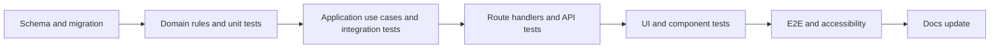

# Lumora Implementation Plan

> Status: Proposal, pending approval. Source of truth: Phase 2 PRD and Phase 1 docs.

This plan states how a milestone from [MILESTONES.md](MILESTONES.md) is executed. Order and rationale are in [DEVELOPMENT-ROADMAP.md](DEVELOPMENT-ROADMAP.md). Completion is judged by [DEFINITION-OF-DONE.md](DEFINITION-OF-DONE.md).

## 1. How milestones are executed

The workflow and rules come from `Build Mode.txt` and are mandatory.

Rules:

1. Implement only one approved milestone at a time.
2. Follow the milestone dependencies.
3. Do not skip prerequisite milestones.
4. Keep the implementation aligned with the SDD.
5. Use strict TypeScript.
6. Validate inputs on the server.
7. Maintain database integrity.
8. Implement real functionality, not placeholder UI.
9. Write tests alongside implementation.
10. Run relevant tests, linting, and type checking.
11. Update documentation whenever implementation changes.
12. Never claim a feature is complete without verification.
13. Avoid unnecessary dependencies and abstractions.
14. Do not implement future-phase features prematurely.

Workflow for each milestone:

1. Read the relevant specifications.
2. Explain the implementation scope.
3. Identify dependencies and files affected.
4. Create a detailed implementation checklist.
5. Implement the milestone incrementally.
6. Run tests and quality checks.
7. Fix discovered issues.
8. Verify acceptance criteria.
9. Update implementation documentation.
10. Provide a completion report.

Completion report contents: implemented functionality; files created or modified; database changes; tests executed; test results; known limitations; remaining tasks; documentation updated; recommended next milestone.

Additional constraints:

- The first action of a build session is to inspect the repository, determine whether the foundation exists, and identify the first incomplete milestone in MILESTONES.md. Nothing is implemented before the initial plan is presented and approved.
- No major architecture change without an explained reason and approval; the change is recorded as an ADR amendment.
- Phase 2 and Phase 3 code is not written before its milestone. When it is written, it merges behind configuration flags.

## 2. Slice order inside a milestone

| Slice | Content | Check before moving on |
|---|---|---|
| Schema and migration | drizzle-kit migration for this milestone's tables only; constraints from DATABASE-CONSTRAINTS; indexes from INDEXING-STRATEGY | Applies on an empty database and on the previous schema |
| Domain rules and unit tests | Pure rules; every BR mapped to at least one test; fixed clock for time rules | Unit stage green |
| Application use cases | Use cases named in MODULE-BOUNDARIES; transactions; events through the outbox; purge handler and export contributor | Integration stage green against PostgreSQL |
| Route handlers and API tests | One handler per endpoint id; validation, error codes, auth, idempotency, rate-limit class | Every endpoint id has the tests listed in TESTING-STRATEGY |
| UI and component tests | Pages from PAGE-SPECIFICATIONS with empty, loading and error states | Component tests green; manual keyboard pass |
| E2E and accessibility | Scenarios from the milestone; axe on each new page | No serious or critical violations |
| Docs update | Changed docs, MILESTONES.md checklist, traceability report | Included in the same pull request set |

## 3. Cross-cutting work in every milestone

| Concern | Rule |
|---|---|
| Ownership | Every resource gets a contract test: another user's id returns not found, never forbidden (NFR-016, AC-E2E-10). The helper is created in M02 |
| Idempotency | Where the endpoint spec names an `Idempotency-Key` or request key, implement replay returning the first result (NFR-053, ADR-011) |
| Optimistic concurrency | Editable records carry a version; stale writes return the documented error (NFR-094) |
| Purge and export | A module that adds a table with `user_id` registers a purge handler and an export contributor in the same milestone |
| Error envelope | All errors use the shared envelope and codes from API-ERRORS.md |
| Logging | Structured logs with request id; no secrets, tokens, passwords or note content (NFR-063) |
| Configuration | Every numeric default comes from the configuration module (NFR-062); no magic numbers in modules |
| Time | All date logic through the time module (ADR-006); stored UTC plus frozen local date |
| Accessibility | Keyboard operable, labelled, 44 px touch targets, no color-only meaning |
| Feature flags | Phase 2 and Phase 3 behavior is unreachable unless its flag is on |

## 4. Environment and tooling plan

| Environment | Purpose | Notes |
|---|---|---|
| Local | Development | PostgreSQL in a container; web and worker run from the same codebase; seed script with deterministic data |
| Preview | One per pull request | Runs Playwright (CI stage 5) against it |
| Staging | Automatic on merge to `main` | Same image as production; load tests and restore drills run here |
| Production | Manual approval | The staging image promoted unchanged; migration step runs first |

Web and worker are built once from one image and promoted unchanged (DEPLOYMENT-ARCHITECTURE section 4, stage 7). Environment settings are injected at runtime; none is in the client bundle (NFR-019).

## 5. Team assumption

One developer, sequential delivery. There are no parallel lanes. The only permitted parallelism is M10 and M11, which depend only on M03 (MILESTONES.md section 2). If the owner supplies a team size, only this section and the M10/M11 note change.

## 6. Open items carried to Phase 8

These are recorded, not resolved here. Phase 8 resolves them and edits the affected documents.

| # | Item | Conflict | Where |
|---|---|---|---|
| 1 | Exam auto-archive | BACKGROUND-JOBS lists an hourly archive job; DATABASE-DESIGN unresolved item 6 chooses derived state with an optional job that only emits `ExamArchived`. This plan follows the derived state (M04) | BACKGROUND-JOBS.md, DATABASE-DESIGN.md |
| 2 | Account purge timing | DATABASE-DESIGN unresolved item 5 defaults to a purge within 24 hours; NFR-031 and BACKGROUND-JOBS allow up to 30 days with a grace period. M14 implements the configured grace period with 30 days as the upper bound | DATABASE-DESIGN.md, NFR-031 |
| 3 | PROF export and delete placement | Endpoint prefix PROF mixes profile, onboarding, export and deletion. This plan splits it: PROF-01..03 in M02, PROF-04..08 in M14 | API-ENDPOINTS.md |
| 4 | Migration owner wording | DEPLOYMENT-ARCHITECTURE stage 9 says the owner and tooling are "decided in Phase 4". The answer exists: DATABASE-DESIGN section 2 (drizzle-kit, separate migration role). Wording needs updating | DEPLOYMENT-ARCHITECTURE.md |
| 5 | `docs/DOCUMENTATION-INDEX.md` | Listed as a source of truth in Build Mode.txt but does not exist | Build Mode.txt, docs/ |
| 6 | Project name | Build Mode.txt and the Phase 7 request text say "Study Tracker"; all documents say Lumora. This plan uses Lumora | Build Mode.txt |
| 7 | NOTIF mixed-phase rows | NOTIF endpoints are all Phase 2 but the Notifications module has an MVP email port. NOTIF rows are Phase 2 (P2-01); the MVP port has no endpoint | API-ENDPOINTS.md, MODULE-BOUNDARIES.md |
| 8 | Plan actuals composition | PLAN-01 and PLAN-03 return actual and variance, but Study plans (rank 6) cannot depend on Study sessions (rank 7). Composition direction (adapter layer or Analytics) must be confirmed in the SDD before M05 | API-ENDPOINTS.md, MODULE-BOUNDARIES.md |

## 7. Vendor and decision register

| ID | Decision | Owner | Needed by |
|---|---|---|---|
| U-A1 | PaaS and managed PostgreSQL vendor | Product owner with architect | M01 first staging deploy (closed at M00 if possible) |
| U-A2 | Transactional email provider | Product owner | M02 (password reset email in staging) |
| U-A7 | Error-tracking vendor | Product owner | M15 (scrub test) |
| U-6 | Age confirmation wording (16+) | Product owner with legal review | M02 (PU-6) |
| U-D5 | Legal pages (terms, privacy) | Product owner | M15 (or hide footer links) |
| U-2 | Level table values | Product owner | P2-03 |
| U-3 | Group size cap | Product owner | P3-02 |
| U-A3 | AI provider | Product owner | P3-01 |
| U-4 | AI consent wording, legal-reviewed | Product owner with legal review | P3-01 |
