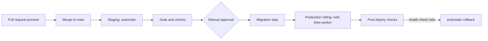

# Lumora Release Plan

> Status: Proposal, pending approval. Source of truth: Phase 2 PRD and Phase 1 docs.

No dates appear here. Environments and pipeline stages are in [DEPLOYMENT-ARCHITECTURE.md](../03-architecture/DEPLOYMENT-ARCHITECTURE.md) sections 4 to 6. Gates are in [DEVELOPMENT-ROADMAP.md](DEVELOPMENT-ROADMAP.md) section 7. Release-level checks are in [DEFINITION-OF-DONE.md](DEFINITION-OF-DONE.md) section 4.

## 1. Release types

| Type | Trigger | Version |
|---|---|---|
| Staging release | Every merge to `main` (automatic, CI stage 8) | none |
| Pre-release | Milestone done during MVP build, internal only | `v0.<n>.0` |
| MVP release | M15 done and gate G2 passed | `v1.0.0` |
| Phase 2 release | One per Phase 2 milestone, behind flags until enabled | minor (`v1.<n>.0`) |
| Phase 3 release | One per Phase 3 milestone | minor, or major if the public API ships a breaking version |
| Hotfix | Severity-1 or severity-2 defect | patch |

## 2. Environments and promotion

- The same container image is promoted unchanged from staging to production. Configuration differs only by injected environment settings.
- Web and worker ship from the same build.
- Migrations run as a distinct step before the new version receives traffic. Only backward-compatible migrations are allowed so the previous version can run during rollout.

## 3. MVP release gate

All must hold before `v1.0.0`:

- [ ] Everything in DEFINITION-OF-DONE.md section 4
- [ ] AC-E2E-01..AC-E2E-10 green in staging on the release candidate image
- [ ] Vendor decisions closed: U-A1 (PaaS), U-A2 (email provider), U-A7 (error tracking)
- [ ] Legal pages exist (U-D5) or footer links are hidden; age confirmation wording final (U-6)
- [ ] Uptime monitor green (NFR-050); alerts on error rate, latency, queue age, auto-close misses and dead-letter jobs configured
- [ ] Backups verified: daily backups retained 30 days; first restore drill completed with the deleted-accounts re-check
- [ ] Production secrets in the secrets store; none in the bundle
- [ ] Rollback rehearsed once in staging
- [ ] Owner approval (gate G2)

## 4. Rollout

1. Staging soak with the release candidate image; smoke checks pass.
2. Manual approval for production.
3. Migration step under the owner role; the latest restorable point is recorded first.
4. Rolling deploy: web, then worker, same version.
5. Automatic rollback if the health check (`GET /api/health`) fails.
6. Post-deploy smoke test, uptime monitor check, error-rate check.

## 5. Rollback and migration compatibility

- Migrations are forward-only and follow expand/contract. The previous application version must run on the new schema.
- Rolling back means redeploying the previous image; the schema stays. A contract migration ships only one release after its expand, so a rollback never meets a removed column.
- If data must be restored, follow BACKUP-RESTORE.md, including the backup re-purge job and the deletion re-check before traffic resumes.

## 6. Post-release

| Activity | Detail |
|---|---|
| Smoke test | Sign in, start and stop a timer, view statistics |
| Error rate | Compare against the pre-release level; investigate any rise |
| Retention | Measure D7 retention to evaluate R9 |
| Feedback | A single intake channel; triage into defects (severity per ACCEPTANCE-CRITERIA section 5) and ideas for Future Considerations |
| Review | Record known limitations in the completion report of M15 |

## 7. Phase 2 and Phase 3 release gates

| Release | Gate |
|---|---|
| P2-01, P2-02, P2-04..P2-07 | M15 released; milestone Definition of Done met; flag enabled per environment after staging checks |
| P2-03 | G3: owner confirms gamification continues; U-2 supplied |
| P3-01 | G4: U-A3 chosen, U-4 consent wording legal-reviewed, at least 4 weeks of user data |
| P3-02 | P2-03 and P2-01 released; U-3 group cap decided |
| P3-03 | G5: internal contracts stable; OpenAPI parity check green |

## 8. Feature-flag policy

- Phase 2 and Phase 3 features ship dark, behind configuration flags (DEPLOYMENT-ARCHITECTURE section 3).
- A flag defaults to off. It is enabled per environment: staging first, then production after the milestone Definition of Done.
- With a flag off, the feature's endpoints, pages and jobs are unreachable; a test proves it.
- The flag is removed one release after it has been enabled in production.
