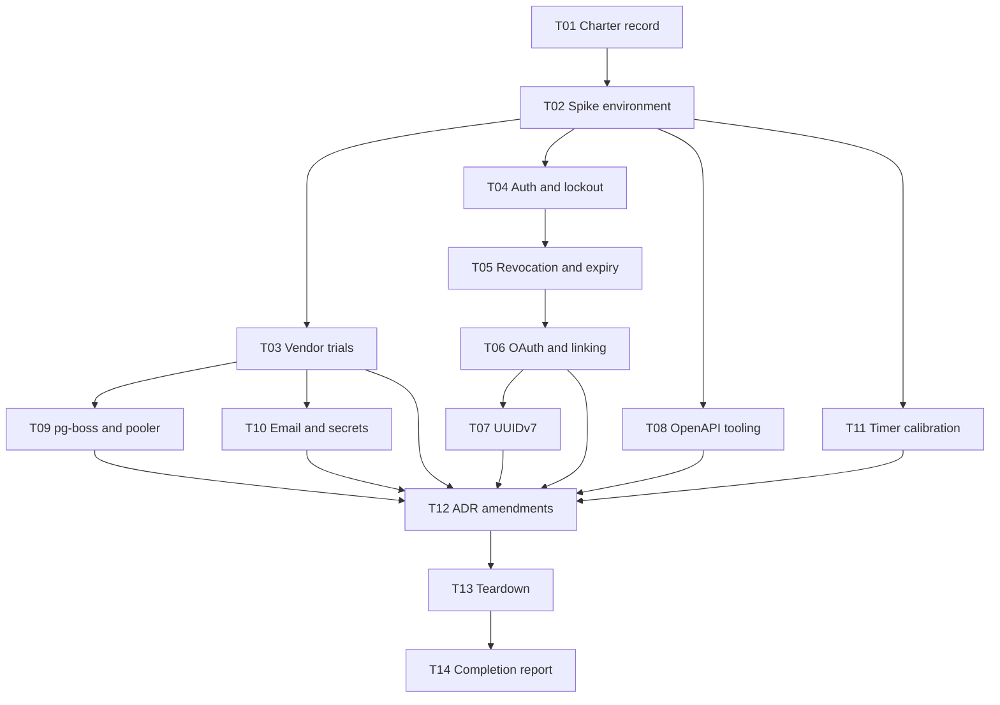

# M00 Implementation Plan

> Status: Approved for execution on 2026-11-18, M00 only. Owner approval is recorded in [OPEN-DECISIONS](../OPEN-DECISIONS.md) section G. No ADR is Accepted, no requirement baseline is approved, and M01 or Build Mode is not authorized.

## 0. Approval and authority

| Field | Value |
|---|---|
| Milestone | M00 Technical spike and decisions |
| Approval date | 2026-11-18 |
| Approval evidence | Owner instruction "approved" in the planning session; this file and the register record |
| Authorized scope | The tasks, scope and out-of-scope list in this plan |
| Timebox | 5 working days from the first day a spike environment and trial accounts exist |
| Spend | Trial credits only; any paid tier needs a separate owner approval |
| Work location | Branch `spike/m00`, never merged, deleted at close |
| Evidence location | [M00-EVIDENCE](M00-EVIDENCE.md), created in T02 |
| Limits | M00 only. No production schema, migration, product UI, product endpoint, Build Mode, M01, or baseline approval |

No milestone approval existed in the repository before this record. This plan is also the M00 charter described in [IMPLEMENTATION-READINESS](../IMPLEMENTATION-READINESS.md) section 4.

## 1. Milestone objective

Resolve the technology risks that would otherwise force rework in M01, M02, M07 and P3-03, and record every outcome as an evidence-backed amendment with an explicit fallback.

M00 passes only when every spike item has a recorded pass or fail, the fallback is named where it failed, and the affected ADR, database, API or integration document carries that answer. Claimed behavior, marketing pages and unexecuted test plans do not count as evidence.

## 2. Requirements mapping

### 2.1 Functional requirements

M00 implements no FR. It produces proof for the FRs whose implementation depends on unverified library, vendor or platform behavior.

| Requirement | M00 proof or decision | Recorded in | Consumer |
|---|---|---|---|
| FR-003 | Google callback path exists; only verified email is accepted; same-email linking cannot be hijacked | ADR-004, API-SECURITY | M02 |
| FR-005 | Reset email is delivered through the notification port with an idempotency key and no plaintext one-time secret at rest | EXTERNAL-INTEGRATIONS 2.2 | M02 |
| FR-046, FR-050..FR-059 | Duration is measured within tolerance under background throttling and a wrong client clock, only if T11 is approved | ADR-006, timer contract | M07 |
| FR-220..FR-226 | OpenAPI 3.1 is generated from the chosen Zod major and a live diff gate runs | ADR-008, OPENAPI-PLAN | P3-03 |

### 2.2 Non-functional requirements

| NFR | Proof | Failure action |
|---|---|---|
| NFR-011 | Passwords are stored only as salted adaptive hashes | Reject the library choice |
| NFR-012 | Five consecutive failures lock the account for 15 minutes, including a correct password during the lock | Adopt the Auth.js fallback |
| NFR-013 | Revocation is effective within 60 s; a session expires after 30 days of inactivity under a controlled clock | Adopt the Auth.js fallback |
| NFR-020 | Sign-in, failed sign-in, lockout, password reset, revoke and deletion events each write a record | Move the event to the application layer |
| NFR-035 | Age confirmation survives the OAuth round trip in signed state | Redesign the state payload before M02 |
| NFR-019 | Reset token, API keys and client secrets never appear in logs or tracked files | Change the payload and logging design |
| NFR-030 | Email and error vendors offer a DPA and an EU processing option | Reject the vendor |
| NFR-050, NFR-100..NFR-103 | Vendor SLA, daily backups, 30-day retention, PITR and restore to a new instance are observed | Reject the platform |
| NFR-052, NFR-090 | Duration is within +/- 2 s over 1, 25 and 120 minutes from stored timestamps, including a background tab | Keep M07 blocked and change the timer contract |
| NFR-053 | The business write and its outbox row commit atomically; delivery is at least once and handlers are safe to repeat | Reject the queue wiring |
| NFR-063 | Error tracking supports scrubbing and no PII or secret reaches an event | Reject the vendor |
| NFR-070 | Platform price and connection limits are known at 10,000 users and 5,000,000 sessions | Reject the platform |

### 2.3 Acceptance criteria

M00 has no acceptance-criteria identifiers by design ([MILESTONES](../07-roadmap/MILESTONES.md) M00). Acceptance is protocol-based: every row in section 8 has a pass criterion and a failure action. A planned or claimed test is not evidence.

### 2.4 Architecture, database, API and UI references

| Area | Specification | Use in M00 |
|---|---|---|
| Architecture | ADR-001, ADR-002, ADR-004, ADR-005, ADR-008, ADR-009, ADR-011 | Amendments with evidence, status stays Proposed |
| Database | [DATABASE-DESIGN](../04-database/DATABASE-DESIGN.md) section 1, section 2, section 5 items 1..3 | Confirm PostgreSQL 15+, `btree_gist`, UUIDv7 and pooler mode, or invoke the documented contingency |
| API | AUTH-03 in [API-ENDPOINTS](../06-api-integrations/API-ENDPOINTS.md); [OPENAPI-PLAN](../06-api-integrations/OPENAPI-PLAN.md) sections 3, 6, 7, 8 | Callback path and generator, diff and reference decisions |
| UI/UX | None | M00 produces no product surface, component, token or copy |
| External | [EXTERNAL-INTEGRATIONS](../06-api-integrations/EXTERNAL-INTEGRATIONS.md) 2.1, 2.2; [DEPLOYMENT-ARCHITECTURE](../03-architecture/DEPLOYMENT-ARCHITECTURE.md) section 8 | Vendor evidence |

### 2.5 Milestone dependencies

| Direction | Milestone | Dependency |
|---|---|---|
| Upstream | none | M00 depends only on this charter and owner-provided trial access |
| Downstream | M01 | Accepted ADR amendments, U-A1 platform, pooler mode, UUID strategy, OpenAPI tooling |
| Downstream | M02 | Auth library decision, same-email linking decision, U-A2 provider |
| Downstream | M07 | Timer calibration evidence, if T11 is approved |
| Downstream | P3-03 | Generator, diff tool and reference page decision |
| Not required | M01 baseline | M00 does not require global baseline approval |

## 3. Scope

### 3.1 In scope

| Item | Source |
|---|---|
| (a) Better Auth: lockout, revocation, inactivity expiry, callback path, audit events, same-email linking | MILESTONES M00, ADR-004, OD-S02, OD-S03 |
| (b) UUIDv7 generation and adapter mapping | DATABASE-DESIGN section 2 |
| (c) Zod major against `@asteasolutions/zod-to-openapi`, diff tool, reference page | OPENAPI-PLAN sections 3, 7, 8 |
| (d) pg-boss against the chosen pooler mode, outbox transaction, at-least-once delivery | ADR-005, DATABASE-DESIGN section 5 item 3 |
| (e) U-A1 PaaS and PostgreSQL, U-A2 email, U-A7 error tracking | ADR-009, EXTERNAL-INTEGRATIONS |
| Email delivery without plaintext one-time secrets | IMPLEMENTATION-READINESS section 6 |
| Timer calibration | IMPLEMENTATION-READINESS section 6; approved with this plan, may be deferred at T11 with an owner note |
| Evidence, amendments and completion report | MILESTONES M00 |

### 3.2 Out of scope

| Item | Owner milestone |
|---|---|
| Production schema, migrations, Drizzle models | M01 and later |
| Application scaffold, CI stages, design tokens, app shell | M01 |
| Authentication UI, registration, reset pages | M02 |
| Product API endpoints, error envelope, rate limiting | M01, M02 |
| Baseline corrections B-01, B-02, B-06, B-09 | Owner-approved correction work |
| Vendor contracts, procurement, production accounts | Owner |
| Any code merged to `main` | Never |

## 4. Dependencies and prerequisites

| ID | Prerequisite | Owner action | Blocks |
|---|---|---|---|
| P-01 | Approve this charter | Done 2026-11-18 | All tasks |
| P-02 | Approve T11 timer calibration | Approved with this plan; may be deferred | T11 |
| P-03 | Create trial accounts: PaaS and PostgreSQL, email sandbox, error tracking, Google OAuth test project | Owner | T03, T06, T10 |
| P-04 | Provide two Google test accounts with distinct verified emails | Owner | T06 |
| P-05 | Confirm no production or personal data enters the spike | Owner | All tasks |
| P-06 | Approve the evidence location `docs/08-build/` | Done with this plan | T02, T12 |

Technical prerequisites: Node LTS, Docker or a local PostgreSQL 15+ instance, a second browser and a way to control the system clock for T04, T05 and T11.

## 5. Technical breakdown

### 5.1 Database

- No production table, migration, seed, Drizzle model or schema file is committed.
- A scratch PostgreSQL 15+ instance verifies `CREATE EXTENSION btree_gist`, UUID column behavior with library ids, and pg-boss schema creation in `pgboss`.
- Auth tables exist only as library-created scratch objects. Their shapes inform DATABASE-DESIGN section 5 item 2; they do not become the M02 migration.
- Pooler tests compare direct, session and transaction modes for DDL, prepared statements and `LISTEN/NOTIFY`.
- The scratch database is deleted in T13.

### 5.2 Backend

- A throwaway Next.js App Router scaffold on `spike/m00`, a minimal worker entry and a notification adapter.
- Lockout, audit events and the age gate are application-owned hooks, matching the ownership split in ADR-004.
- Time-sensitive checks use a controlled clock, never real waits of 15 or 30 days.
- No shared abstraction, domain module or pattern intended for reuse. Anything reusable is written as a finding, not ported as code.

### 5.3 API

- Only the library auth handler, the callback route and a scratch status route exist.
- No AUTH, PROF, SUBJ or other product endpoint is implemented.
- OpenAPI work is a generator script plus one sample registry route. The committed `openapi/v1.json` belongs to P3-03.

### 5.4 Frontend and UI components

- None. No page, component, token, theme or copy is produced.
- If T11 needs a browser harness, it is a throwaway measurement page on the spike branch, not a product surface, and is deleted with the branch.
- UI/UX specifications, the design system, accessibility gates and antislop checks are not exercised in M00.

### 5.5 Authentication and authorization

| Control | Spike behavior |
|---|---|
| Lockout | Per-account counter, 5 failures, 15 minutes, correct password refused during the lock |
| Sessions | Opaque server-side sessions, revocation on the next request, 30-day inactivity expiry |
| OAuth | State and PKCE, verified email only, callback path confirmed |
| Linking | Default library behavior recorded; no automatic link accepted without verified ownership |
| Age gate | `ageConfirmed` and `timezone` survive signed state; no account is created when the flag is false |
| Audit | Each listed event writes one row with actor, result and timestamp |

### 5.6 Tests

Throwaway scripts only. They are deleted with the branch; their commands, versions and raw output are preserved in the evidence record. No test enters CI from M00.

### 5.7 Documentation

ADR amendments stay Proposed. M00 records evidence and recommendations; it does not mark an ADR Accepted, close a global blocker, or authorize M01.

## 6. Implementation checklist

| ID | Task | Depends on | Expected files | Expected outcome | Verification |
|---|---|---|---|---|---|
| M00-T01 | Record the approved charter: owner, date, scope, timebox, branch, evidence path, spend cap | P-01 | `OPEN-DECISIONS.md` section G; `CHANGELOG.md` | Authorization exists with owner and date; no ADR status changes | Register entry present; changelog entry present; no ADR marked Accepted |
| M00-T02 | Create `spike/m00`, minimal scaffold, scratch PostgreSQL, evidence template | T01, P-06 | branch `spike/m00`; `package.json`; auth route; worker entry; `docs/08-build/M00-EVIDENCE.md` | Reproducible environment and numbered evidence sections | Scaffold boots; status route responds; evidence template lists every spike |
| M00-T03 | Shortlist and test vendors: U-A1 platform, U-A2 email, U-A7 error tracking | T01, P-03 | `M00-EVIDENCE.md` vendor matrix; draft ADR-009 amendment | Every checklist row has observed evidence, not vendor copy | PostgreSQL version, `btree_gist`, pooler, PITR, worker service, SLA and price observed |
| M00-T04 | Better Auth integration and lockout (NFR-011, NFR-012, NFR-020) | T02 | throwaway auth config and hooks; evidence section | Pass or fallback decision for lockout and audit events | Five failures then correct password refused; accepted after 15 minutes under a controlled clock; hash algorithm inspected |
| M00-T05 | Revocation and inactivity expiry (NFR-013) | T04 | throwaway session checks; evidence section | Revocation and 30-day expiry proven | Revoked session rejected within 60 seconds measured; backdated activity rejected |
| M00-T06 | Google OAuth callback, verified email, same-email linking (FR-003, OD-S03) | T04, P-04 | throwaway OAuth config; evidence section | Callback path confirmed; linking behavior known; safe option chosen | Callback returns a redirect or success; replayed state fails; unverified email rejected; pre-hijack attempt leaves no attacker session |
| M00-T07 | UUIDv7 generation and adapter mapping (DATABASE-DESIGN section 2) | T06 | throwaway id adapter; evidence section | Version 7 ids or the documented cast fallback | Inspect 10,000 ids for version nibble and ordering; round trip through Drizzle and PostgreSQL |
| M00-T08 | OpenAPI generation, diff tool and reference page (OPENAPI-PLAN sections 3, 7, 8) | T02 | `scripts/m00/openapi.ts`; sample registry; evidence section | Valid OpenAPI 3.1 output, working diff gate, reference page decision | Meta-schema validation passes; two runs are identical; removing a field fails the diff |
| M00-T09 | pg-boss against the pooler (ADR-005, DATABASE-DESIGN section 5 item 3) | T03 | throwaway worker; outbox script; evidence section | Connection mode selected; atomic enqueue; at-least-once delivery | Rollback writes no job; commit writes one; killed worker redelivers and the handler effect stays single |
| M00-T10 | Email delivery and one-time secret handling (U-A2, FR-005, NFR-019) | T03 | throwaway notification adapter; evidence section | Provider passes criteria; no plaintext token at rest | Sink delivery observed; duplicate request sends once; database and log scan finds no token; bounce webhook received |
| M00-T11 | Timer calibration (NFR-052, NFR-090), if not deferred | T02, P-02 | throwaway browser harness; evidence section | Pass or defer decision with evidence | Measurements over 1, 25 and 120 minutes, background tab, wrong clock, at least two browsers |
| M00-T12 | ADR amendments and decision record | T03, T06, T07, T08, T09, T10, T11 | ADR-004, ADR-005, ADR-008, ADR-009; DATABASE-DESIGN; OPENAPI-PLAN; EXTERNAL-INTEGRATIONS; TECHNOLOGY-DECISIONS | Every spike item has pass or fail plus a fallback; every vendor has an evidence row | No unsupported claim; statuses stay Proposed; owner acceptance is a separate action |
| M00-T13 | Teardown | T12 | none; deletions only | No branch, scratch database, trial key or local secret remains | Branch absent locally and remotely; keys revoked; scratch database deleted; secret scan clean |
| M00-T14 | Completion report and gate update | T13 | `M00-COMPLETION-REPORT.md`; MILESTONES; IMPLEMENTATION-READINESS; OPEN-DECISIONS; CHANGELOG; index | Evidence recorded; M00 checklist checked or explicitly waived | Report matches evidence; every checklist item checked or waived; next milestone recommendation stated |

## 7. Implementation order

One developer, sequential execution. The graph shows the dependency edges; the numbered order below is a topological order that keeps vendor access and auth evidence early.

1. T01, T02: record the charter, create the branch and scratch database, open the evidence file.
2. T03: start vendor trials first because T09 and T10 wait on access, and approval lead time is outside our control.
3. T04, T05, T06, T07: auth cluster in dependency order. Lockout before revocation, revocation before OAuth, OAuth before the id mapping that depends on the final auth table shape.
4. T08: independent of auth, after the scaffold exists.
5. T09, T10: queue and email, after trial access exists.
6. T11: timer harness, after the scaffold exists, deferred without penalty if the owner chooses.
7. T12: amendments only after every evidence section is complete. Do not draft conclusions before the data exists.
8. T13, T14: teardown before the completion report, so the report describes the final state.

If a second developer joins, T08 and T11 may run in parallel with the auth cluster. No other parallelism is useful: every remaining task depends on shared trial access or on evidence from another task.

## 8. Testing strategy

### 8.1 Evidence rules

Every numbered spike section in [M00-EVIDENCE](M00-EVIDENCE.md) contains:

1. Hypothesis and the requirement or decision it tests.
2. Library, runtime, browser, PostgreSQL and vendor versions.
3. Exact commands or steps, including environment variables with secrets redacted.
4. Raw output, not a summary written after the fact.
5. UTC timestamps and the runner.
6. Pass or fail against the stated criterion.
7. Fallback decision when failed.
8. Residual risk and what the evidence does not prove.

No secret, token, password, cookie or personal email appears in the evidence. Use sandbox identities only. A screenshot is acceptable for a visual state, never as the only proof of an API, session or database behavior.

### 8.2 Protocols

| ID | Spike | Setup | Procedure | Pass criterion | Failure action |
|---|---|---|---|---|---|
| TS-01 | Lockout (NFR-012) | Scratch auth app, one credential account, controlled clock or direct `lockedUntil` mutation | Five wrong passwords, then the correct one; move the lock timestamp past its end; retry | Correct password refused while locked; accepted after the lock window; audit rows for each failure and the lock | Record Auth.js fallback decision in ADR-004 |
| TS-02 | Revocation and expiry (NFR-013) | Two sessions for one account | Revoke one session, then call an authenticated route with its cookie; backdate the other session by 30 days and call again | Revoked session rejected within 60 seconds measured; backdated session rejected | Record fallback decision in ADR-004 |
| TS-03 | OAuth and linking (FR-003, OD-S03) | Google test project; a mocked callback payload for the unverified-email case; a credential account created for the victim email without verification | Complete sign-in, replay the state, submit an unverified email payload, then attempt attacker registration followed by victim Google sign-in | Callback path works; replay fails; unverified email rejected; no attacker credential session survives an unproven link | Block linking in the application layer or choose explicit merge with revocation; record in ADR-004 and OD-S03 |
| TS-04 | UUIDv7 (DATABASE-DESIGN section 2) | Scratch table with a `uuid` column; adapter configuration | Generate 10,000 ids; decode version and timestamp; insert and read back | All ids are version 7; timestamps non-decreasing at millisecond granularity; no duplicates; round trip preserved | Use application-generated ids in the adapter; record the mapping |
| TS-05 | OpenAPI (OPENAPI-PLAN sections 3, 7, 8) | Zod major in the scaffold; one sample route | Generate twice; validate against the 3.1 meta-schema; remove one field and run the diff | Document validates; two runs are byte-identical; the removal is reported as breaking | Adopt native Zod JSON Schema export; keep the registry design; record the tool choice |
| TS-06 | Queue and pooler (ADR-005, NFR-053) | Trial PostgreSQL through the vendor pooler; scratch outbox table; minimal worker | Roll back an outbox transaction; commit another; claim a job and kill the worker; replay the same job key | Rollback leaves no job; commit yields exactly one; killed job is redelivered and the effect stays single; connection mode documented | Worker uses a direct or session connection; if still incompatible, record the queue risk before M01 |
| TS-07 | Email and secrets (U-A2, FR-005, NFR-019) | Provider sandbox and local sink; scratch reset request | Send once, send again with the same key, trigger a bounce event, scan the database and logs for the token | One message per key; bounce event received; no plaintext token at rest or in logs | Reject the provider; if no provider passes, M02 stays blocked on U-A2 |
| TS-08 | Timer calibration (NFR-052, NFR-090) | Browser harness, server timestamps, second browser, wrong-clock simulation | Run 1, 25 and 120 minute sessions; throttle the background tab; change the client clock | Saved duration within +/- 2 seconds of server time in every case | Defer to M07 and record that M07 remains blocked; do not claim NFR-052 |
| TS-09 | Vendor checklist (U-A1, U-A7) | Trial accounts and a scratch project | Query PostgreSQL version; create `btree_gist`; inspect backup and PITR settings; deploy a worker process; price the target volume; read the DPA and region terms | Every required row in DEPLOYMENT-ARCHITECTURE section 8 observed; error tracking scrubs a known token and email | Reject the vendor and test the next shortlisted vendor |

### 8.3 What does not count

- Vendor documentation, marketing pages, or a support answer without an observed result.
- A configuration screen that shows a feature without exercising it.
- A library unit test, a planned test identifier, a TODO, or a mock that replaces the behavior under test.
- A pass that depends on a wall-clock wait; use a controlled clock.
- A secret or personal address captured in evidence.

### 8.4 Cleanup

T13 deletes the branch, the scratch database, the trial projects and the local environment files, and revokes every key. Evidence survives in `docs/08-build/`; code does not. A secret found in history is treated as leaked and rotated, not ignored.

## 9. Expected documentation changes

| File | Change | When | Gate |
|---|---|---|---|
| [OPEN-DECISIONS](../OPEN-DECISIONS.md) | Section G approval record; OD-S02..OD-S06 evidence and closure proposals | Now and T12 | Owner accepts closures |
| [CHANGELOG](../CHANGELOG.md) | Approval entry now; evidence entry at close | Now and T14 | None |
| [IMPLEMENTATION-READINESS](../IMPLEMENTATION-READINESS.md) | M00 gate state now; gate and blocker updates at close | Now and T14 | Owner reviews any blocker reclassification |
| [README](../README.md), [DOCUMENTATION-INDEX](../DOCUMENTATION-INDEX.md) | Inventory count and build-record entry | Now | None |
| [ADR-004](../adr/ADR-004-authentication.md) | Lockout, revocation, expiry, callback, audit and linking evidence; fallback decision | T12 | Status stays Proposed |
| [ADR-005](../adr/ADR-005-background-jobs.md) | Worker connection mode, atomic enqueue and at-least-once evidence | T12 | Status stays Proposed |
| [ADR-008](../adr/ADR-008-api-strategy.md) | Generator, diff and reference decisions for the public contract | T12 | Status stays Proposed |
| [ADR-009](../adr/ADR-009-deployment-platform.md) | Vendor, PostgreSQL version, extension, pooler, backup, SLA and price evidence | T12 | Status stays Proposed |
| [DATABASE-DESIGN](../04-database/DATABASE-DESIGN.md) | Section 1 platform facts, section 2 id mapping, section 5 items 1..3 | T12 | Owner accepts |
| [OPENAPI-PLAN](../06-api-integrations/OPENAPI-PLAN.md) | Sections 3, 6, 7 and 8 decisions | T12 | Owner accepts |
| [EXTERNAL-INTEGRATIONS](../06-api-integrations/EXTERNAL-INTEGRATIONS.md) | Summary status, email provider row and decision register | T12 | Owner accepts |
| [TECHNOLOGY-DECISIONS](../03-architecture/TECHNOLOGY-DECISIONS.md) | Vendor rows and auth library status | T12 | Owner accepts |
| [MILESTONES](../07-roadmap/MILESTONES.md) | M00 checklist checked or waived | T14 | Evidence exists |
| [TRACEABILITY-MATRIX](../TRACEABILITY-MATRIX.md) | No change; M00 implements no FR | Never | None |
| [FINAL-ARCHITECTURE-REVIEW](../FINAL-ARCHITECTURE-REVIEW.md) | No finding rewritten; optional evidence links only with owner approval | After M00 | Owner |

New build records:

| File | Content |
|---|---|
| `M00-EVIDENCE.md` | One numbered section per spike, with commands and raw output |
| `M00-COMPLETION-REPORT.md` | Build Mode report: functionality, files, database changes, tests run, results, limitations, remaining tasks, docs updated, next milestone |

## 10. Risks and unresolved decisions

### 10.1 Risks

| ID | Risk | Impact | Mitigation | Trigger |
|---|---|---|---|---|
| R-01 | Trial tier lacks PostgreSQL 15+, `btree_gist` or PITR, producing a false failure | Wrong vendor rejection or wrong contingency | Use a paid trial where possible; record the limitation; test the documented contingency | A required checklist row cannot be observed |
| R-02 | Library hooks cannot express lockout, audit or session expiry | M02 rework | Switch to the Auth.js fallback behind the same module interface | TS-01 or TS-02 fails |
| R-03 | Same-email linking permits pre-hijack | Security blocker for M02 | Require verified ownership or an explicit merge that revokes credential sessions | TS-03 shows an attacker session surviving |
| R-04 | Better Auth cannot emit UUIDv7 or uses text ids | Cast mapping and index behavior | Application-generated ids in the adapter; contract test in M02 | TS-04 fails |
| R-05 | Pooler mode breaks pg-boss or prepared statements | Foundation redesign | Worker uses a direct or session connection; prepared statements disabled on the web pooler | TS-06 fails in transaction mode |
| R-06 | Zod major is incompatible with the generator | Contract tooling delay | Native Zod JSON Schema export with the same registry | TS-05 fails |
| R-07 | No email provider proves idempotency, bounce events and DPA | M02 blocked on U-A2 | Test at least two providers; do not accept a provider that misses a required row | TS-07 fails |
| R-08 | Timer evidence is inconclusive | M07 remains blocked | Run the full 1, 25 and 120 minute protocol; if deferred, record it and keep the block | TS-08 fails or is deferred |
| R-09 | Spike code or a package manifest reaches `main` | Architecture contamination | Branch protection; no merge; delete the branch and scratch files at T13 | A spike file appears on `main` |
| R-10 | Trial keys, tokens or personal emails leak into evidence or history | Credential compromise, privacy breach | Sandbox identities only; redact; revoke; secret scan before close | Any secret pattern is found |
| R-11 | Scope expands into M01 or product code | Timebox overrun, governance breach | Out-of-scope list; owner stop; evidence only | A task needs a production file |
| R-12 | Amendments are mistaken for approval | Unauthorized baseline change | Status stays Proposed; closure is a separate owner action in OPEN-DECISIONS | An ADR is marked Accepted during M00 |
| R-13 | Vendor lead time exceeds the timebox | Partial M00 | Start T03 on day one; record partial evidence and the needed-by milestone | Access is not granted within two working days |
| R-14 | Controlled clocks do not reflect real long-running behavior | Weak evidence | Pair clock control with real short runs; record the limitation | TS-01, TS-02 or TS-08 relies only on a simulated clock |

### 10.2 Unresolved decisions

| ID | Decision | Owner | Needed by | Effect if open |
|---|---|---|---|---|
| U-01 | T11 stays in M00 or is deferred | Product owner | Start of T11 | Deferred means M07 keeps its timer-evidence block |
| U-02 | Trial vendor shortlist and any spend | Product owner | T03 | T03, T09 and T10 cannot start |
| U-03 | Google test project and two verified test accounts | Product owner | T06 | The live OAuth path cannot be proven |
| U-04 | Evidence retention period | Product owner | T13 | Default: keep in `docs/08-build/` because decisions cite it |
| U-05 | Email evidence: provider sandbox plus local sink | Product owner | T10 | Local sink alone is insufficient for U-A2 |
| U-06 | Acceptance of ADR amendments and fallbacks | Product owner | After M00 | M01 and M02 stay blocked |
| U-07 | Global baseline corrections B-01, B-02, B-06 and B-09 | Product owner | M01 | M00 does not unblock M01, regardless of its result |
| U-08 | U-A7 needed-by milestone | Product owner | M00 close | Default: needed by M15; a shortlist is enough for M00 |

### 10.3 M00 completion checklist

- [x] Spike (a) recorded, fallback chosen if failed (PASS/PARTIAL; live Google U-03)
- [x] Spike (b) recorded (PASS for app ids; native auth-table `uuid` mapping open)
- [x] Spike (c) recorded, diff tool and reference page decided (oasdiff 1.39.0; no MVP page)
- [x] Spike (d) recorded (PARTIAL; local no-pooler path only)
- [x] Same-email linking decision recorded (refusal option; OD-S03 open)
- [x] Email one-time secret evidence recorded (local sink; provider U-A2 open)
- [ ] U-A1, U-A2 and U-A7 closed or the owner set the needed-by milestone (not closed; no needed-by set; see OPEN-DECISIONS)
- [x] T11 recorded or explicitly deferred (deferred under U-01)
- [x] Evidence file complete and free of secrets
- [x] ADR amendments drafted, all statuses still Proposed
- [x] Spike branch deleted and trial access revoked (no trial access existed)
- [x] Completion report produced
- [x] DEFINITION-OF-DONE checked for the spike level; code-dependent items are marked not applicable with a reason

Close-out executed 2026-11-18. Evidence and teardown are complete; item (e) and owner acceptance (U-06) remain open. The record is [M00-COMPLETION-REPORT.md](M00-COMPLETION-REPORT.md).

M00 does not include owner acceptance of the amendments. That acceptance is the next gate and the prerequisite for M01 planning.