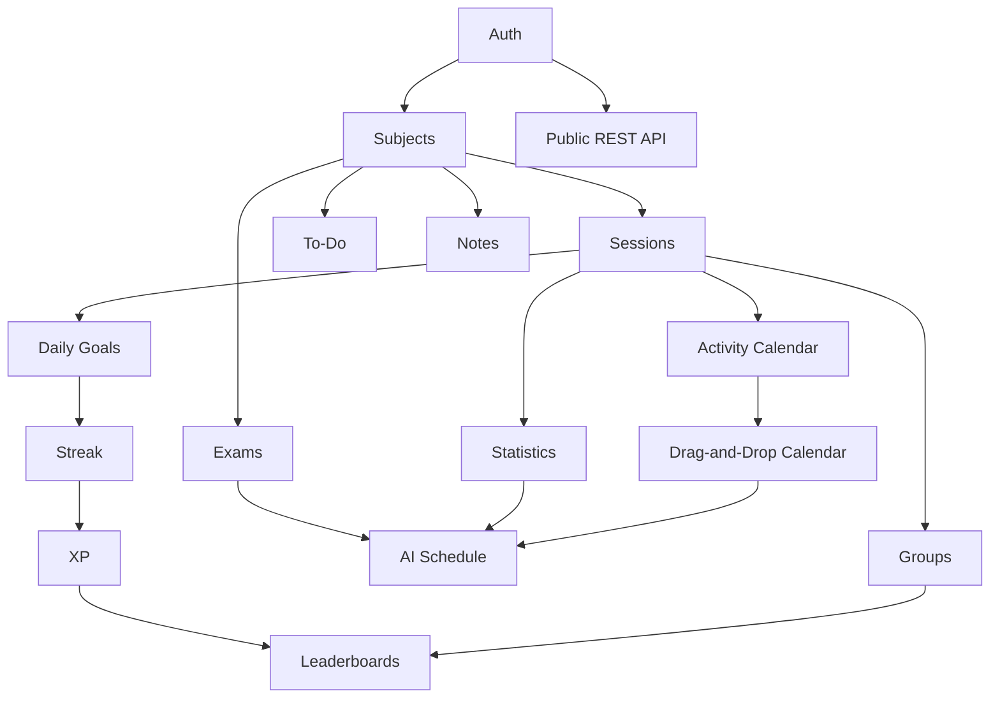

# Feature Prioritization

> Status: Proposal. Scores 1–5. **Value:** higher = better. **Effort, Risk:** higher = worse. **Dependency:** higher = more prerequisites. Scores are judgment, not measured data.

| Feature | Value | Effort | Risk | Dependency | MoSCoW | Phase |
|---|---|---|---|---|---|---|
| Authentication & Profile | 5 | 3 | 2 | 1 | Must | MVP |
| Subjects & Topics Management | 5 | 2 | 1 | 2 | Must | MVP |
| Study Hours Tracking by Subject | 5 | 3 | 3 | 3 | Must | MVP |
| Pomodoro Timer and Stopwatch | 5 | 3 | 3 | 3 | Must | MVP |
| Daily Study Goals | 4 | 2 | 2 | 4 | Must | MVP |
| To-Do List and Priority Management | 4 | 2 | 1 | 2 | Must | MVP |
| Study Activity Calendar (read-only) | 4 | 3 | 2 | 4 | Should | MVP |
| Daily and Monthly Statistics | 4 | 3 | 2 | 4 | Must | MVP |
| Notes (basic) | 3 | 3 | 2 | 2 | Should | MVP |
| Exam Preparation Management (basic) | 4 | 3 | 2 | 3 | Should | MVP |
| Data Export | 3 | 2 | 1 | 3 | Should | MVP |
| Onboarding | 4 | 2 | 1 | 3 | Should | MVP |
| Drag-and-Drop Study Calendar | 3 | 4 | 4 | 4 | Could | 2 |
| Revision tools / Flashcards | 4 | 4 | 3 | 3 | Could | 2 |
| Habit Streak | 4 | 2 | 2 | 4 | Could | 2 |
| XP Gamification | 2 | 3 | 4 | 5 | Could | 2 |
| Focus Timer Ambient Audio | 2 | 2 | 3 | 3 | Could | 2 |
| Exam readiness score | 3 | 2 | 3 | 4 | Could | 2 |
| Reminders / Notifications | 4 | 3 | 3 | 3 | Could | 2 |
| AI-Generated Study Schedule | 3 | 5 | 5 | 5 | Won't (now) | 3 |
| Study Groups and Leaderboards | 3 | 5 | 5 | 5 | Won't (now) | 3 |
| REST API for External Integrations (public) | 2 | 4 | 4 | 4 | Won't (now) | 3 |

## Dependency graph

